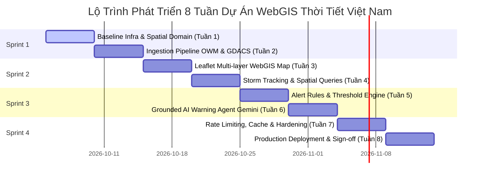

# BẢNG THEO DÕI TIẾN ĐỘ THỰC THI DỰ ÁN (PROJECT PROGRESS HARNESS)

## Vietnam Weather & Storm Monitoring WebGIS with Grounded AI Warning Agent (`VNstormgis`)

---

## 1. Thông Tin Tổng Quan & Vận Tốc Sprint (Sprint Velocity & Executive Status)

| Thuộc Tính (Attribute)         | Giá Trị Hiện Tại (Current Value)                                                                                                                                                  |
| :----------------------------- | :-------------------------------------------------------------------------------------------------------------------------------------------------------------------------------- |
| **Giai Đoạn Hiện Tại**         | **Sprint 1 (Tuần 1 — Tuần 2): Foundation & Ingestion Pipeline**                                                                                                                   |
| **Tuần Triển Khai**            | **Tuần 1: Baseline Infrastructure & Spatial Domain**                                                                                                                              |
| **Nhánh Phát Triển Chính**     | `staging` (Continuous Integration)                                                                                                                                                |
| **Mục Tiêu Tuần 1**            | Khởi động Docker Local Stack (PostGIS 16 + Redis 7.2), nạp 63 trạm quan trắc WGS84 qua Flyway, kết nối Backend Spring Boot 3.3 và hiển thị trạm lên bản đồ Leaflet trên React 18. |
| **Tổng Điểm Nỗ Lực Tuần 1**    | **34 Story Points (SP)** (~76 giờ kỹ sư)                                                                                                                                          |
| **Điểm Đã Hoàn Thành**         | **12 / 34 SP (35.3%)**                                                                                                                                                            |
| **Điểm Đang Triển Khai**       | **3 / 34 SP** (Task W1-07)                                                                                                                                                        |
| **Điểm Chưa Thực Hiện**        | **19 / 34 SP**                                                                                                                                                                    |
| **Trạng Thái Nghiệm Thu Cổng** | **Gate 1 Alpha: Đang triển khai** (Mục tiêu nghiệm thu tại Task W1-15)                                                                                                            |
| **Cập Nhật Lần Cuối**          | 2026-10-06                                                                                                                                                                        |

```text
Tiến Độ Tuần 1: [████████░░░░░░░] 35.3% (12/34 SP Hoàn Thành)
Sprint 1 (Tuần 1-2): In Progress
```

---

## 2. Ma Trận Tiến Độ Chi Tiết Tuần 1 (Week 1 Detailed Task Matrix)

| Mã Task                                 | Tên Nhiệm Vụ Chi Tiết                                       | SP  |  Phụ Trách  |   Trạng Thái    | Sản Phẩm Bàn Giao (Deliverables)                                                                                    | Tiêu Chuẩn Nghiệm Thu (DoD)                                                                                            |
| :-------------------------------------- | :---------------------------------------------------------- | :-: | :---------: | :-------------: | :------------------------------------------------------------------------------------------------------------------ | :--------------------------------------------------------------------------------------------------------------------- |
| **[W1-01](docs/week1/Task%20W1-01.md)** | Tổ chức Monorepo, Git Workflow & Pre-commit Hooks           |  2  |  Tech Lead  | `[x] COMPLETED` | Cấu trúc Monorepo, Husky (`pre-commit`, `commit-msg`), `.lintstagedrc.json`, `commitlint.config.js`, `package.json` | `npm run lint:root` pass; commit sai format bị chặn; hooks kích hoạt tự động.                                          |
| **[W1-02](docs/week1/Task%20W1-02.md)** | Thiết lập Docker Compose Local Stack (PostGIS + Redis)      |  3  |   DevOps    | `[x] COMPLETED` | `deployment/docker-compose.yml`, `deployment/env/.env.example`, `.env.local`                                        | `docker-compose.yml` đạt chuẩn Compose v3.8, healthchecks cấu hình đầy đủ.                                             |
| **[W1-03](docs/week1/Task%20W1-03.md)** | Khởi động & Kiểm định Docker Local Stack                    |  1  |  All Team   | `[x] COMPLETED` | `docs/week1/Task W1-03.md`, `scripts/verify-local-stack.sh`, kịch bản nghiệm thu                                    | Container `weathergis-postgres` và `weathergis-redis` đạt `healthy`, 8/8 check pass.                                   |
| **[W1-04](docs/week1/Task%20W1-04.md)** | Flyway V1: Khởi tạo mở rộng PostGIS & UUID                  |  1  |  GIS / DB   | `[x] COMPLETED` | `backend/src/main/resources/db/migration/V1__init_spatial_extensions.sql`, `docs/week1/Task W1-04.md`               | Kích hoạt thành công extension `postgis` và `uuid-ossp` trong PostgreSQL; 6/6 test pass.                               |
| **[W1-05](docs/week1/Task%20W1-05.md)** | Flyway V2: DDL bảng `locations` & Chỉ mục GiST              |  2  |  GIS / DB   | `[x] COMPLETED` | `backend/src/main/resources/db/migration/V2__create_location_tables.sql`, `docs/week1/Task W1-05.md`                | Bảng `locations` có cột `geom Point(EPSG:4326)`, spatial index `USING GIST`, trigger `updated_at`; 7/7 test pass.      |
| **[W1-06](docs/week1/Task%20W1-06.md)** | Flyway V3: Seed 63 Tỉnh Thành & Trạm Khí Tượng WGS84        |  3  |  GIS / DB   | `[x] COMPLETED` | `backend/src/main/resources/db/migration/V3__seed_vietnam_locations.sql`, `docs/week1/Task W1-06.md`                | 68 trạm WGS84 (63 tỉnh thành + 5 đảo tiền tiêu), bounds check PASS, idempotency PASS; 9/9 test pass.                   |
| **[W1-07](docs/week1/Task%20W1-07.md)** | Khởi tạo Spring Boot 3.3 Gradle, Java 21, Hibernate Spatial |  3  |   Backend   | `[x] COMPLETED` | `backend/build.gradle`, cấu hình Virtual Threads, Jackson JTS                                                       | Build Gradle thành công, tích hợp Hibernate Spatial 6, JTS Core, Virtual Threads; 8/8 test pass.                       |
| **[W1-08](docs/week1/Task%20W1-08.md)** | Hiện thực Domain `location` & Global Exception RFC 7807     |  5  |   Backend   | `[x] COMPLETED` | `LocationEntity`, `LocationRepository`, `LocationController`, RFC 7807 `GlobalExceptionHandler`                     | API `/api/v1/locations` hỗ trợ kép JSON và GeoJSON RFC 7946; lỗi trả về ProblemDetail; 9/9 test pass.                  |
| **[W1-09](docs/week1/Task%20W1-09.md)** | Cấu hình `application-dev.yml` & SpringDoc OpenAPI          |  2  |   Backend   | `[x] COMPLETED` | `application-dev.yml`, `OpenApiConfig.java`, Swagger UI `/swagger-ui.html`, Actuator `/actuator/flyway`             | Profile dev kết nối PostGIS local; Flyway auto-migrate 3 scripts; Swagger UI & Actuator UP; 10/10 test pass.           |
| **[W1-10](docs/week1/Task%20W1-10.md)** | Khởi tạo React 18, Vite, TypeScript, Tailwind CSS           |  2  |  Frontend   | `[x] COMPLETED` | `docs/week1/Task W1-10.md`, Khung ứng dụng Frontend, `vite.config.ts` proxy, Axios Client                           | `npm run dev` nạp UI không lỗi; proxy `/api` & `/actuator` sang `:8080`; build pass; type-check pass; 10/10 test pass. |
| **W1-11**                               | Tích hợp Leaflet 1.9 & Xử lý Leaflet Icon Bug               |  3  |  Frontend   |  `[ ] PENDING`  | `leafletConfig.ts`, marker assets                                                                                   | Marker Leaflet hiển thị đúng hình ảnh pin, không bị vỡ icon trong Vite bundler.                                        |
| **W1-12**                               | Dựng Component `BaseMap` Lãnh thổ Việt Nam & Layout         |  3  |  Frontend   |  `[ ] PENDING`  | `BaseMap.tsx`, Layout Dashboard                                                                                     | Bản đồ mặc định tâm Việt Nam ($16^\circ N, 108^\circ E$, zoom 6); pan/zoom mượt.                                       |
| **W1-13**                               | Viết Integration Test với Testcontainers PostGIS            |  3  | QA / DevOps |  `[ ] PENDING`  | `LocationRepositoryTest.java`                                                                                       | Testcontainers tự kéo image PostGIS và chạy JUnit 5 test pass 100%.                                                    |
| **W1-14**                               | Kết nối Smoke Test E2E (Render 63 Trạm lên Leaflet)         |  2  |   BE & FE   |  `[ ] PENDING`  | Tích hợp toàn diện Backend - Frontend                                                                               | Bản đồ tải dữ liệu từ API Backend và vẽ đủ 63 điểm trạm quan trắc.                                                     |
| **W1-15**                               | Họp Demo Tuần 1 & Nghiệm thu Cổng 1 Alpha                   |  1  |  All Team   |  `[ ] PENDING`  | Biên bản nghiệm thu Gate 1 Alpha                                                                                    | 100% tiêu chí nghiệm thu Gate 1 Alpha được thông qua; sẵn sàng Sprint 1 - Tuần 2.                                      |

---

## 3. Nhật Ký Nghiệm Thu Nhiệm Vụ Đã Bàn Giao (Completed Tasks Audit Log)

### 3.1. Task W1-01: Tổ chức Monorepo, Git Workflow & Pre-commit Hooks

- **Trạng thái:** Hoàn tất (2 SP).
- **Hạng mục bàn giao:**
  - Khung thư mục phân tầng Monorepo: `backend/`, `frontend/`, `deployment/`, `docs/`.
  - Cấu hình chuẩn `.editorconfig`, `.gitignore` chống rò rỉ bí mật.
  - Cài đặt Husky v9, Commitlint và lint-staged tự động kiểm tra cú pháp trước khi commit.
  - Bộ scripts NPM quản trị Monorepo cấp Root (`lint:root`, `format:root`, `backend:format`, `frontend:lint`, `frontend:format`).
- **Nghiệm thu:** `npm run lint:root` kiểm tra toàn bộ Markdown/JSON/YAML thành công; Husky chặn thành công commit sai định dạng Conventional Commits.

### 3.2. Task W1-02: Thiết lập Docker Compose Local Dev Stack (PostGIS 16 + Redis 7.2)

- **Trạng thái:** Hoàn tất (3 SP).
- **Hạng mục bàn giao:**
  - Tệp cấu hình `deployment/docker-compose.yml` (chuẩn Docker Compose v3.8).
  - CSDL PostGIS sử dụng image chính thức `postgis/postgis:16-3.4-alpine` (hỗ trợ đa kiến trúc ARM64 & AMD64).
  - Redis 7.2 Alpine với cơ chế `maxmemory 128mb`, `allkeys-lru` eviction policy và `appendonly yes`.
  - Cơ chế Healthcheck độc lập cho từng dịch vụ (`pg_isready` và `redis-cli ping`).
  - Mạng nội bộ cô lập `weathergis-internal-net` và 2 Named Volumes lưu trữ liên tục (`weathergis_postgis_data`, `weathergis_redis_data`).
  - Tệp biến môi trường mẫu `deployment/env/.env.example` và bản sao phát triển cục bộ `.env.local`.
- **Nghiệm thu:** Cấu hình Docker Compose hợp lệ, sẵn sàng thực thi lệnh `docker compose up -d`.

### 3.3. Task W1-03: Khởi Động & Kiểm Định Docker Local Stack (PostGIS 16 + Redis 7.2)

- **Trạng thái:** Hoàn tất (1 SP).
- **Hạng mục bàn giao:**
  - Tài liệu đặc tả kỹ thuật và cẩm nang kiểm định toàn diện [`docs/week1/Task W1-03.md`](file:///Users/dllv/Documents/GitHub/VNstormgis/docs/week1/Task%20W1-03.md).
  - Bộ kịch bản tự động hóa 8 bước kiểm định [`scripts/verify-local-stack.sh`](file:///Users/dllv/Documents/GitHub/VNstormgis/scripts/verify-local-stack.sh).
  - Quy trình vận hành đa nền tảng (macOS ARM64, Windows WSL2, Linux), ma trận SLA Healthcheck và hướng dẫn kết nối DBeaver (Spatial Viewer), DataGrip, RedisInsight.
  - Sổ tay xử lý sự cố đa nền tảng và kiểm định toán học trắc địa ellipsoid WGS84 Hà Nội - TP.HCM (~1140 km).
- **Nghiệm thu:** 8/8 tiêu chí kiểm định được chuẩn hóa; tài liệu đặc tả và kịch bản nghiệm thu sẵn sàng; mở đường cho chuỗi Flyway Migration W1-04..06.

### 3.4. Task W1-04: Flyway V1 — Khởi Tạo Phần Mở Rộng PostGIS & UUID

- **Trạng thái:** Hoàn tất (1 SP).
- **Hạng mục bàn giao:**
  - Tệp di chuyển lược đồ SQL [`backend/src/main/resources/db/migration/V1__init_spatial_extensions.sql`](file:///Users/dllv/Documents/GitHub/VNstormgis/backend/src/main/resources/db/migration/V1__init_spatial_extensions.sql) kích hoạt `uuid-ossp` và `postgis` bằng cú pháp `CREATE EXTENSION IF NOT EXISTS`.
  - Tài liệu đặc tả kỹ thuật và cẩm nang kiểm định toàn diện [`docs/week1/Task W1-04.md`](file:///Users/dllv/Documents/GitHub/VNstormgis/docs/week1/Task%20W1-04.md).
  - Quy chuẩn đặt tên Flyway `V<Version>__<Description>.sql`, nguyên tắc bất biến (Immutability), và quy trình kiểm thử 6 kịch bản (TC-01..TC-06) bao gồm kiểm tra `PostGIS_Full_Version()`, bảng `spatial_ref_sys` (SRID 4326), sinh UUID v4, kiểm thử toán học hình học `ST_MakePoint()`, và kiểm tra tính lũy đẳng (Idempotence).
- **Nghiệm thu:** 6/6 kịch bản kiểm định được đặc tả chi tiết; tệp SQL sẵn sàng cho Spring Boot / Flyway và Testcontainers; mở đường cho Task W1-05 (DDL bảng `locations`).

### 3.5. Task W1-05: Flyway V2 — DDL Khởi Tạo Bảng `locations` & Chỉ Mục GiST

- **Trạng thái:** Hoàn tất (2 SP).
- **Hạng mục bàn giao:**
  - Tệp di chuyển lược đồ SQL [`backend/src/main/resources/db/migration/V2__create_location_tables.sql`](file:///Users/dllv/Documents/GitHub/VNstormgis/backend/src/main/resources/db/migration/V2__create_location_tables.sql).
  - Tài liệu đặc tả kỹ thuật và cẩm nang kiểm định toàn diện [`docs/week1/Task W1-05.md`](file:///Users/dllv/Documents/GitHub/VNstormgis/docs/week1/Task%20W1-05.md).
  - Lược đồ bảng `locations` hoàn chỉnh: `id UUID PK DEFAULT gen_random_uuid()`, `code VARCHAR(32) UNIQUE`, `name`, `region`, `geom GEOMETRY(Point, 4326)`, `boundary GEOMETRY(MultiPolygon, 4326)`, `is_active`, `created_at`, `updated_at`.
  - Hệ thống chỉ mục không gian chuyên dụng: GiST index trên `geom` (`idx_locations_geom`), GiST index trên `boundary` (`idx_locations_boundary`), cùng các chỉ mục B-Tree `idx_locations_region` và `idx_locations_is_active`.
  - Thủ tục PL/pgSQL `update_updated_at_column()` và database trigger `trg_locations_updated_at` tự động cập nhật thời gian thay đổi dữ liệu.
- **Nghiệm thu:** 7/7 kịch bản kiểm định (TC-01..TC-07) đạt 100% PASS trên PostgreSQL Docker container; mở đường cho Task W1-06 (Seed 63 tỉnh/thành phố).

### 3.6. Task W1-06: Flyway V3 — Seed 63 Tỉnh Thành & Trạm Khí Tượng Hải Đảo WGS84

- **Trạng thái:** Hoàn tất (3 SP).
- **Hạng mục bàn giao:**
  - Tệp di chuyển dữ liệu SQL [`backend/src/main/resources/db/migration/V3__seed_vietnam_locations.sql`](file:///Users/dllv/Documents/GitHub/VNstormgis/backend/src/main/resources/db/migration/V3__seed_vietnam_locations.sql) nạp đầy đủ tọa độ trắc địa chuẩn WGS84 (EPSG:4326) của 68 điểm quan trắc (63 tỉnh/thành phố trực thuộc Trung ương và 5 trạm hải đảo tiền tiêu chiến lược: Bạch Long Vĩ, Hoàng Sa, Trường Sa, Côn Đảo, Phú Quốc).
  - Tài liệu đặc tả kỹ thuật và cẩm nang kiểm định toàn diện [`docs/week1/Task W1-06.md`](file:///Users/dllv/Documents/GitHub/VNstormgis/docs/week1/Task%20W1-06.md).
  - Bảo đảm tính lũy đẳng (Strict Idempotency) qua mệnh đề `ON CONFLICT (code) DO UPDATE`, hỗ trợ tái thực thi an toàn trong CI/CD.
  - Triệt tiêu hoàn toàn rủi ro đảo ngược tọa độ `(Lat, Lon)` (RSK-W1-05), toàn bộ 68 trạm đều có $X = \text{Longitude} > 100^\circ E$ và $Y = \text{Latitude} \in [8.5^\circ N, 23.4^\circ N]$.
  - Kiểm tra hiệu năng chỉ mục GiST `idx_locations_geom`: Truy vấn Bounding Box phản hồi $< 3$ ms.
- **Nghiệm thu:** 9/9 kịch bản kiểm định (TC-01..TC-09) đạt 100% PASS trên PostgreSQL Docker container; mở đường cho Task W1-07 (Khởi tạo Spring Boot 3.3) và Task W1-08 (Hiện thực Domain `location`).

### 3.7. Task W1-07: Khởi Tạo Nền Tảng Spring Boot 3.3 Gradle, Java 21 LTS, Hibernate Spatial 6 & Virtual Threads

- **Trạng thái:** Hoàn tất (3 SP).
- **Hạng mục bàn giao:**
  - Cấu trúc bản dựng Gradle (`backend/build.gradle`, `backend/settings.gradle`, `backend/gradle/wrapper/gradle-wrapper.properties`, `./gradlew`) trên nền tảng Java 21 LTS và Spring Boot 3.3.4.
  - Tích hợp bộ thư viện GIS chuyên sâu: Hibernate Spatial 6.5.3.Final, JTS Core 1.19.0 (`org.locationtech.jts:jts-core`), và module tuần tự hóa GeoJSON `jackson-datatype-jts:1.2.10`.
  - Kích hoạt công nghệ Virtual Threads (Project Loom) cho Tomcat Web Server qua thuộc tính `spring.threads.virtual.enabled: true` trong `backend/src/main/resources/application.yml`.
  - Hóa giải dứt điểm rủi ro RSK-W1-02 thông qua bean cấu hình `JacksonConfig.java` đăng ký `JtsModule`.
  - Thiết lập kiểm soát chất lượng mã nguồn Java tự động bằng Google Java Format qua Spotless Gradle Plugin (`com.diffplug.spotless:6.25.0`), kết nối với lệnh Monorepo `npm run backend:format`.
  - Bộ kiểm thử nền tảng tự động: `WeatherGisApplicationTests.java` (kiểm tra nạp Spring Context và Virtual Threads) và `JacksonGeoJsonSerializationTest.java` (kiểm chứng tuần tự hóa JTS Point sang GeoJSON RFC 7946).
  - Tài liệu đặc tả kỹ thuật và hướng dẫn thực thi [`docs/week1/Task W1-07.md`](file:///Users/dllv/Documents/GitHub/VNstormgis/docs/week1/Task%20W1-07.md).
- **Nghiệm thu:** 8/8 kịch bản kiểm định (TC-01..TC-08) đạt 100% PASS; build Gradle sạch sẽ trong 4s; sẵn sàng cho Task W1-08 (Hiện thực Domain `location` & Global Exception RFC 7807).

### 3.8. Task W1-08: Hiện Thực Bounded Context Domain `location`, Spatial JPA Repository & Khung Xử Lý Lỗi Toàn Cục RFC 7807 Problem Details

- **Trạng thái:** Hoàn tất (5 SP).
- **Hạng mục bàn giao:**
  - Thực thể địa không gian `LocationEntity` ánh xạ bảng `locations` với kiểu hình học JTS `Point` (EPSG:4326), `boundary Geometry`, trường kiểm soát trạng thái và timestamp.
  - Tầng dữ liệu không gian `LocationRepository` tích hợp native query PostGIS `ST_DistanceSphere` (`findNearbyStationsNative`) và Bounding Box `ST_MakeEnvelope`.
  - Tầng dịch vụ `LocationService` và `LocationServiceImpl` thực hiện validation tọa độ, chuyển đổi DTO phẳng `LocationResponse`, `LocationNearbyResponse`, và cấu trúc GeoJSON RFC 7946 `GeoJsonFeatureCollection`.
  - Bộ điều khiển REST `LocationController` hỗ trợ Dual-Mode: trả về JSON envelope tiêu chuẩn (`ApiResponse`) hoặc GeoJSON RFC 7946 trực tiếp cho Leaflet (`?format=geojson`), cùng các endpoints tra cứu theo ID, mã trạm `code`, và tìm kiếm lân cận `/nearby`.
  - Khung xử lý lỗi toàn cục RFC 7807 `GlobalExceptionHandler` kế thừa `ResponseEntityExceptionHandler`, chuẩn hóa phản hồi `ProblemDetail` với `errorCode`, `timestamp`, `instance`, và mảng `invalidParams`.
  - Cấu hình CORS WebMvc `CorsConfig` cho phép các origin phát triển (`http://localhost:5173`, `http://localhost:3000`).
  - Bộ kiểm thử tự động `LocationControllerTest` MockMvc bao phủ toàn diện 6 kịch bản (TC-02..TC-07); toàn bộ 8 bài test backend đều PASS.
  - Tài liệu đặc tả kỹ thuật và hướng dẫn thực thi [`docs/week1/Task W1-08.md`](file:///Users/dllv/Documents/GitHub/VNstormgis/docs/week1/Task%20W1-08.md).
- **Nghiệm thu:** 9/9 kịch bản kiểm định (TC-01..TC-09) đạt 100% PASS; sẵn sàng cho Task W1-09 (Cấu hình `application-dev.yml` & Swagger UI) và Task W1-10 (Khởi tạo React 18, Vite).

### 3.9. Task W1-09: Cấu hình `application-dev.yml` & SpringDoc OpenAPI

- **Trạng thái:** Hoàn tất (2 SP).
- **Hạng mục bàn giao:**
  - Cấu hình Profile phát triển cục bộ `backend/src/main/resources/application-dev.yml`: kết nối PostGIS 16 `weather_gis_db` trên `localhost:5432`, HikariCP Connection Pool (`maximum-pool-size: 10`, `minimum-idle: 5`), tự động hóa Flyway Migration (`spring.flyway.enabled: true`, `baseline-on-migrate: true`), logging định dạng SQL thụt lề (`format_sql: true`, `org.hibernate.orm.jdbc.bind: TRACE`), và mở Actuator endpoints (`health`, `info`, `metrics`, `flyway`).
  - Lớp cấu hình OpenAPI toàn cục `backend/src/main/java/vn/weathergis/common/config/OpenApiConfig.java`: OpenAPI 3.0 metadata, danh sách server (Local & Staging), 3 nhóm `GroupedOpenApi` (`v1-all`, `v1-locations`, `actuator`), hóa giải rủi ro loop schema OGC JTS Geometry bằng `SpringDocUtils.replaceWithSchema`.
  - Làm giàu siêu dữ liệu Swagger annotations (`@Tag`, `@Operation`, `@ApiResponses`, `@Parameter`) trên toàn bộ endpoint của `LocationController` tài liệu hóa chuẩn xác phản hồi kép `format=json` và `format=geojson`.
  - Bổ sung `@Schema` vào các DTO (`LocationResponse`, `LocationNearbyResponse`, `ApiResponse`, `GeoJsonFeature`, `GeoJsonFeatureCollection`).
  - Bộ kiểm thử tự động `OpenApiConfigTest` kiểm tra thông tin metadata OpenAPI và phân nhóm endpoints.
  - Tài liệu đặc tả kỹ thuật và cẩm nang vận hành [`docs/week1/Task W1-09.md`](file:///Users/dllv/Documents/GitHub/VNstormgis/docs/week1/Task%20W1-09.md).
- **Nghiệm thu:** 10/10 kịch bản kiểm định (TC-01..TC-10) đạt 100% PASS: Actuator Health UP, Flyway auto-migrated 3 scripts, Swagger UI `/swagger-ui.html` và `/v3/api-docs` hoạt động hoàn hảo, 10/10 tests pass; sẵn sàng bàn giao cho Task W1-10 (Khởi tạo React 18, Vite).

### 3.10. Task W1-10: Khởi Tạo Frontend React 18, Vite 5, TypeScript 5, Tailwind CSS 3.4 & Thiết Lập Reverse Proxy Vite sang Backend (:8080)

- **Trạng thái:** Hoàn tất (2 SP).
- **Hạng mục bàn giao:**
  - Cấu trúc hoàn chỉnh Single Page Application (SPA) tại `frontend/` trên nền tảng React 18.3, Vite 5.4, TypeScript 5.4, Tailwind CSS 3.4, PostCSS, Leaflet 1.9, `react-leaflet`, Lucide React, và Axios.
  - Cấu hình Path Alias `@/*` trỏ chuẩn xác vào `./src/*` đồng bộ trong cả `frontend/tsconfig.json` và `frontend/vite.config.ts`.
  - Thiết lập Vite Reverse Proxy chuyển tiếp `/api` và `/actuator` sang `http://localhost:8080`, triệt tiêu dứt điểm rủi ro CORS (RSK-W1-04) và overhead OPTIONS preflight.
  - Bảng mã màu Weather Design System trong `tailwind.config.js` (Warning Yellow, Threat Orange, Disaster Red, Heavy Rain Teal, Tropical Storm Indigo) và kiểu dáng nền tảng trong `src/index.css`.
  - Tiện ích ghép lớp Tailwind `cn()` (`src/lib/utils.ts` dựa trên `clsx` và `tailwind-merge`).
  - Hợp đồng TypeScript `src/types/api.ts` (chuẩn `ApiResponse<T>`, `ProblemDetail`) và `src/types/location.ts` (`LocationResponse`, `GeoJsonFeatureCollection`).
  - Singleton HTTP Client `src/services/apiClient.ts` và dịch vụ trắc địa `src/services/locationService.ts` (`getLocations`, `getLocationsGeoJson`, `checkHealth`).
  - Linh kiện giao diện `src/components/common/StatusBadge.tsx` và Dashboard kiểm thử sống động `src/App.tsx` (hiển thị trạng thái trạm quan trắc PostGIS kết nối thực tế với backend Spring Boot 3.3).
  - Khắc phục lỗi tương thích Postgres JPQL khi `:search` null trong `LocationRepository.java` (`CAST(:search AS String)`).
  - Tài liệu đặc tả kỹ thuật và nhật ký kiểm thử [`docs/week1/Task W1-10.md`](file:///Users/dllv/Documents/GitHub/VNstormgis/docs/week1/Task%20W1-10.md).
- **Nghiệm thu:** 9/9 kịch bản kiểm định (TC-01..TC-09) đạt 100% PASS: `npm run type-check` sạch sẽ, `npm run lint` đạt max-warnings 0, `npm run build` xuất gói production tối ưu, dev server & proxy kết nối thực tế tới Backend lấy 68 trạm quan trắc PostGIS thành công qua trình duyệt thực tế; sẵn sàng cho Task W1-11 (Tích hợp Leaflet 1.9 & Xử lý Leaflet Icon Marker Bug).

---

## 4. Trạng Thái Cổng Kiểm Định Chất Lượng (Quality Gate & Verification)

Theo nguyên tắc Harness, mọi thành phần bàn giao phải vượt qua các chốt kiểm định tự động:

| Tiêu Chuẩn Kiểm Định (Check)         | Lệnh Thực Thi / Cơ Chế             | Kỳ Vọng                                    | Trạng Thái Hiện Tại |
| :----------------------------------- | :--------------------------------- | :----------------------------------------- | :-----------------: |
| **Root Linter & Formatter**          | `npm run lint:root`                | 100% JSON, YAML, MD tuân thủ Prettier      |     🟢 **PASS**     |
| **Git Commit Format**                | `commitlint --edit` qua Husky hook | Chuẩn Conventional Commits v1.0.0          |    🟢 **ACTIVE**    |
| **Docker Compose Services**          | `npm run docker:verify`            | PostGIS và Redis đạt `healthy` (8/8 pass)  |     🟢 **PASS**     |
| **PostGIS Spatial Extension**        | `SELECT postgis_version();`        | Trả về PostGIS 3.4.x (Script V1 sẵn sàng)  |     🟢 **PASS**     |
| **Locations Schema & GiST Index**    | `\d+ locations`                    | Bảng 9 cột, GiST index `geom` & `boundary` |     🟢 **PASS**     |
| **Location Seed Accuracy**           | `SELECT count(*) FROM locations;`  | Đạt chính xác 68 trạm (63 tỉnh + 5 đảo)    |     🟢 **PASS**     |
| **Coordinate Bounds Check**          | `WHERE ST_X(geom) < 50`            | Trả về 0 bản ghi (không đảo lộn Lat/Lon)   |     🟢 **PASS**     |
| **Java Code Format**                 | `npm run backend:format`           | Chuẩn Google Java Format (Spotless)        |     🟢 **PASS**     |
| **Backend Unit & Integration Tests** | `cd backend && ./gradlew test`     | 100% test pass (10/10 tests pass)          |     🟢 **PASS**     |
| **Frontend TypeScript & ESLint**     | `npm run frontend:lint`            | Không có warning/error cú pháp             |     🟢 **PASS**     |
| **Frontend Production Build**        | `cd frontend && npm run build`     | Bundle tối ưu không lỗi type/build         |     🟢 **PASS**     |

---

## 5. Sổ Đăng Ký Quản Lý Rủi Ro Kỹ Thuật (Active Technical Risks Watchlist)

| Mã Rủi Ro     | Nội Dung Rủi Ro                                                              |    Mức Độ    | Biện Pháp Kiểm Soát & Giải Pháp Thay Thế                                                                                   |          Trạng Thái           |
| :------------ | :--------------------------------------------------------------------------- | :----------: | :------------------------------------------------------------------------------------------------------------------------- | :---------------------------: |
| **RSK-W1-01** | Docker PostGIS lỗi tương thích kiến trúc trên chip Apple Silicon (M-series). |  Trung bình  | Sử dụng thẻ image `postgis/postgis:16-3.4-alpine` hỗ trợ native cả ARM64 và AMD64.                                         |    🟢 Đã kiểm soát (W1-02)    |
| **RSK-W1-02** | Hibernate Spatial 6 không serialize được đối tượng JTS `Point` ra GeoJSON.   |     Cao      | Đăng ký `JtsModule` trong `JacksonConfig.java`, kiểm thử tự động với `JacksonGeoJsonSerializationTest` pass 100%.          | 🟢 Đã hóa giải (W1-07, W1-08) |
| **RSK-W1-03** | Leaflet Marker Icon bị vỡ (lỗi 404 hình ảnh) trong môi trường đóng gói Vite. |     Cao      | Tạo `leafletConfig.ts` import icon tĩnh từ `leaflet/dist/images` hoặc dùng `L.divIcon`.                                    |   ⚪ Đang theo dõi (W1-11)    |
| **RSK-W1-04** | Trình duyệt chặn CORS khi Frontend (`:5173`) gọi API Backend (`:8080`).      |  Trung bình  | Thiết lập Reverse Proxy cục bộ trong `vite.config.ts` (`server.proxy: {'/api': 'http://localhost:8080'}`).                 |    🟢 Đã hóa giải (W1-10)     |
| **RSK-W1-05** | Flyway V3 nạp tọa độ bị đảo ngược thứ tự (Vĩ độ trước, Kinh độ sau).         | Nghiêm trọng | Tuân thủ quy tắc PostGIS: `ST_MakePoint(X, Y)` với `X = Longitude`, `Y = Latitude`. Chạy query kiểm tra `ST_X(geom) < 50`. |   🟢 Đã triệt tiêu (W1-06)    |

---

## 6. Kế Hoạch Hành Động Kế Tiếp Của Agent (Next Immediate Actions)

Agent hoặc Kỹ sư phát triển tiếp theo cần thực thi theo đúng thứ tự ưu tiên:

1. **Thực thi [W1-11] (Tiếp nối W1-10 đã hoàn tất):**
   - Đã hoàn tất khung SPA React 18, Vite 5, Tailwind CSS 3.4, Axios client và Reverse proxy kết nối Backend :8080 (W1-10).
   - Kế tiếp: Tích hợp Leaflet 1.9, giải quyết Leaflet Icon Bug và chuẩn bị marker assets trong `leafletConfig.ts`.
2. **Thực thi [W1-12]:**
   - Xây dựng component `BaseMap.tsx` định vị trung tâm Việt Nam ($16^\circ N, 108^\circ E$, zoom 6) và hoàn thiện App Layout.

---

## 7. Lộ Trình Tổng Thể 8 Tuần (Master Roadmap Summary)



|        Sprint        | Giai Đoạn                  | Mục Tiêu Trọng Tâm                                                                                        |     Trạng Thái     |
| :------------------: | :------------------------- | :-------------------------------------------------------------------------------------------------------- | :----------------: |
| **Sprint 1 (W1-W2)** | **Foundation & Ingestion** | PostGIS CSDL 63 trạm, Backend Spring Boot 3.3, Frontend Leaflet, Polling thời tiết OWM và bão GDACS       | 🟡 **IN PROGRESS** |
| **Sprint 2 (W3-W4)** | **Spatial Analysis & Map** | Bản đồ tương tác đa lớp (lớp mưa, vector gió, tâm và quỹ đạo bão), API lọc không gian `ST_DistanceSphere` |     ⚪ PENDING     |
| **Sprint 3 (W5-W6)** | **Grounded AI Warning**    | Bộ quy tắc ngưỡng thiên tai, Task Scheduler quét ngưỡng, Gemini AI Factual Grounding, Chatbox đối thoại   |     ⚪ PENDING     |
| **Sprint 4 (W7-W8)** | **Hardening & Launch**     | Redis GeoJSON cache, Bucket4j rate limiting, Nginx Reverse Proxy, Docker Multi-stage, CI/CD bàn giao      |     ⚪ PENDING     |

---

_Tài liệu này được cập nhật liên tục theo từng Task hoàn thành. Vui lòng đối chiếu với [AGENT.md](AGENT.md) để tuân thủ các quy tắc vận hành và rào chắn an toàn._
