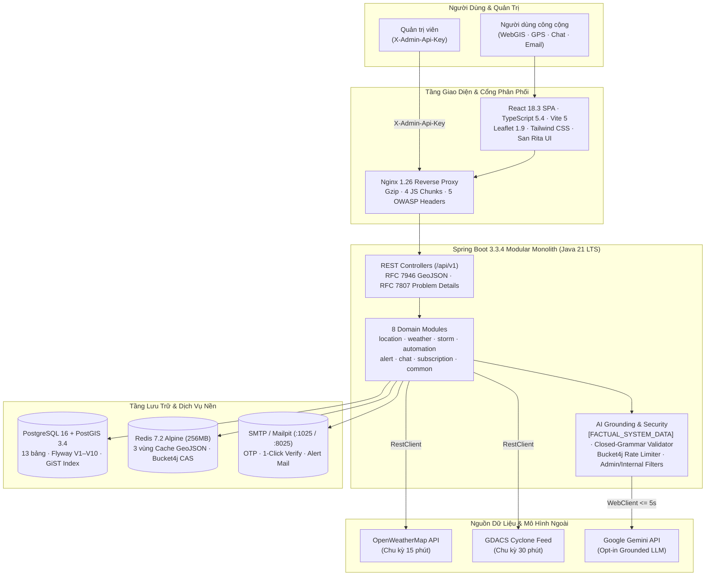

# VNstormgis — Hệ Thống WebGIS Giám Sát Mưa Gió Bão Tích Hợp AI Agent Cảnh Báo

[](OPERATIONS.md)
[](VNstormgis-Backend/build.gradle)
[](VNstormgis-Backend/build.gradle)
[](VNstormgis-Deployment/docker-compose.yml)
[](VNstormgis-Deployment/docker-compose.yml)
[](VNstormgis-Frontend/package.json)
[](LICENSE)

> **Vietnam Weather & Storm Monitoring WebGIS with Grounded AI Warning Agent (`v1.0.0`)**  
> Nền tảng bản đồ số địa không gian thời gian thực phục vụ giám sát mưa lớn, gió giật, xoáy thuận nhiệt đới và cảnh báo thiên tai sớm trên toàn lãnh thổ & vùng biển Việt Nam — kết hợp cơ chế **AI Grounding chống ảo giác số liệu**.

---

## Mục Lục

1. [Giới Thiệu Dự Án](#1-giới-thiệu-dự-án)
2. [Tính Năng Trọng Tâm](#2-tính-năng-trọng-tâm)
3. [Kiến Trúc Hệ Thống & Công Nghệ](#3-kiến-trúc-hệ-thống--công-nghệ)
4. [Cấu Trúc Kho Mã Nguồn (Monorepo)](#4-cấu-trúc-kho-mã-nguồn-monorepo)
5. [Hướng Dẫn Khởi Chạy Nhanh (Quick Start)](#5-hướng-dẫn-khởi-chạy-nhanh-quick-start)
6. [Danh Mục RESTful API (`/api/v1`)](#6-danh-mục-restful-api-apiv1)
7. [Chỉ Số Kiểm Định Chất Lượng, Chịu Tải & Bảo Mật](#7-chỉ-số-kiểm-định-chất-lượng-chịu-tải--bảo-mật)
8. [Lệnh Kiểm Thử & Vận Hành Hệ Thống](#8-lệnh-kiểm-thử--vận-hành-hệ-thống)
9. [Quy Chuẩn Kỹ Thuật & Cam Kết Mã Nguồn](#9-quy-chuẩn-kỹ-thuật--cam-kết-mã-nguồn)
10. [Tác Giả & Giấy Phép](#10-tác-giả--giấy-phép)

---

## 1. Giới Thiệu Dự Án

**VNstormgis** giải quyết bài toán phân tán thông tin khí tượng và độ trễ giải thích cảnh báo thiên tai bằng cách hợp nhất **dữ liệu quan trắc thời gian thực**, **phân tích không gian PostGIS** và **AI Agent hai chế độ (Chủ động & Bị động)** trên một giao diện bản đồ số duy nhất theo ngôn ngữ thiết kế **San Rita Field Guide**:

- **Dữ liệu chuẩn hóa trắc địa:** Giám sát **39 điểm quan trắc** theo chuẩn **WGS84 (`EPSG:4326`)** và **GeoJSON RFC 7946**. Danh mục gồm 34 điểm đại diện đơn vị hành chính cấp tỉnh và 5 điểm hải đảo, bao gồm **Hoàng Sa (`HSA`)** và **Trường Sa (`TSA`)**. [Nghị quyết 202/2025/QH15](https://vanban.chinhphu.vn/?classid=1&docid=213930&orggroupid=1&pageid=27160), [Nghị quyết 30/2026/QH16 về thành lập thành phố Đồng Nai](https://chinhphu.vn/?docid=218009&pageid=27160).
- **AI không bịa số liệu (Zero-Trust Grounded AI):** Mọi bản tin cảnh báo và câu trả lời hội thoại đều bị ràng buộc chặt chẽ vào khối dữ liệu thực đo `[FACTUAL_SYSTEM_DATA]`, đi qua tầng kiểm chứng ngữ pháp đóng đối chiếu số học chính xác (`BigDecimal`) và tự động chuyển sang mẫu tiếng Việt tất định (`is_fallback=true`) khi thiếu khóa API hoặc mô hình ngoại lệ.
- **Sẵn sàng vận hành thực tế (`v1.0.0`):** Đóng gói Multi-Stage Docker non-root, Nginx 1.26 Reverse Proxy gắn đủ 5 HTTP Security Headers chuẩn OWASP, chịu tải kiểm chứng **500 CCU**, kèm quy trình sao lưu/phục hồi thảm họa PostGIS (`RTO < 5 phút`).

---

## 2. Tính Năng Trọng Tâm

### 2.1. Bản Đồ Số WebGIS Đa Lớp Thời Gian Thực
- **Lớp trạm quan trắc & ranh giới chủ quyền:** Hiển thị 39 điểm quan trắc, ranh giới đất liền, vùng biển Việt Nam và hai quần đảo Hoàng Sa, Trường Sa; hỗ trợ lọc nhanh theo vùng miền (*Bắc Bộ, Trung Bộ, Tây Nguyên, Nam Bộ, Biển Đảo*).
- **Lớp lượng mưa (`RainfallLayer`):** Phân tầng màu sắc cường độ mưa (`rain_1h`, `rain_3h`) bám sát thang quy chuẩn khí tượng kèm Popup chi tiết nhiệt độ, độ ẩm, áp suất, gió.
- **Lớp trường gió (`WindLayer`):** Biểu diễn vector hướng gió (`FROM + 180°`) và sức gió theo thang **Beaufort SVG**.
- **Lớp theo dõi xoáy thuận nhiệt đới (`ActiveStormLayer` & `StormTrackLayer`):** Đồng bộ bão đang hoạt động từ **GDACS**, phân cấp cảnh báo (`Red` / `Orange` / `Green`), vẽ đường đi lịch sử nét liền, dự báo nét đứt, vùng ảnh hưởng `Polygon` và chế độ **`STORM_OPS`** mở rộng khung nhìn khi theo dõi bão ngoài khơi xa.

### 2.2. Tiện Ích Địa Không Gian Cá Nhân Hóa & Trực Quan Hóa Lịch Sử
- **Định vị *"Vị trí của tôi"* (`GPS + PostGIS Spatial Context`):** Định vị trình duyệt (hoặc nhập tọa độ tùy chỉnh), thực thi truy vấn láng giềng gần nhất **KNN GiST (`<->`)** và khoảng cách cầu **`ST_DistanceSphere`** để trả về trạm đo gần nhất, số liệu thời tiết tại chỗ, khoảng cách tới tâm bão active và các cảnh báo trong bán kính `100 km`.
- **Tìm kiếm nhanh Tỉnh/Trạm (`Ctrl+K` / `Cmd+K`):** Tra cứu tức thì theo mã trạm hoặc tên địa phương tiếng Việt có dấu / không dấu (`da nang`, `truong sa`, `HAN`).
- **Biểu đồ diễn biến thời tiết `24h / 72h / 7 ngày`:** Đồ thị SVG thuần chuẩn San Rita hiển thị chuỗi thời gian lượng mưa, tốc độ gió, gió giật và nhiệt độ mà không làm phình dung lượng gói tải Frontend (`dist = 664 KB`).

### 2.3. AI Agent Chủ Động & Bị Động Có Đối Chứng Dữ Liệu (`Grounded AI`)
- **Cảnh báo chủ động (`Proactive AI Warning Engine`):** Sau mỗi chu kỳ đồng bộ thời tiết, hệ thống tự động đối chiếu bộ ngưỡng quản trị (`rain_1h`, `rain_3h`, `wind_speed`, `wind_gust`, `storm_dist`), ghi nhận vào hàng đợi giao dịch **PostgreSQL Inbox** (`PENDING → READY → COMPLETED`) có khóa thuê bao `lease_until` / `claim_token` chống xung đột đa tiến trình, kiểm chứng đầu ra Gemini và xuất bản kèm `factual_snapshot` bất biến.
- **Trợ lý hội thoại ẩn danh (`Passive AI Weather Copilot`):** Quản lý phiên không thu thập dữ liệu cá nhân (`X-Session-Token` lưu băm `SHA-256`), phân loại ý định tất định `chat-intent-v1` (mưa lớn nhất, gió mạnh nhất, thời tiết trạm, bão active, giải thích cảnh báo), co gọn ngữ cảnh bậc thang `5 → 3 → 1` và bảo vệ ngân sách suy luận bằng **Bucket4j + Redis** (`10 câu/phút/phiên`, `30 câu/phút/IP`, `Fail-Closed` khi Redis gián đoạn).

### 2.4. Đăng Ký Nhận Cảnh Báo Thiên Tai Qua Email
- Cho phép người dân đăng ký giám sát theo **Tỉnh / Trạm đo (`STATION`)** hoặc **Tọa độ GPS (`COORDINATE`)** kèm bán kính quét không gian **`ST_DWithin`** (`5–500 km`) và mức độ tối thiểu (`INFO` → `CRITICAL`).
- Bảo mật xác thực 2 bước bằng **mã OTP 6 chữ số** (băm `SHA-256`) hoặc **liên kết 1-click**, hỗ trợ hủy đăng ký **1-click**, chống gửi trùng lũy đẳng ở pha `AFTER_COMMIT` và tích hợp sẵn cả **SMTP thực tế** lẫn hộp thư thử nghiệm cục bộ **Mailpit (`:8025`)**.

---

## 3. Kiến Trúc Hệ Thống & Công Nghệ

Hệ thống tuân thủ kiến trúc **Modular Monolith** trên nền Java 21 Virtual Threads, phân tách chặt chẽ 8 phân hệ miền (`common`, `location`, `weather`, `storm`, `automation`, `alert`, `chat`, `subscription`) giao tiếp qua Port/Adapter và sự kiện nội bộ.



### Ngăn Xếp Công Nghệ Chi Tiết

| Tầng | Công nghệ & Phiên bản | Vai trò trong hệ thống |
| :--- | :--- | :--- |
| **Backend Core** | Java 21 LTS, Spring Boot `3.3.4`, Hibernate Spatial `6.5.3`, JTS `1.19.0`, Flyway `10.15.2` | Xử lý nghiệp vụ, hình học không gian, quản lý tiến hóa CSDL (`V1`–`V10`), OpenAPI 3 (`SpringDoc 2.5`) |
| **Spatial DB** | PostgreSQL `16` + PostGIS `3.4` | Lưu trữ tọa độ WGS84 `EPSG:4326`, truy vấn `ST_DWithin`, `ST_DistanceSphere`, KNN `<->`, PostgreSQL Inbox |
| **Cache & Limiter** | Redis `7.2` Alpine, Lettuce, Bucket4j `8.10.1` | Bộ đệm GeoJSON 3 vùng TTL (`Fail-Open`) và giới hạn tần suất hỏi đáp AI (`Fail-Closed` CAS) |
| **Frontend WebGIS** | React `18.3`, TypeScript `5.4`, Vite `5.3`, Tailwind CSS `3.4`, Leaflet `1.9.4` (`react-leaflet`) | Bản đồ tương tác đa lớp, đồ thị lịch sử SVG, giao diện San Rita (`dist = 664 KB`) |
| **AI & Email** | Google Gemini API (`WebClient`), Spring Mail + Mailpit `v1.21` | Sinh giải thích cảnh báo / hội thoại có Grounding & thông báo cảnh báo qua Email |
| **QA & DevOps** | JUnit 5, Testcontainers `1.20.4`, WireMock `3.9.1`, Spotless, Docker Multi-Stage, Nginx `1.26`, GitHub Actions | Kiểm thử tích hợp CSDL thật, giả lập lỗi dịch vụ ngoài, quét bảo mật, đóng gói OCI Images & DR |

---

## 4. Cấu Trúc Kho Mã Nguồn (Monorepo)

```text
VNstormgis/
├── VNstormgis-Backend/              # Spring Boot 3.3 Modular Monolith, Flyway V1–V10 & Testcontainers suite
├── VNstormgis-Frontend/             # React 18 + TypeScript + Vite + Leaflet SPA (San Rita Design System)
├── VNstormgis-Deployment/           # Hạ tầng triển khai & Vận hành
│   ├── docker/                      # Multi-stage Dockerfiles cho Backend (non-root uid=100) & Frontend (Nginx)
│   ├── env/                         # Mẫu biến môi trường (.env.example, .env.prod.example)
│   ├── nginx/                       # Cấu hình Nginx Reverse Proxy, Gzip & 5 OWASP Security Headers
│   ├── scripts/                     # Kịch bản backup-db.sh, restore-db.sh, health-check.sh
│   ├── docker-compose.yml           # Compose phát triển local & chế độ fullstack
│   └── docker-compose.prod.yml      # Compose triển khai Production cô lập mạng nội bộ
├── .github/
│   ├── scripts/                     # Pipeline kiểm định E2E/SIT/Go-Live, Load Test 500 CCU & Security Audit
│   └── workflows/                   # GitHub Actions CI/CD (Backend CI, Frontend CI, Nightly E2E, Release CD)
├── scripts/                         # Kịch bản kiểm định đường ống tích hợp cơ sở (W2–W4)
├── RUN_LOCAL.md                     # Hướng dẫn cài đặt và chạy End-to-End trên máy cá nhân
├── OPERATIONS.md                    # Sổ tay triển khai Production, cấu hình SMTP, Backup/DR & Rollback
└── README.md
```

---

## 5. Hướng Dẫn Khởi Chạy Nhanh (Quick Start)

> Xem hướng dẫn chi tiết từng bước và xử lý sự cố tại **[RUN_LOCAL.md](RUN_LOCAL.md)**.  
> Xem quy trình triển khai máy chủ Production, cấu hình Gmail SMTP và phục hồi thảm họa tại **[OPERATIONS.md](OPERATIONS.md)**.

### Cách 1: Chạy trọn bộ bằng 1 lệnh Docker Compose (`fullstack`)

Yêu cầu duy nhất: **Docker Desktop** đang hoạt động.

```bash
# 1. Tạo file cấu hình cục bộ từ mẫu (có thể điền thêm OPENWEATHERMAP_API_KEY / GEMINI_API_KEY)
cp VNstormgis-Deployment/env/.env.example VNstormgis-Deployment/env/.env.local

# 2. Khởi chạy đồng bộ PostGIS + Redis + Mailpit + Backend + Nginx Frontend
docker compose --profile fullstack \
  --env-file VNstormgis-Deployment/env/.env.local \
  -f VNstormgis-Deployment/docker-compose.yml up -d --build
```

- **Ứng dụng WebGIS:** `http://localhost` (cổng `80`)
- **Hộp thư thử nghiệm Mailpit (nhận OTP & Email cảnh báo):** `http://localhost:8025`
- **Tài liệu OpenAPI / Swagger UI (chế độ dev):** `http://localhost:8080/swagger-ui.html`

### Cách 2: Chạy chế độ Phát triển (3 cửa sổ Terminal — Hot Reload)

Yêu cầu: **Docker**, **JDK 21**, **Node.js 20+**.

```bash
# Terminal 1 — Khởi động PostGIS (5432), Redis (6379) và Mailpit (1025/8025)
cp -n VNstormgis-Deployment/env/.env.example VNstormgis-Deployment/env/.env.local
docker compose --env-file VNstormgis-Deployment/env/.env.local \
  -f VNstormgis-Deployment/docker-compose.yml up -d

# Terminal 2 — Khởi động Spring Boot Backend (:8080)
cd VNstormgis-Backend
./gradlew bootRun --args='--spring.profiles.active=dev'

# Terminal 3 — Khởi động Vite React Frontend (:5173)
cd VNstormgis-Frontend
npm ci && npm run dev
```

Truy cập giao diện phát triển tại **`http://localhost:5173`**. Khi `GEMINI_ENABLED=false` (mặc định), cả **Cảnh báo tự động** và **Trợ lý AI** vẫn hoạt động trọn vẹn thông qua bộ tổng hợp tiếng Việt tất định từ dữ liệu thực trong PostGIS.

---

## 6. Danh Mục RESTful API (`/api/v1`)

Toàn bộ API tuân thủ chuẩn **GeoJSON RFC 7946** (`[lng, lat]`) cho dữ liệu bản đồ và **RFC 7807 Problem Details** (`status`, `title`, `detail`, `instance`, `errorCode`, `timestamp`) cho mọi phản hồi lỗi.

| Phân hệ | Phương thức & Đường dẫn chính | Quyền hạn | Chức năng cốt lõi |
| :--- | :--- | :--- | :--- |
| **1. Locations** | `GET /api/v1/locations`<br/>`GET /api/v1/locations/{id}` · `/code/{code}`<br/>`GET /api/v1/locations/nearby`<br/>`GET /api/v1/locations/at-point` | Public | Danh sách 39 trạm đang hoạt động (JSON/GeoJSON, Redis TTL `24h`), tìm trạm lân cận `ST_DWithin` và phân tích không gian tại tọa độ GPS người dùng (`KNN <->`, bão gần nhất, cảnh báo `100 km`) |
| **2. Weather** | `GET /api/v1/weather/current`<br/>`GET /api/v1/weather/locations/{id}/history`<br/>`GET /api/v1/weather/summary` | Public | Quan trắc mới nhất toàn mạng lưới (GeoJSON, Redis TTL `15m`), chuỗi lịch sử theo trạm (`24h`–`7d`) và thống kê điểm cực đoan mưa/gió |
| **3. Storms** | `GET /api/v1/storms`<br/>`GET /api/v1/storms/{id}`<br/>`GET /api/v1/storms/{id}/track` | Public | Danh sách xoáy thuận nhiệt đới active (Redis TTL `30m`), thông tin chi tiết và quỹ đạo lịch sử/dự báo kèm vùng ảnh hưởng `Polygon` |
| **4. Thresholds** | `GET /api/v1/alert-thresholds` · `/{id}`<br/>`POST` · `PUT /{id}` · `PATCH /{id}/toggle` · `DELETE /{id}` | Public (GET)<br/>`X-Admin-Api-Key` | Tra cứu và quản trị bộ quy chuẩn ngưỡng cảnh báo (`rain_1h`, `rain_3h`, `wind_speed`, `wind_gust`, `storm_dist`) |
| **5. Alerts** | `GET /api/v1/alerts/active`<br/>`GET /api/v1/alerts/{id}` | Public | Lớp phủ GeoJSON các cảnh báo đang hoạt động và chi tiết bản tin giải thích AI / Fallback kèm `factual_snapshot` bất biến |
| **6. AI Chat** | `POST /api/v1/chat/sessions`<br/>`GET /api/v1/chat/sessions/{id}/messages`<br/>`POST /api/v1/chat/sessions/{id}/messages` | Public +<br/>`X-Session-Token` | Khởi tạo phiên hội thoại ẩn danh, tải lịch sử theo con trỏ (`cursor`) và hỏi đáp ngôn ngữ tự nhiên có Grounding & Rate Limit (`10/phút/phiên`) |
| **7. Subscriptions** | `POST /api/v1/subscriptions`<br/>`POST /api/v1/subscriptions/{id}/verify` · `/verify-token`<br/>`GET/POST /api/v1/subscriptions/verify` · `/unsubscribe`<br/>`POST /api/v1/subscriptions/{id}/test-notification` | Public (OTP / Token) | Đăng ký nhận cảnh báo qua Email theo trạm hoặc tọa độ GPS, xác thực OTP 6 chữ số / liên kết 1-click, hủy 1-click và gửi email kiểm tra |
| **8. Internal & Ops** | `POST /api/v1/internal/sync/weather`<br/>`POST /api/v1/internal/sync/storms`<br/>`GET /actuator/health` | `X-Internal-Secret`<br/>Public/Ops | Kích hoạt đồng bộ tức thời OpenWeatherMap / GDACS và kiểm tra sức khỏe Liveness/Readiness |

---

## 7. Chỉ Số Kiểm Định Chất Lượng, Chịu Tải & Bảo Mật

Tất cả các chỉ số dưới đây được trích xuất từ kết quả thực chạy tự động tại cổng nghiệm thu phát hành **`v1.0.0`**:

| Hạng mục Kiểm định | Chỉ tiêu Thiết kế | Kết quả Đo Thực tế | Trạng thái |
| :--- | :--- | :--- | :---: |
| **Kiểm thử tự động Backend** | JUnit 5 + MockMvc + WireMock + Testcontainers | **889 bài test PASS** (`0` lỗi) | ĐẠT |
| **Độ phủ mã nguồn (JaCoCo)** | Line Coverage toàn Backend `>= 80%` | **`91.45%`** toàn Backend (`94.99%` module `chat`) | VƯỢT MỨC |
| **Chịu tải 500 CCU (`4.520 req`)** | `P95 <= 100 ms`, `Avg < 50 ms`, `0% 5xx` | `weather_current P95 = 6.471 ms` · `Avg = 2.331 ms` · `1,278 req/s` · `0% 5xx` | VƯỢT MỨC |
| **Hiệu quả Redis Cache** | Giảm tải truy vấn lặp xuống PostGIS | Giảm **`> 99.5%`** truy vấn DB; tự động `Fail-Open` `HTTP 200` khi Redis sập | ĐẠT |
| **Tối ưu gói tải Frontend** | Production `dist/ <= 1,536 KB` | **`664 KB`** (chia tách 4 JS chunks, `0` ESLint warnings) | VƯỢT MỨC |
| **Kiểm toán Bảo mật & Container** | OWASP Headers, Non-root, `0` rò rỉ khóa | Đủ **5 OWASP Headers**, Backend `uid=100`, **`0` secrets**, **`0` High/Critical CVEs** | ĐẠT |
| **Phục hồi Thảm họa PostGIS (DR)** | `RTO < 5 phút`, bảo toàn `SRID=4326` | Đợt đo trước migration V11 với danh mục 68 trạm hoàn tất trong **`< 10 giây`** bằng `pg_dump -Fc`, `SHA-256` và `pg_restore` | VƯỢT MỨC |

---

## 8. Lệnh Kiểm Thử & Vận Hành Hệ Thống

Chạy từ thư mục gốc của dự án (yêu cầu Docker đang bật cho Testcontainers):

```bash
# 1. Cổng chất lượng toàn diện (Định dạng mã nguồn + Unit/Integration Test + Type-check/Lint/Build)
(cd VNstormgis-Backend && ./gradlew spotlessCheck test) && \
  (cd VNstormgis-Frontend && npm run type-check && npm run lint && npm run build)

# 2. Cổng kiểm định Go-Live tổng thể (Quality Gate + Security Audit + Prod Config + DR Drill)
bash .github/scripts/verify-week7-golive.sh

# 3. Chạy kiểm thử chịu tải 500 người dùng đồng thời (khi stack đang chạy)
node .github/scripts/run-load-test-500ccu.mjs

# 4. Sao lưu nén CSDL không gian PostGIS & Kiểm tra sức khỏe toàn hệ thống
bash VNstormgis-Deployment/scripts/backup-db.sh
bash VNstormgis-Deployment/scripts/health-check.sh
```

---

## 9. Quy Chuẩn Kỹ Thuật & Cam Kết Mã Nguồn

1. **Thứ tự tọa độ địa lý (`WGS84 EPSG:4326`):**
   - PostGIS SQL, JTS Topology Suite và GeoJSON RFC 7946 bắt buộc dùng **`[kinh_độ (lng), vĩ_độ (lat)]`**.
   - Thư viện hiển thị Leaflet ở tầng giao diện dùng **`[vĩ_độ (lat), kinh_độ (lng)]`**.
   - Mọi cột hình học (`GEOMETRY`) trong CSDL đều phải được đánh chỉ mục không gian **GiST**.
2. **Bảo vệ tính trung thực số liệu AI (Grounded AI):**
   - Không bao giờ suy diễn hoặc bịa đặt thông số khí tượng. Đầu ra của LLM bắt buộc được kiểm chứng với khối `[FACTUAL_SYSTEM_DATA]` trước khi lưu trữ hoặc phản hồi cho người dùng.
3. **Quy chuẩn nhánh & Commit (Conventional Commits):**
   - Nhánh phát triển tách từ `main`/`staging` theo dạng `feat/*`, `fix/*`, `chore/*`.
   - Định dạng thông điệp commit (tối đa 120 ký tự): `<type>(<scope>): <description> [W<week>-<id>]` (ví dụ: `feat(subscription): add spatial email alert subscription with otp [W7-02]`).
4. **An toàn khóa bí mật:**
   - Tuyệt đối không đưa các tệp `.env`, `.env.local`, `.env.prod` lên Git; chỉ lưu trữ các tệp mẫu `*.env.example`.

---

## 10. Tác Giả & Giấy Phép

- **Thực hiện:** Đào Lê Long Vũ — Trường Đại học Công nghệ, Đại học Quốc gia Hà Nội (UET - VNU).
- **Giảng viên hướng dẫn:** ThS. Ngô Xuân Trường.
- **Giấy phép:** Phân phối theo giấy phép [MIT License](LICENSE).

---

*© 2026 UET — VNstormgis: Vietnam Weather & Storm Monitoring WebGIS with Grounded AI Warning Agent.*
