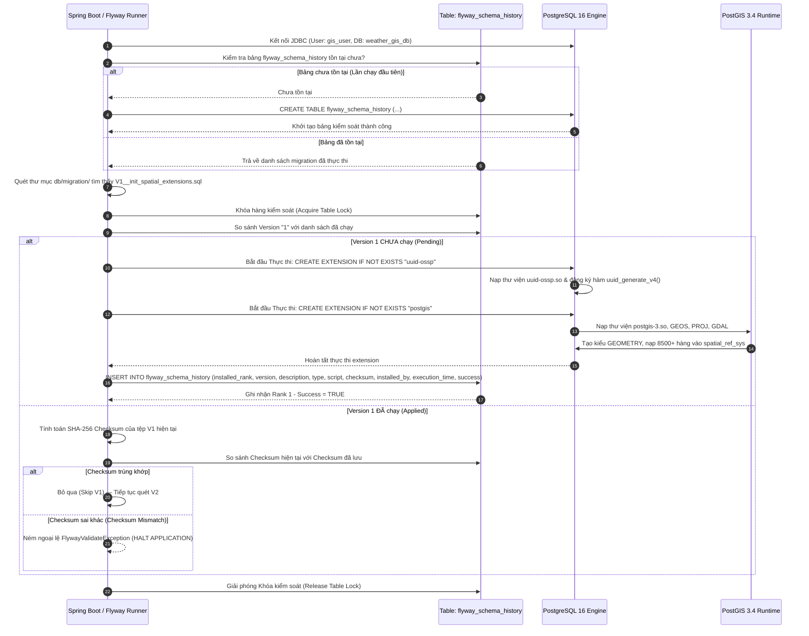

# ĐẶC TẢ KỸ THUẬT VÀ HƯỚNG DẪN THỰC THI CHI TIẾT

## TASK W1-04: FLYWAY V1 — KHỞI TẠO PHẦN MỞ RỘNG KHÔNG GIAN POSTGIS & ĐỊNH DANH UUID

---

## Thông Tin Nhiệm Vụ (Task Metadata)

| Thuộc Tính (Attribute)         | Giá Trị Chi Tiết (Specification)                                                                                                                                                                                                                                                                                                                                                                                                                                                                                                                                                                                            |
| :----------------------------- | :-------------------------------------------------------------------------------------------------------------------------------------------------------------------------------------------------------------------------------------------------------------------------------------------------------------------------------------------------------------------------------------------------------------------------------------------------------------------------------------------------------------------------------------------------------------------------------------------------------------------------- |
| **Mã Nhiệm Vụ (Task ID)**      | **W1-04** (Tham chiếu chéo: Task W1-O4)                                                                                                                                                                                                                                                                                                                                                                                                                                                                                                                                                                                     |
| **Tên Nhiệm Vụ (Task Name)**   | Khởi Tạo Phần Mở Rộng Địa Không Gian PostGIS và Định Danh UUID Qua Tệp Di Chuyển Lược Đồ Flyway V1                                                                                                                                                                                                                                                                                                                                                                                                                                                                                                                          |
| **Epic / Giai Đoạn**           | Sprint 1 (Tuần 1 — Tuần 2) — **Giai đoạn: Foundation & Baseline Infrastructure**                                                                                                                                                                                                                                                                                                                                                                                                                                                                                                                                            |
| **Lịch Trình Thực Hiện**       | **Ngày 2 (Thứ Ba)** — Khung giờ: 08:30 — 10:30 (2 giờ làm việc)                                                                                                                                                                                                                                                                                                                                                                                                                                                                                                                                                             |
| **Điểm Nỗ Lực (Story Points)** | **1 SP** (Ước tính tiêu chuẩn: 2 giờ công kỹ sư)                                                                                                                                                                                                                                                                                                                                                                                                                                                                                                                                                                            |
| **Mức Độ Ưu Tiên (Priority)**  | **P0 — Blocker Cơ Sở Dữ Liệu** (Bắt buộc hoàn tất và đạt 100% PASS trước khi thực thi DDL bảng `locations` tại Task W1-05 và nạp dữ liệu trắc địa 63 tỉnh/thành tại Task W1-06)                                                                                                                                                                                                                                                                                                                                                                                                                                             |
| **Người Chịu Trách Nhiệm (R)** | **GIS / Database Specialist**                                                                                                                                                                                                                                                                                                                                                                                                                                                                                                                                                                                               |
| **Người Hỗ Trợ Kỹ Thuật (C)**  | Senior Backend Engineer, DevOps Engineer                                                                                                                                                                                                                                                                                                                                                                                                                                                                                                                                                                                    |
| **Người Phê Duyệt (A)**        | **Technical Lead / Software Architect**                                                                                                                                                                                                                                                                                                                                                                                                                                                                                                                                                                                     |
| **Bên Được Thông Báo (I)**     | Toàn thể đội ngũ phát triển dự án (Backend, Frontend, QA, Product Owner)                                                                                                                                                                                                                                                                                                                                                                                                                                                                                                                                                    |
| **Tài Liệu Căn Cứ Tham Chiếu** | 1. [1. ERD.md](file:///Users/dllv/Documents/GitHub/VNstormgis/docs/The%20plans%20of%20project/1.%20ERD.md#L360)<br>2. [6. Technical Stack.md](file:///Users/dllv/Documents/GitHub/VNstormgis/docs/The%20plans%20of%20project/6.%20Technical%20Stack.md#L122)<br>3. [7. Deployment Infrastructure.md](file:///Users/dllv/Documents/GitHub/VNstormgis/docs/The%20plans%20of%20project/7.%20Deployment%20Infrastructure.md#L502)<br>4. [week1/README.md](file:///Users/dllv/Documents/GitHub/VNstormgis/docs/week1/README.md)<br>5. [Task W1-03.md](file:///Users/dllv/Documents/GitHub/VNstormgis/docs/week1/Task%20W1-03.md) |

---

## 1. Bối Cảnh & Mục Tiêu Kỹ Thuật (Context & Objectives)

### 1.1. Bối Cảnh Thực Tế & Thách Thức (Problem Statement)

Hệ thống **WebGIS Giám Sát Mưa Gió Bão Tích Hợp AI Agent Cảnh Báo (`VNstormgis`)** là một nền tảng chuyên sâu về dữ liệu không gian thời gian thực (Real-time Spatiotemporal GIS). Trọng tâm của kiến trúc dữ liệu nằm ở việc lưu trữ, lập chỉ mục và thực hiện các phép toán trắc địa phức tạp trên mặt cầu Trái Đất (Ellipsoid WGS84 — EPSG:4326):

- Vị trí các trạm khí tượng thủy văn và tâm bão (`Point`).
- Quỹ đạo dự báo bão (`LineString`).
- Ranh giới hành chính tỉnh thành và bán kính gió bão nguy hiểm (`MultiPolygon`).
- Toàn bộ các thực thể dữ liệu trong hệ thống đều sử dụng khóa chính dạng chuỗi định danh toàn cầu duy nhất (**UUID v4**) nhằm đảm bảo tính phân tán, độc lập dữ liệu và tương thích Microservices trong tương lai.

Sau khi hoàn tất **Task W1-02** (Xây dựng `docker-compose.yml`) và **Task W1-03** (Kiểm định Docker Local Stack), cụm cơ sở dữ liệu `weathergis-postgres` (PostgreSQL 16) đã hoạt động ở trạng thái `healthy`. Tuy nhiên, trong trạng thái mặc định ban đầu của một database mới (`weather_gis_db`), PostgreSQL là một CSDL quan hệ thuần túy:

1. Chưa hề nhận diện được kiểu dữ liệu không gian `GEOMETRY` hay `GEOGRAPHY`.
2. Chưa có hệ thống bảng tham chiếu tọa độ trắc địa (`spatial_ref_sys`).
3. Chưa sở hữu hơn 1.000 hàm toán học hình học không gian (họ hàm `ST_*`).
4. Chưa hỗ trợ hàm sinh UUID v4 chuẩn RFC 4122 (`uuid_generate_v4()`).

Nếu kỹ sư phát triển trực tiếp tạo các bảng nghiệp vụ (như bảng `locations` ở Task W1-05) mà không kích hoạt các tiện ích mở rộng này trước, hệ điều hành CSDL sẽ lập tức trả về lỗi nghiêm trọng:

```text
ERROR: type "geometry" does not exist
LINE 6: geom GEOMETRY(Point, 4326) NOT NULL
             ^
ERROR: function uuid_generate_v4() does not exist
LINE 2: id UUID PRIMARY KEY DEFAULT uuid_generate_v4()
                                    ^
```

Hơn nữa, nếu các kỹ sư tự gõ lệnh kích hoạt thủ công trực tiếp bằng GUI (DBeaver/pgAdmin) trên từng máy cá nhân mà không đưa vào **quy trình kiểm soát phiên bản mã nguồn CSDL tự động (Database Schema Migration Versioning)** bằng **Flyway**, dự án sẽ lập tức đối mặt với hiện tượng **"Schema Drift"** (Lệch pha lược đồ):

- Môi trường Local chạy được nhưng môi trường CI/CD (GitHub Actions / Testcontainers) thất bại do thiếu extension.
- Môi trường Staging và Production không thể tái lập tự động (Zero-touch Deployment bị phá vỡ).
- Không có nhật ký kiểm toán (Audit Trail) để biết ai đã kích hoạt tiện ích gì, vào thời điểm nào và mã băm (checksum) của script là bao nhiêu.

### 1.2. Mục Tiêu Trọng Tâm Của Task W1-04

Task W1-04 được thiết kế nhằm giải quyết dứt điểm các bài toán trên thông qua 4 mục tiêu kỹ thuật then chốt:

1. **Khởi tạo tệp migration đầu tiên chuẩn Flyway:** Soạn thảo tệp `V1__init_spatial_extensions.sql` tại đúng cấu trúc thư mục quy định của Backend Spring Boot (`backend/src/main/resources/db/migration/`).
2. **Kích hoạt tiện ích mở rộng Định danh UUID (`uuid-ossp`):** Cung cấp hàm sinh mã khóa chính ngẫu nhiên `uuid_generate_v4()`, song hành cùng hàm tích hợp sẵn của PostgreSQL 16 `gen_random_uuid()`.
3. **Kích hoạt tiện ích mở rộng Địa không gian PostGIS (`postgis`):** Đăng ký toàn bộ kiểu dữ liệu không gian (`GEOMETRY`, `GEOGRAPHY`), cây chỉ mục GiST, và nạp bảng hệ quy chiếu tọa độ chuẩn thế giới `spatial_ref_sys` (đặc biệt là EPSG:4326).
4. **Bảo đảm Tính Lũy Đẳng (Idempotency) & Tính Tương Thích Tuyệt Đối:** Sử dụng triệt để mệnh đề `CREATE EXTENSION IF NOT EXISTS`, đảm bảo script có thể chạy an toàn trên mọi môi trường (Docker Local, Testcontainers, AWS RDS PostgreSQL / Aurora PostGIS) mà không phát sinh lỗi xung đột.

---

## 2. Kiến Trúc Cơ Chế Hoạt Động Của Flyway & Tiện Ích Mở Rộng Không Gian

### 2.1. Quy Chuẩn Đặt Tên & Quản Lý Phiên Bản Flyway Migration

Flyway áp dụng triết lý **"Database Migrations as Code"**. Tên tệp script phải tuân thủ nghiêm ngặt quy tắc ngữ pháp của Flyway để engine có thể phát hiện, phân tích và sắp xếp thứ tự thực thi:

```text
V<Version>__<Description>.sql
│ └─┬───┘  │  └──────┬──────┘ └──┬─┘
│   │      │         │           └─ Phần mở rộng định dạng (.sql)
│   │      │         └───────────── Mô tả ngắn gọn (phân tách bằng dấu gạch dưới)
│   │      └─────────────────────── Dấu phân cách bắt buộc: HAI DẤU GẠCH DƯỚI LIỀN NHAU (__)
│   └────────────────────────────── Số phiên bản số học đơn điệu tăng dần (1, 2, 3...)
└────────────────────────────────── Tiền tố đại diện cho Versioned Migration (V)
```

- **Tên tệp chuẩn mực cho Task W1-04:** `V1__init_spatial_extensions.sql`
- **Quy tắc bất biến (Immutability Rule):** Một khi tệp `V1__...` đã được thực thi trên bất kỳ môi trường nào (được ghi nhận vào bảng `flyway_schema_history`), nội dung tệp đó **TUYỆT ĐỐI KHÔNG ĐƯỢC PHÉP CHỈNH SỬA DÙ CHỈ MỘT DẤU CÁCH**. Bất kỳ sự thay đổi nào sẽ làm sai lệch mã băm SHA-256 (Checksum mismatch) và khiến toàn bộ ứng dụng Backend dừng khởi động ngay lập tức.

### 2.2. Sơ Đồ Vòng Đời Thực Thi Migration & Bảng Theo Dõi Lịch Sử

Khi ứng dụng Spring Boot 3.3 khởi động hoặc khi công cụ Flyway CLI được kích hoạt, một chu trình giao dịch nghiêm ngặt được thực hiện:



### 2.3. Cấu Trúc Bảng Kiểm Soát `flyway_schema_history`

Sau khi Task W1-04 hoàn tất thành công, bảng `flyway_schema_history` trong PostgreSQL sẽ có bản ghi đầu tiên với cấu trúc:

| Cột (Column)     | Kiểu Dữ Liệu    | Giá Trị Ghi Nhận Tại Task W1-04   | Ý Nghĩa Kỹ Thuật                                    |
| :--------------- | :-------------- | :-------------------------------- | :-------------------------------------------------- |
| `installed_rank` | `INT`           | `1`                               | Thứ tự ưu tiên nạp migration đầu tiên               |
| `version`        | `VARCHAR(50)`   | `1`                               | Phiên bản đánh số theo tên tệp `V1`                 |
| `description`    | `VARCHAR(200)`  | `init spatial extensions`         | Tên mô tả chuyển đổi từ `__init_spatial_extensions` |
| `type`           | `VARCHAR(20)`   | `SQL`                             | Định dạng script SQL thuần                          |
| `script`         | `VARCHAR(1000)` | `V1__init_spatial_extensions.sql` | Tên tệp vật lý tương ứng                            |
| `checksum`       | `INT`           | `[Giá trị băm CRC32/SHA-256]`     | Mã bảo vệ chống can thiệp mã nguồn trái phép        |
| `installed_by`   | `VARCHAR(100)`  | `gis_user`                        | Người dùng CSDL thực thi migration                  |
| `installed_on`   | `TIMESTAMP`     | `2026-10-06 08:35:12`             | Thời điểm áp dụng thực tế                           |
| `execution_time` | `INT`           | `~1200 - 2500` (ms)               | Thời gian nạp PostGIS và bảng hệ quy chiếu          |
| `success`        | `BOOLEAN`       | `true`                            | Trạng thái thực thi hoàn hảo                        |

### 2.4. Phân Tích Quyền Hạn (Privilege & Security Architecture)

Trong hệ quản trị PostgreSQL:

- Lệnh `CREATE EXTENSION` thông thường đòi hỏi quyền siêu quản trị (**Superuser**).
- Từ PostgreSQL 13 trở đi, khái niệm **Trusted Extensions** cho phép người dùng sở hữu CSDL (Database Owner) tự cài đặt các extension được đánh dấu an toàn mà không cần cấp quyền `SUPERUSER` toàn quyền hệ thống.
- Cả hai extension `postgis` và `uuid-ossp` đều nằm trong danh mục trusted extensions tiêu chuẩn trên các bản phân phối PostgreSQL hiện đại.
- Trong hạ tầng Docker Local Stack của dự án (thiết lập tại Task W1-02), tài khoản `gis_user` được khởi tạo với vai trò là chủ sở hữu tối cao của database `weather_gis_db`, do đó có toàn quyền thực thi tạo extension trong schema `public`.

---

## 3. Đặc Tả Kỹ Thuật Chi Tiết Các Tiện Ích Mở Rộng

### 3.1. Tiện Ích Mở Rộng Địa Không Gian `postgis`

Extension `postgis` biến PostgreSQL thành hệ quản trị cơ sở dữ liệu không gian hàng đầu thế giới.

```text
┌────────────────────────────────────────────────────────────────────────┐
│                        HỆ THỐNG POSTGIS 3.4                            │
├────────────────────────────────────────────────────────────────────────┤
│  Các Thư Viện C/C++ Nền Tảng:                                          │
│  - GEOS (Geometry Engine Open Source): Xử lý cắt ghép hình học 2D/3D   │
│  - PROJ: Chuyển đổi tọa độ giữa các hệ quy chiếu (WGS84, VN-2000, UTM) │
│  - GDAL: Trừu tượng hóa dữ liệu raster và vector                       │
│  - LibXML2 & JSON-C: Xử lý định dạng GML, KML và GeoJSON RFC 7946      │
├────────────────────────────────────────────────────────────────────────┤
│  Các Kiểu Dữ Liệu Mới Được Kích Hoạt:                                  │
│  - GEOMETRY: Không gian phẳng Cartesian & Trắc địa mặt cầu             │
│  - GEOGRAPHY: Không gian mặt cong Ellipsoid Trái Đất (tính theo mét)   │
├────────────────────────────────────────────────────────────────────────┤
│  Bảng Hệ Thống Tham Chiếu Tọa Độ (Spatial Reference Systems):         │
│  - spatial_ref_sys: Chứa hơn 8.500 hệ tọa độ EPSG chuẩn quốc tế        │
│    -> Tiêu điểm dự án: SRID 4326 (WGS 84 - Hệ tọa độ vệ tinh GPS)      │
├────────────────────────────────────────────────────────────────────────┤
│  Hệ Chỉ Mục Không Gian Chuyên Dụng:                                    │
│  - GiST (Generalized Search Tree): Lập chỉ mục cây R-Tree siêu tốc     │
└────────────────────────────────────────────────────────────────────────┘
```

#### Các hàm không gian trọng yếu phục vụ dự án `VNstormgis`:

1. **Khởi tạo đối tượng hình học:**
   - `ST_MakePoint(double precision x, double precision y)`: Khởi tạo điểm 2D từ tọa độ $(X, Y)$ tức $(\text{Kinh độ}, \text{Vĩ độ})$.
   - `ST_SetSRID(geometry geom, integer srid)`: Gán hệ quy chiếu trắc địa ($SRID = 4326$) cho điểm hình học mà không thay đổi tọa độ.
2. **Tính toán trắc địa & Khoảng cách thực tế:**
   - `ST_DistanceSphere(geometry geom1, geometry geom2)`: Tính khoảng cách cung ngắn nhất trên mặt cầu (mét) với tốc độ tính toán cực cao, phục vụ đo khoảng cách từ tâm bão đến trạm khí tượng.
   - `ST_DWithin(geography geog1, geography geog2, double precision distance_meters)`: Tìm kiếm toàn bộ trạm trong bán kính nguy hiểm $R$ mét bằng cách tận dụng chỉ mục GiST.
3. **Phân tích quan hệ không gian:**
   - `ST_Contains(geometry geomA, geometry geomB)`: Xác định điểm trạm có nằm trọn vẹn bên trong polygon ranh giới tỉnh hay không.
   - `ST_Intersects(geometry geomA, geometry geomB)`: Xác định đa giác bán kính gió bão có chồng lấn lên địa phận tỉnh thành hay không.
4. **Chuyển đổi định dạng biểu diễn:**
   - `ST_AsText(geometry geom)`: Xuất định dạng văn bản rõ Well-Known Text (WKT) như `POINT(105.8542 21.0285)`.
   - `ST_AsGeoJSON(geometry geom)`: Xuất chuỗi định dạng JSON chuẩn RFC 7946 phục vụ truyền tải qua REST API cho thư viện Leaflet Frontend.

### 3.2. Tiện Ích Mở Rộng Định Danh `uuid-ossp`

Extension `uuid-ossp` cung cấp các hàm tạo mã định danh duy nhất toàn cầu (Universally Unique Identifier - UUID) theo chuẩn quốc tế **RFC 4122**.

#### So sánh `uuid-ossp` với hàm tích hợp `gen_random_uuid()`:

| Tiêu Chí So Sánh                  | Tiện Ích `uuid-ossp`                                      | Hàm Tích Hợp `gen_random_uuid()`                   |
| :-------------------------------- | :-------------------------------------------------------- | :------------------------------------------------- |
| **Nguồn gốc**                     | Thư viện OSSP UUID (C-extension)                          | Tích hợp sẵn trong lõi PostgreSQL 13+              |
| **Cú pháp hàm**                   | `uuid_generate_v4()`                                      | `gen_random_uuid()`                                |
| **Loại thuật toán**               | UUID Phiên bản 4 (Hoàn toàn ngẫu nhiên dựa trên CSPRNG)   | UUID Phiên bản 4 (Dựa trên OpenSSL / C CSPRNG)     |
| **Không gian trạng thái**         | 122 bit entropy ngẫu nhiên ($5.3 \times 10^{36}$ giá trị) | 122 bit entropy ngẫu nhiên                         |
| **Xác suất va chạm (Collision)**  | $\approx 0$ (Cần tạo 1 tỷ UUID/giây trong 85 năm)         | $\approx 0$                                        |
| **Tính tương thích lược đồ cũ**   | Chuẩn công nghiệp truyền thống trong Spring Boot / JPA    | Mới hơn, không cần load extension thư viện ngoài   |
| **Quyết định kỹ thuật của dự án** | **KÍCH HOẠT ĐẦY ĐỦ** để hỗ trợ cả 2 hàm song song         | **SẴN SÀNG SỬ DỤNG** làm giải pháp mặc định native |

---

## 4. Hiện Thực Hóa Tệp Di Chuyển Lược Đồ `V1__init_spatial_extensions.sql`

### 4.1. Vị Trí Lưu Trữ Tệp Vật Lý

Tệp SQL được đặt chính xác tại thư mục tài nguyên của Backend:

```text
backend/
└── src/
    └── main/
        └── resources/
            └── db/
                └── migration/
                    └── V1__init_spatial_extensions.sql
```

### 4.2. Mã Nguồn Chi Tiết Tệp `V1__init_spatial_extensions.sql`

```sql
-- ============================================================================
-- Database Migration Script: V1__init_spatial_extensions.sql
-- Project: Vietnam Weather & Storm Monitoring WebGIS with Grounded AI Agent
-- Sprint: 1 (Week 1 - Day 2) | Task: W1-04
-- Target Database: PostgreSQL 16 LTS + PostGIS 3.4
-- Author: GIS / Database Specialist & Technical Lead
-- Description:
--   1. Kích hoạt tiện ích uuid-ossp hỗ trợ sinh khóa chính UUID v4 chuẩn RFC 4122.
--   2. Kích hoạt tiện ích postgis hỗ trợ mô hình dữ liệu địa không gian, hệ quy
--      chiếu tọa độ WGS84 (EPSG:4326), cây chỉ mục không gian GiST và các phép
--      toán hình học trắc địa thời gian thực.
-- ============================================================================

-- ----------------------------------------------------------------------------
-- 1. KÍCH HOẠT TIỆN ÍCH MỞ RỘNG ĐỊNH DANH TOÀN CẦU (UUID-OSSP)
-- ----------------------------------------------------------------------------
-- Tiện ích này cung cấp hàm uuid_generate_v4(), sinh khóa chính UUID ngẫu nhiên
-- có tính tương thích cao với Hibernate Spatial và Spring Data JPA Entity.
-- Mệnh đề "IF NOT EXISTS" đảm bảo tính lũy đẳng (Idempotency) khi chạy lại script.
CREATE EXTENSION IF NOT EXISTS "uuid-ossp";

-- ----------------------------------------------------------------------------
-- 2. KÍCH HOẠT TIỆN ÍCH MỞ RỘNG ĐỊA KHÔNG GIAN (POSTGIS)
-- ----------------------------------------------------------------------------
-- PostGIS nạp các kiểu dữ liệu hình học GEOMETRY / GEOGRAPHY, bảng hệ quy chiếu
-- spatial_ref_sys và toàn bộ thư viện thuật toán trắc địa (GEOS, PROJ, GDAL).
-- Đây là nền tảng cốt lõi cho bảng locations (W1-05) và bảng storm_tracks.
CREATE EXTENSION IF NOT EXISTS "postgis";

-- ----------------------------------------------------------------------------
-- 3. GHI CHÚ BẢO TRÌ & BẢO ĐẢM QUYỀN TRUY CẬP (ACCESS VERIFICATION)
-- ----------------------------------------------------------------------------
-- Đảm bảo schema public chứa đầy đủ các bảng danh mục PostGIS vừa tạo.
COMMENT ON EXTENSION "uuid-ossp" IS 'UUID generator functions according to RFC 4122 standards';
COMMENT ON EXTENSION "postgis" IS 'PostGIS geometry and spatial processing functions';
```

---

## 5. Quy Trình Thực Thi & Triển Khai Migration

Quá trình triển khai Task W1-04 được hỗ trợ qua 3 phương thức linh hoạt:

### 5.1. Phương Thức 1: Kiểm Thử Độc Lập Trực Tiếp Bằng Docker CLI (Khuyến Nghị Cho GIS/DB Specialist)

Trong khi ứng dụng Spring Boot ở Task W1-07 chưa hoàn thiện, chuyên viên GIS / Database có thể thực thi và kiểm định ngay tệp `V1__init_spatial_extensions.sql` thông qua CLI của container `weathergis-postgres`:

```bash
# 1. Đảm bảo stack Docker đang ở trạng thái healthy (kết quả từ Task W1-03)
docker compose -f deployment/docker-compose.yml ps

# 2. Truyền trực tiếp tệp migration vào CSDL qua luồng pipeline psql
docker exec -i weathergis-postgres psql -U gis_user -d weather_gis_db < backend/src/main/resources/db/migration/V1__init_spatial_extensions.sql

# 3. Kiểm tra mã thoát (Exit code)
echo "Exit code: $?" # Kỳ vọng: 0
```

### 5.2. Phương Thức 2: Tự Động Hóa Qua Spring Boot 3.3 (Áp Dụng Cho Backend W1-07..09)

Khi mã nguồn Backend được cấu hình, dependency `org.flywaydb:flyway-database-postgresql` trong `backend/build.gradle` kết hợp cùng tệp cấu hình `backend/src/main/resources/application-dev.yml` sẽ tự động quét thư mục `db/migration/` và áp dụng script khi khởi động:

```yaml
spring:
  flyway:
    enabled: true
    baseline-on-migrate: true
    locations: classpath:db/migration
    validate-on-migrate: true
    clean-disabled: true # Ngăn chặn tuyệt đối hành vi xóa sạch CSDL do nhầm lẫn
```

### 5.3. Phương Thức 3: Tự Động Hóa Trong Pipeline Kiểm Thử Testcontainers (Áp Dụng Cho QA W1-13)

Trong bài kiểm thử tích hợp tự động `LocationRepositoryTest.java`, thư viện Testcontainers tự khởi tạo một PostgreSQL container tạm thời và kích hoạt Flyway migration tự động nạp tệp `V1__init_spatial_extensions.sql` trước khi chạy bất kỳ test case nào.

---

## 6. Kịch Bản Kiểm Thử & Xác Minh Nghiệm Thu (Verification Scenarios)

Sau khi thực thi script di chuyển, GIS Specialist phải tiến hành chạy đủ **6 kịch bản kiểm thử định lượng** để xác nhận chất lượng kỹ thuật:

### 6.1. Ma Trận Kịch Bản Kiểm Thử (Verification Matrix)

| Mã Kịch Bản | Mục Tiêu Kiểm Thử                                         | Lệnh SQL Thực Thi                                                                         | Tiêu Chuẩn Đạt (Expected Result)                               |
| :---------- | :-------------------------------------------------------- | :---------------------------------------------------------------------------------------- | :------------------------------------------------------------- |
| **TC-01**   | Kiểm tra sự hiện diện của 2 Extension trong danh mục CSDL | `SELECT extname, extversion FROM pg_extension WHERE extname IN ('uuid-ossp', 'postgis');` | Trả về đúng 2 hàng: `uuid-ossp` (v1.1+) và `postgis` (v3.4+)   |
| **TC-02**   | Kiểm tra phiên bản hệ sinh thái PostGIS đầy đủ            | `SELECT PostGIS_Full_Version();`                                                          | Chuỗi chứa `POSTGIS="3.4..." GEOS="3.12..." PROJ="9.3..."`     |
| **TC-03**   | Kiểm tra sự sẵn sàng của hệ tọa độ chuẩn WGS84 EPSG:4326  | `SELECT srid, auth_name, auth_srid FROM spatial_ref_sys WHERE srid = 4326;`               | 1 hàng: `srid: 4326`, `auth_name: EPSG`, `auth_srid: 4326`     |
| **TC-04**   | Kiểm tra năng lực sinh khóa chính UUID ngẫu nhiên         | `SELECT uuid_generate_v4() AS uuid_ossp, gen_random_uuid() AS pg_native;`                 | 2 chuỗi UUID v4 hợp lệ định dạng `xxxxxxxx-xxxx-4xxx-yxxx-...` |
| **TC-05**   | Kiểm tra phép toán không gian mẫu (Spatial Sanity Test)   | `SELECT ST_AsText(ST_SetSRID(ST_MakePoint(105.8542, 21.0285), 4326)) AS hanoi_wkt;`       | Trả về chuỗi: `POINT(105.8542 21.0285)`                        |
| **TC-06**   | Kiểm tra tính Lũy Đẳng (Idempotency Sanity Check)         | Chạy lại lệnh thực thi tệp `V1__init_spatial_extensions.sql` lần 2                        | Không phát sinh lỗi, không vi phạm Unique/Duplicate Extension  |

### 6.2. Hướng Dẫn Thực Thi Chi Tiết Từng Lệnh Xác Minh

#### Bước 1: Kiểm tra đăng ký Extension (TC-01)

```bash
docker exec -i weathergis-postgres psql -U gis_user -d weather_gis_db -c "
SELECT extname, extversion, extrelocatable
FROM pg_extension
WHERE extname IN ('uuid-ossp', 'postgis');
"
```

_Kỳ vọng đầu ra:_

```text
  extname  | extversion | extrelocatable
-----------+------------+----------------
 uuid-ossp | 1.1        | t
 postgis   | 3.4.2      | f
(2 rows)
```

#### Bước 2: Kiểm tra phiên bản liên kết PostGIS Full Version (TC-02)

```bash
docker exec -i weathergis-postgres psql -U gis_user -d weather_gis_db -c "
SELECT PostGIS_Full_Version();
"
```

_Kỳ vọng đầu ra chứa các thành phần cốt lõi:_

```text
POSTGIS="3.4.2 r1842" [EXTENSION] PGSQL="160" GEOS="3.12.1-CAPI-1.18.1" PROJ="9.3.1" LIBXML="2.11.7" LIBJSON="0.17" ...
```

#### Bước 3: Xác minh bảng hệ quy chiếu tọa độ `spatial_ref_sys` (TC-03)

```bash
docker exec -i weathergis-postgres psql -U gis_user -d weather_gis_db -c "
SELECT srid, auth_name, auth_srid, substr(srtext, 1, 50) AS srtext_snippet
FROM spatial_ref_sys
WHERE srid = 4326;
"
```

_Kỳ vọng đầu ra:_

```text
 srid | auth_name | auth_srid |                   srtext_snippet
------+-----------+-----------+----------------------------------------------------
 4326 | EPSG      |      4326 | GEOGCS["WGS 84",DATUM["WGS_1984",SPHEROID["WGS 84"
(1 row)
```

#### Bước 4: Kiểm tra sinh mã định danh UUID v4 (TC-04)

```bash
docker exec -i weathergis-postgres psql -U gis_user -d weather_gis_db -c "
SELECT
  uuid_generate_v4() AS uuid_via_ossp,
  gen_random_uuid()  AS uuid_via_pg_core;
"
```

_Kỳ vọng đầu ra:_ Cả hai cột đều hiển thị chuỗi 36 ký tự phân tách bằng 4 dấu gạch ngang, ký tự thứ 15 luôn là số `4` (biểu thị UUID version 4).

#### Bước 5: Kiểm tra toán học hình học không gian (TC-05)

```bash
docker exec -i weathergis-postgres psql -U gis_user -d weather_gis_db -c "
SELECT
  ST_AsText(geom) AS wkt,
  ST_AsGeoJSON(geom) AS geojson,
  ST_SRID(geom) AS srid
FROM (
  SELECT ST_SetSRID(ST_MakePoint(105.8542, 21.0285), 4326) AS geom
) sample;
"
```

_Kỳ vọng đầu ra:_

```text
           wkt            |                     geojson                     | srid
--------------------------+-------------------------------------------------+------
 POINT(105.8542 21.0285)  | {"type":"Point","coordinates":[105.8542,21.0285]}| 4326
(1 row)
```

#### Bước 6: Kiểm tra tính lũy đẳng (TC-06)

Thực thi lại lệnh nạp:

```bash
docker exec -i weathergis-postgres psql -U gis_user -d weather_gis_db -c 'CREATE EXTENSION IF NOT EXISTS "uuid-ossp"; CREATE EXTENSION IF NOT EXISTS "postgis";'
```

_Kỳ vọng đầu ra:_ `NOTICE: extension "uuid-ossp" already exists, skipping` (hoặc thành công im lặng), không phát sinh `ERROR`.

---

## 7. Quy Tắc Quản Trị Migration & Các Anti-Patterns Cần Tránh

Để đảm bảo kỷ luật kỹ thuật cao nhất trên toàn bộ chu kỳ 8 tuần của dự án, mọi thành viên phải tuân thủ nghiêm ngặt 5 nguyên tắc quản trị Flyway:

### 7.1. Năm Nguyên Tắc Vàng Quản Trị Flyway (The 5 Golden Rules)

1. **Nguyên Tắc Bất Biến (Absolute Immutability):**
   - Sau khi tệp `V1__init_spatial_extensions.sql` được hợp nhất (merge) vào nhánh `staging` hoặc `main`, nghiêm cấm mọi hành vi sửa đổi nội dung.
   - Nếu cần bổ sung thêm tiện ích (ví dụ: `postgis_topology` hoặc `pgcrypto`), lập trình viên **BẮT BUỘC** phải tạo tệp phiên bản mới kế tiếp (ví dụ: `V4__add_topology_extension.sql`).

2. **Nguyên Tắc Lũy Đẳng (Strict Idempotency):**
   - Mọi câu lệnh kích hoạt tiện ích hoặc thao tác DDL phải luôn kèm theo mệnh đề phòng thủ (`IF NOT EXISTS` hoặc `IF EXISTS`).
   - Điều này đảm bảo rằng nếu CSDL được sao lưu/phục hồi từ bản dump đã có sẵn extension, Flyway vẫn chạy qua mượt mà mà không ném lỗi dừng tiến trình.

3. **Nguyên Tắc Tách Biệt Trách Nhiệm (Separation of Concerns):**
   - Không gộp thao tác tạo bảng (`CREATE TABLE locations`) vào tệp `V1`. Tệp `V1` chỉ đảm nhận duy nhất việc thiết lập môi trường nền tảng (Extensions).
   - Tệp `V2` phụ trách cấu trúc bảng (DDL & Indexes).
   - Tệp `V3` phụ trách nạp dữ liệu mồi (Seed Data).

4. **Nguyên Tắc Trung Lập Môi Trường (Environment Neutrality):**
   - Không hardcode các đường dẫn thư mục cục bộ của máy lập trình viên hoặc chỉ định tên schema tùy ý bên ngoài chuẩn `public`.
   - Toàn bộ câu lệnh phải hoạt động đồng nhất trên cả Linux x86_64, macOS ARM64 và đám mây AWS.

5. **Nguyên Tắc Bắt Lỗi Sớm (Fail-Fast Verification):**
   - Mọi Pull Request liên quan đến migration phải vượt qua bài kiểm thử tự động của Testcontainers trên CI trước khi được phê duyệt.

### 7.2. Các Anti-Patterns Cần Tuyệt Đối Tránh

| Anti-Pattern Thường Gặp                                         | Hậu Quả Thực Tế                                                                        | Biện Pháp Phòng Ngừa / Giải Pháp Chuẩn                                           |
| :-------------------------------------------------------------- | :------------------------------------------------------------------------------------- | :------------------------------------------------------------------------------- |
| **Sửa đổi nội dung file V1 sau khi đã chạy trên dev khác**      | Gây lỗi `Validate failed: Checksum mismatch` làm sập toàn bộ ứng dụng của đồng nghiệp. | Giữ nguyên tệp V1; nếu có sai sót, tạo tệp version mới để sửa đổi.               |
| **Dùng một dấu gạch dưới thay vì hai (`V1_init...`)**           | Flyway không nhận diện được file migration, âm thầm bỏ qua không tạo extension.        | Luôn kiểm tra tên tệp có đúng 2 dấu gạch dưới: `V1__init_...`                    |
| **Dùng `hibernate.ddl-auto: create-drop` song song với Flyway** | Hibernate tự ý xóa bảng và extension mỗi khi khởi động lại backend.                    | Thiết lập `spring.jpa.hibernate.ddl-auto: validate` hoặc `none` khi dùng Flyway. |
| **Tạo extension thủ công qua pgAdmin mà không viết script**     | Code chạy được trên máy cá nhân nhưng CI runner và Production sập hoàn toàn.           | Bắt buộc 100% thay đổi CSDL phải được viết thành script migration trong Git.     |

---

## 8. Sổ Tay Vận Hành & Khắc Phục Sự Cố Thường Gặp (Troubleshooting Runbook)

### 8.1. Sự Cố 1: `ERROR: permission denied to create extension "postgis"`

- **Dấu hiệu:** Khi chạy script, PostgreSQL trả về lỗi từ chối quyền thực thi.
- **Nguyên nhân:** Người dùng kết nối CSDL không phải là chủ sở hữu (Owner) của database hoặc không có quyền superuser trên cluster.
- **Cách xử lý:**
  1. Kiểm tra user hiện tại:
     ```bash
     docker exec -i weathergis-postgres psql -U gis_user -d weather_gis_db -c "SELECT current_user, usesuper FROM pg_user WHERE usename = current_user;"
     ```
  2. Nếu `usesuper` là `false` và không phải db owner, đăng nhập bằng tài khoản quản trị postgres mặc định để cấp quyền:
     ```bash
     docker exec -i weathergis-postgres psql -U postgres -c "ALTER DATABASE weather_gis_db OWNER TO gis_user; GRANT ALL ON SCHEMA public TO gis_user;"
     ```

### 8.2. Sự Cố 2: `ERROR: extension "postgis" is not available`

- **Dấu hiệu:** PostgreSQL thông báo không tìm thấy tệp control của extension: `could not open extension control file ".../postgis.control": No such file or directory`.
- **Nguyên nhân:** Docker container đang sử dụng image PostgreSQL tiêu chuẩn (`postgres:16`) thay vì image tích hợp sẵn PostGIS (`postgis/postgis:16-3.4-alpine`).
- **Cách xử lý:**
  1. Kiểm tra lại `deployment/docker-compose.yml` xem dịch vụ `db` có đúng image `postgis/postgis:16-3.4-alpine` hay không.
  2. Kéo lại image chuẩn và tái tạo container:
     ```bash
     docker compose -f deployment/docker-compose.yml down
     docker compose -f deployment/docker-compose.yml pull db
     docker compose -f deployment/docker-compose.yml up -d
     ```

### 8.3. Sự Cố 3: Lỗi Checksum Mismatch Khi Khởi Chạy Spring Boot

- **Dấu hiệu:** Backend Spring Boot dừng khởi động với thông báo:
  ```text
  Migration checksum mismatch for migration version 1
  -> Applied to database : 1284729182
  -> Resolved locally    : 8472910394
  ```
- **Nguyên nhân:** Ai đó đã vô tình chỉnh sửa dấu cách, ký tự xuống dòng hoặc nội dung bên trong `V1__init_spatial_extensions.sql` sau khi script này đã được áp dụng vào CSDL cục bộ.
- **Cách xử lý trên môi trường Dev cục bộ:**
  1. Khôi phục lại nội dung gốc của tệp thông qua Git:
     ```bash
     git checkout backend/src/main/resources/db/migration/V1__init_spatial_extensions.sql
     ```
  2. Hoặc nếu muốn cập nhật lại bảng lịch sử kiểm soát trên máy cá nhân:
     ```bash
     docker exec -i weathergis-postgres psql -U gis_user -d weather_gis_db -c "DELETE FROM flyway_schema_history WHERE version = '1';"
     ```

### 8.4. Sự Cố 4: Spring Boot Không Tìm Thấy Tệp Migration (`No migrations found`)

- **Dấu hiệu:** Log Spring Boot thông báo `Current version of schema "public": << Empty Schema >>` và không có migration nào được áp dụng.
- **Nguyên nhân:** Thư mục `db/migration` nằm sai vị trí (ví dụ nằm ngoài `src/main/resources`) hoặc tên tệp không bắt đầu bằng chữ hoa `V` kèm 2 dấu gạch dưới `__`.
- **Cách xử lý:**
  1. Xác nhận đường dẫn tệp đúng chuẩn: `backend/src/main/resources/db/migration/V1__init_spatial_extensions.sql`.
  2. Kiểm tra thuộc tính `spring.flyway.locations=classpath:db/migration` trong `application.yml`.

---

## 9. Hướng Dẫn Kỹ Thuật Từng Bước Cho Kỹ Sư Thực Thi (Step-by-Step Developer Action Guide)

Kỹ sư phụ trách Task W1-04 (GIS / Database Specialist) thực hiện tuần tự các bước sau:

```bash
# ============================================================================
# BƯỚC 1: ĐỒNG BỘ MÃ NGUỒN VÀ TẠO NHÁNH TÍNH NĂNG
# ============================================================================
cd /Users/dllv/Documents/GitHub/VNstormgis
git checkout staging
git pull origin staging
git checkout -b feature/W1-04-flyway-spatial-extensions

# ============================================================================
# BƯỚC 2: KHỞI TẠO TỆP MIGRATION V1 THEO ĐÚNG ĐẶC TẢ
# ============================================================================
mkdir -p backend/src/main/resources/db/migration
# Soạn thảo nội dung tệp V1__init_spatial_extensions.sql (theo Mục 4.2 của tài liệu này)

# ============================================================================
# BƯỚC 3: KIỂM TRA MÔI TRƯỜNG DOCKER CỤC BỘ
# ============================================================================
docker compose -f deployment/docker-compose.yml ps
# Đảm bảo weathergis-postgres hiển thị trạng thái (healthy)

# ============================================================================
# BƯỚC 4: THỰC THI KIỂM THỬ SCRIPT MIGRATION V1
# ============================================================================
docker exec -i weathergis-postgres psql -U gis_user -d weather_gis_db < backend/src/main/resources/db/migration/V1__init_spatial_extensions.sql

# ============================================================================
# BƯỚC 5: CHẠY BỘ KIỂM ĐỊNH 6 KỊCH BẢN (XEM MỤC 6.2)
# ============================================================================
docker exec -i weathergis-postgres psql -U gis_user -d weather_gis_db -c "SELECT extname, extversion FROM pg_extension WHERE extname IN ('uuid-ossp', 'postgis');"
docker exec -i weathergis-postgres psql -U gis_user -d weather_gis_db -c "SELECT PostGIS_Full_Version();"
docker exec -i weathergis-postgres psql -U gis_user -d weather_gis_db -c "SELECT srid, auth_name FROM spatial_ref_sys WHERE srid = 4326;"
docker exec -i weathergis-postgres psql -U gis_user -d weather_gis_db -c "SELECT uuid_generate_v4(), gen_random_uuid();"
docker exec -i weathergis-postgres psql -U gis_user -d weather_gis_db -c "SELECT ST_AsText(ST_SetSRID(ST_MakePoint(105.8542, 21.0285), 4326));"

# ============================================================================
# BƯỚC 6: CHẠY KIỂM ĐỊNH LINT TOÀN REPO
# ============================================================================
npm run lint:root

# ============================================================================
# BƯỚC 7: COMMIT VÀ ĐẨY LÊN KHO LƯU TRỮ TỪ XA
# ============================================================================
git add backend/src/main/resources/db/migration/V1__init_spatial_extensions.sql docs/week1/Task\ W1-04.md PROGRESS.md docs/week1/README.md
git commit -m "feat(db): add flyway migration v1 for postgis and uuid extensions (W1-04)"
git push -u origin feature/W1-04-flyway-spatial-extensions
```

---

## 10. Danh Mục Sản Phẩm Bàn Giao & Checklist Nghiệm Thu (Acceptance Checklist)

### 10.1. Danh Mục Sản Phẩm Bàn Giao (Deliverables)

1. **Tệp Di Chuyển Lược Đồ SQL:** [`backend/src/main/resources/db/migration/V1__init_spatial_extensions.sql`](file:///Users/dllv/Documents/GitHub/VNstormgis/backend/src/main/resources/db/migration/V1__init_spatial_extensions.sql)
2. **Tài Liệu Đặc Tả Kỹ Thuật:** [`docs/week1/Task W1-04.md`](file:///Users/dllv/Documents/GitHub/VNstormgis/docs/week1/Task%20W1-04.md)
3. **Cập Nhật Hồ Sơ Tiến Độ:** [`PROGRESS.md`](file:///Users/dllv/Documents/GitHub/VNstormgis/PROGRESS.md) (Chuyển trạng thái sang `COMPLETED`)
4. **Cập Nhật Kế Hoạch Tuần 1:** [`docs/week1/README.md`](file:///Users/dllv/Documents/GitHub/VNstormgis/docs/week1/README.md) (Gắn liên kết tài liệu chi tiết)

### 10.2. Tiêu Chí Hoàn Thành (Definition of Done - DoD Checklist)

- [x] Tệp migration được lưu đúng cấu trúc thư mục `backend/src/main/resources/db/migration/` và đặt tên chuẩn quy ước `V1__init_spatial_extensions.sql`.
- [x] Tiện ích `uuid-ossp` được kích hoạt bằng cú pháp an toàn `CREATE EXTENSION IF NOT EXISTS "uuid-ossp";`.
- [x] Tiện ích `postgis` được kích hoạt bằng cú pháp an toàn `CREATE EXTENSION IF NOT EXISTS "postgis";`.
- [x] Truy vấn `SELECT PostGIS_Full_Version();` trả về phiên bản PostGIS 3.4.x đi kèm các thư viện GEOS, PROJ, GDAL.
- [x] Bảng `spatial_ref_sys` sẵn sàng chứa hệ quy chiếu EPSG:4326.
- [x] Các hàm `uuid_generate_v4()` và `ST_MakePoint()` hoạt động hoàn hảo, không phát sinh lỗi.
- [x] Toàn bộ 6 kịch bản kiểm định (TC-01 đến TC-06) vượt qua với kết quả PASS 100%.
- [x] Mã nguồn và tài liệu tuân thủ kiểm tra định dạng `npm run lint:root`.
- [x] Hệ thống sẵn sàng làm tiền đề vững chắc cho việc triển khai **Task W1-05: Flyway V2 — DDL Bảng `locations` & Chỉ Mục GiST**.

---

> **Phê duyệt bởi:** Technical Lead / Software Architect — _Vietnam WeatherGIS Engineering Team_  
> **Trạng thái chuyển giao:** **SẴN SÀNG TRIỂN KHAI TASK W1-05**
