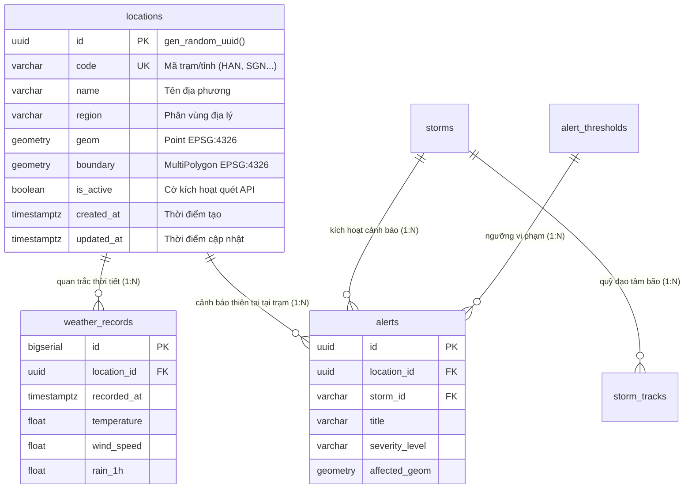

# ĐẶC TẢ KỸ THUẬT VÀ HƯỚNG DẪN THỰC THI CHI TIẾT

## TASK W1-05: FLYWAY V2 — DDL KHỞI TẠO BẢNG `LOCATIONS` & CHỈ MỤC KHÔNG GIAN GIST

---

## Thông Tin Nhiệm Vụ (Task Metadata)

| Thuộc Tính (Attribute)         | Giá Trị Chi Tiết (Specification)                                                                                                                                                                                                                                                                                                                                                                                                                                                                                                                                                                                                                         |
| :----------------------------- | :------------------------------------------------------------------------------------------------------------------------------------------------------------------------------------------------------------------------------------------------------------------------------------------------------------------------------------------------------------------------------------------------------------------------------------------------------------------------------------------------------------------------------------------------------------------------------------------------------------------------------------------------------- |
| **Mã Nhiệm Vụ (Task ID)**      | **W1-05**                                                                                                                                                                                                                                                                                                                                                                                                                                                                                                                                                                                                                                                |
| **Tên Nhiệm Vụ (Task Name)**   | Xây Dựng Lược Đồ Bảng `locations` và Hệ Thống Chỉ Mục Không Gian GiST Qua Tệp Di Chuyển Lược Đồ Flyway V2                                                                                                                                                                                                                                                                                                                                                                                                                                                                                                                                                |
| **Epic / Giai Đoạn**           | Sprint 1 (Tuần 1 — Tuần 2) — **Giai đoạn: Foundation & Baseline Infrastructure**                                                                                                                                                                                                                                                                                                                                                                                                                                                                                                                                                                         |
| **Lịch Trình Thực Hiện**       | **Ngày 2 (Thứ Ba)** — Khung giờ: 10:30 — 12:30 & 13:30 — 15:30 (4 giờ làm việc)                                                                                                                                                                                                                                                                                                                                                                                                                                                                                                                                                                          |
| **Điểm Nỗ Lực (Story Points)** | **2 SP** (Ước tính tiêu chuẩn: 4 giờ công kỹ sư)                                                                                                                                                                                                                                                                                                                                                                                                                                                                                                                                                                                                         |
| **Mức Độ Ưu Tiên (Priority)**  | **P0 — Blocker Cơ Sở Dữ Liệu & Tầng Miền** (Bắt buộc hoàn tất và đạt 100% PASS trước khi nạp dữ liệu trắc địa 63 tỉnh/thành tại Task W1-06 và xây dựng Domain Entity `Location` tại Task W1-08)                                                                                                                                                                                                                                                                                                                                                                                                                                                          |
| **Người Chịu Trách Nhiệm (R)** | **GIS / Database Specialist**                                                                                                                                                                                                                                                                                                                                                                                                                                                                                                                                                                                                                            |
| **Người Hỗ Trợ Kỹ Thuật (C)**  | Senior Backend Engineer, Software Architect                                                                                                                                                                                                                                                                                                                                                                                                                                                                                                                                                                                                              |
| **Người Phê Duyệt (A)**        | **Technical Lead / Software Architect**                                                                                                                                                                                                                                                                                                                                                                                                                                                                                                                                                                                                                  |
| **Bên Được Thông Báo (I)**     | Toàn thể đội ngũ phát triển dự án (Backend, Frontend, QA, Product Owner)                                                                                                                                                                                                                                                                                                                                                                                                                                                                                                                                                                                 |
| **Tài Liệu Căn Cứ Tham Chiếu** | 1. [1. ERD.md](file:///Users/dllv/Documents/GitHub/VNstormgis/docs/The%20plans%20of%20project/1.%20ERD.md#L142)<br>2. [4. SRS.md](file:///Users/dllv/Documents/GitHub/VNstormgis/docs/The%20plans%20of%20project/4.%20SRS.md)<br>3. [6. Technical Stack.md](file:///Users/dllv/Documents/GitHub/VNstormgis/docs/The%20plans%20of%20project/6.%20Technical%20Stack.md#L122)<br>4. [week1/README.md](file:///Users/dllv/Documents/GitHub/VNstormgis/docs/week1/README.md)<br>5. [Task W1-04.md](file:///Users/dllv/Documents/GitHub/VNstormgis/docs/week1/Task%20W1-04.md)<br>6. [PROGRESS.md](file:///Users/dllv/Documents/GitHub/VNstormgis/PROGRESS.md) |

---

## 1. Bối Cảnh & Mục Tiêu Kỹ Thuật (Context & Objectives)

### 1.1. Bối Cảnh Thực Tế & Thách Thức (Problem Statement)

Hệ thống **WebGIS Giám Sát Mưa Gió Bão Tích Hợp AI Agent Cảnh Báo (`VNstormgis`)** là một nền tảng giám sát khí tượng và cảnh báo thiên tai diện rộng tại Việt Nam. Trọng tâm dữ liệu nghiệp vụ của toàn bộ hệ thống xoay quanh các thực thể vị trí địa lý:

1. **63 Tỉnh/Thành phố và Các Trạm Khí Tượng Trọng Điểm:** Mỗi địa phương sở hữu tọa độ trắc địa trung tâm (`Point`) để hiển thị trâm ghim (Marker) trên bản đồ tương tác Leaflet và liên kết với các chuỗi thời gian quan trắc thời tiết (`weather_records`) lấy từ OpenWeatherMap API.
2. **Ranh Giới Hành Chính Không Gian (`MultiPolygon`):** Cho phép Backend thực hiện các phép toán topo không gian (Spatiotemporal Topological Analysis) như `ST_Contains` và `ST_Intersects` để phát hiện ngay lập tức tỉnh nào đang nằm trong bán kính gió bão nguy hiểm của cơn bão từ GDACS.
3. **Hiệu Năng Truy Vấn Dữ Liệu Lớn & Thời Gian Thực:** Khi người dùng di chuyển hoặc phóng to/thu nhỏ (Pan/Zoom) trên bản đồ Leaflet, Frontend liên tục gửi tọa độ Bounding Box về Backend. Nếu không có chỉ mục không gian chuyên dụng, PostgreSQL buộc phải quét toàn bộ bảng (Sequential Scan - $O(N)$), gây tắc nghẽn tài nguyên CPU và tăng độ trễ phản hồi API vượt mức SLA quy định (< 200ms).

Tiếp nối thành công của **Task W1-04** (kích hoạt thành công extension `postgis` và `uuid-ossp` qua `V1__init_spatial_extensions.sql`), cơ sở dữ liệu `weather_gis_db` đã hoàn toàn sẵn sàng về mặt môi trường hình học trắc địa. Bước đi sống còn tiếp theo là kiến tạo bảng dữ liệu nền tảng đầu tiên: bảng `locations`.

### 1.2. Mục Tiêu Trọng Tâm Của Task W1-05

Task W1-05 được thiết kế nhằm hiện thực hóa cấu trúc dữ liệu trắc địa chuẩn mực thông qua 5 mục tiêu cốt lõi:

1. **Khởi tạo tệp di chuyển lược đồ Flyway V2:** Soạn thảo tệp `V2__create_location_tables.sql` tại `backend/src/main/resources/db/migration/` tuân thủ triệt để nguyên tắc kiểm soát phiên bản CSDL bất biến.
2. **Hiện thực hóa DDL bảng `locations`:** Thiết lập đầy đủ các trường dữ liệu theo đúng [Từ Điển Dữ Liệu ERD](file:///Users/dllv/Documents/GitHub/VNstormgis/docs/The%20plans%20of%20project/1.%20ERD.md#L142), bao gồm khóa chính UUID v4 ngẫu nhiên, mã định danh duy nhất (`code UNIQUE`), tên trạm, phân vùng, kiểu hình học điểm `GEOMETRY(Point, 4326)`, và ranh giới đa giác `GEOMETRY(MultiPolygon, 4326)`.
3. **Thiết lập cây chỉ mục không gian GiST (Generalized Search Tree):** Tạo chỉ mục GiST trên cột `geom` (`idx_locations_geom`) và cột `boundary` (`idx_locations_boundary`) nhằm phục vụ tính toán khoảng cách cầu `ST_DistanceSphere`, tìm kiếm lân cận `ST_DWithin`, và lọc vùng Bounding Box `&&` với độ phức tạp $O(\log N)$.
4. **Tối ưu hóa truy vấn nghiệp vụ với chỉ mục B-Tree:** Thiết lập các chỉ mục B-Tree trên các cột thường xuyên dùng làm điều kiện lọc (`region`, `is_active`).
5. **Cơ chế tự động hóa thời gian biến đổi (Automated Audit Timestamp):** Thiết lập hàm thủ tục `update_updated_at_column()` và database trigger `trg_locations_updated_at` để tự động cập nhật trường `updated_at` mỗi khi có bản ghi bị thay đổi, đảm bảo tính nhất quán dữ liệu mà không phụ thuộc hoàn toàn vào tầng ứng dụng.
6. **Bảo đảm tính lũy đẳng (Strict Idempotency):** Áp dụng mệnh đề phòng thủ `IF NOT EXISTS` và `OR REPLACE` xuyên suốt script, bảo đảm script có thể tái thực thi an toàn trên mọi pipeline CI/CD hoặc môi trường kiểm thử.

---

## 2. Kiến Trúc Lược Đồ & Mối Quan Hệ Nghiệp Vụ Của Bảng `locations`

### 2.1. Vị Trí Cốt Lõi Của Bảng `locations` Trong Hệ Thống

Bảng `locations` giữ vai trò là "Thực Thể Gốc" (Root Geography Entity) kết nối các phân hệ chức năng trọng yếu của dự án:



- **Mối quan hệ 1-N với `weather_records`:** Một điểm quan trắc định kỳ thu thập hàng nghìn bản ghi thời tiết theo chuỗi thời gian (Nhiệt độ, gió, lượng mưa tích lũy 1h/3h).
- **Mối quan hệ 1-N với `alerts`:** Khi AI Agent hoặc Worker phát hiện trạm vượt ngưỡng an toàn (ví dụ: mưa > 50mm/h hoặc bão áp sát < 150km), một cảnh báo sẽ liên kết trực tiếp tới `location_id`.
- **Phân tích giao cắt với `storm_tracks`:** Vùng ảnh hưởng của tâm bão (`storm_tracks.impact_polygon`) sẽ được đối chiếu không gian với `locations.geom` hoặc `locations.boundary` thông qua câu truy vấn `ST_Intersects` để phát hiện những trạm nào nằm trong vùng nguy hiểm.

### 2.2. Từ Điển Dữ Liệu Chi Tiết (Data Dictionary Specification)

| Tên Cột (Column) | Kiểu Dữ Liệu CSDL              | Ràng Buộc (Constraints)   | Giá Trị Mặc Định (Default) | Ý Nghĩa Nghiệp Vụ Kỹ Thuật                                                                                                                                        |
| :--------------- | :----------------------------- | :------------------------ | :------------------------- | :---------------------------------------------------------------------------------------------------------------------------------------------------------------- |
| `id`             | `UUID`                         | **PRIMARY KEY**, NOT NULL | `gen_random_uuid()`        | Khóa chính định danh ngẫu nhiên toàn cầu (RFC 4122 Version 4), bảo đảm an toàn phân tán và tương thích JPA/Hibernate.                                             |
| `code`           | `VARCHAR(32)`                  | **UNIQUE**, NOT NULL      | _None_                     | Mã viết tắt chuẩn hóa của trạm/tỉnh thành (ví dụ: `HAN`, `DNG`, `SGN`, `QNH`, `HPH`). Tự động sinh chỉ mục Unique B-Tree phục vụ truy vấn tra cứu theo mã $O(1)$. |
| `name`           | `VARCHAR(128)`                 | NOT NULL                  | _None_                     | Tên địa phương hoặc tên trạm khí tượng thủy văn chính thức (ví dụ: "Hà Nội", "Đà Nẵng", "TP. Hồ Chí Minh", "Trạm Hải Văn Bạch Long Vĩ").                          |
| `region`         | `VARCHAR(64)`                  | NOT NULL                  | _None_                     | Phân vùng địa lý lãnh thổ (ví dụ: "Bắc Bộ", "Bắc Trung Bộ", "Nam Trung Bộ", "Tây Nguyên", "Nam Bộ"). Phục vụ phân cụm hiển thị và báo cáo thống kê.               |
| `geom`           | `GEOMETRY(Point, 4326)`        | NOT NULL                  | _None_                     | Tọa độ điểm đại diện trắc địa trạm theo hệ quy chiếu chuẩn WGS84 (EPSG:4326). Lưu trữ theo thứ tự quy ước PostGIS: **(Kinh độ, Vĩ độ)**. Bắt buộc phục vụ Marker. |
| `boundary`       | `GEOMETRY(MultiPolygon, 4326)` | NULL                      | `NULL`                     | Đa giác ranh giới hành chính trọn vẹn của tỉnh/thành. Cho phép `NULL` ở Sprint 1 và sẽ nạp GeoJSON chi tiết ở các sprint nâng cao phục vụ tô màu cảnh báo vùng.   |
| `is_active`      | `BOOLEAN`                      | NOT NULL                  | `TRUE`                     | Cờ trạng thái hoạt động: `true` biểu thị điểm đang được Scheduled Task gọi OpenWeatherMap API lấy dữ liệu; `false` tạm ngừng để tiết kiệm quota gọi API.          |
| `created_at`     | `TIMESTAMPTZ`                  | NOT NULL                  | `CURRENT_TIMESTAMP`        | Dấu thời gian (có múi giờ UTC/ISO-8601) thời điểm bản ghi được tạo lập.                                                                                           |
| `updated_at`     | `TIMESTAMPTZ`                  | NOT NULL                  | `CURRENT_TIMESTAMP`        | Dấu thời gian cập nhật thông tin trạm gần nhất. Được tự động điều chỉnh qua Trigger mỗi khi thực hiện thao tác SQL `UPDATE`.                                      |

### 2.3. Quy Chuẩn Trục Tọa Độ Trắc Địa WGS84 (EPSG:4326 Coordinate Convention)

> [!WARNING]
> **CẢNH BÁO RỦI RO KỸ THUẬT NGHIÊM TRỌNG (Tham chiếu: RSK-W1-05 trong Ma trận Rủi ro):**  
> Trong toán học và chuẩn PostGIS OGC, đối tượng hình học `Point` nhận hai tham số: `ST_MakePoint(X, Y)`.
>
> - **$X$ tương ứng với Kinh độ (Longitude):** Phạm vi lãnh thổ Việt Nam nằm trong khoảng **$102.1^\circ E$ đến $114.5^\circ E$**.
> - **$Y$ tương ứng với Vĩ độ (Latitude):** Phạm vi lãnh thổ Việt Nam nằm trong khoảng **$8.5^\circ N$ đến $23.4^\circ N$**.
>
> Nếu kỹ sư hoặc script nạp dữ liệu truyền nhầm thứ tự `(Latitude, Longitude)`, tọa độ sẽ bị văng ra biển Ấn Độ Dương hoặc ngoài khơi bờ biển Somalia. Toàn bộ tính năng định vị trên bản đồ Leaflet sẽ bị sai lệch hoàn toàn.

Quy tắc bất biến khi khởi tạo hình học điểm:

```sql
-- CÚ PHÁP CHUẨN POSTGIS CHO VIỆT NAM:
ST_SetSRID(ST_MakePoint(kinh_độ_long, vĩ_độ_lat), 4326)

-- VÍ DỤ TRẠM HÀ NỘI (Long: 105.8542, Lat: 21.0285):
ST_SetSRID(ST_MakePoint(105.8542, 21.0285), 4326)
```

---

## 3. Phân Tích Chuyên Sâu Chỉ Mục Không Gian GiST vs B-Tree

### 3.1. Bản Chất Kỹ Thuật Của Cây R-Tree Trong GiST (Generalized Search Tree)

Trong cơ sở dữ liệu quan hệ truyền thống, chỉ mục **B-Tree** sắp xếp dữ liệu theo trật tự 1 chiều tuyến tính ($A < B < C$). Tuy nhiên, dữ liệu không gian là dữ liệu đa chiều (2D hoặc 3D). Một điểm không gian $(x, y)$ không thể sắp xếp đơn thuần theo một chiều mà không làm mất thông tin lân cận của chiều còn lại.

PostGIS giải quyết bài toán này thông qua **GiST (Generalized Search Tree)** cấu hình thuật toán **R-Tree (Rectangle Tree)**:

```text
┌────────────────────────────────────────────────────────────────────────┐
│                   CẤU TRÚC PHÂN CẤP CỦA CHỈ MỤC GIST R-TREE            │
├────────────────────────────────────────────────────────────────────────┤
│                                                                        │
│   [Root Node: Bounding Box Bao Phủ Toàn Lãnh Thổ Việt Nam (R0)]        │
│          ├── [Child R1: Miền Bắc]                                      │
│          │      ├── [Box: Hà Nội (HAN)]                                │
│          │      ├── [Box: Hải Phòng (HPH)]                             │
│          │      └── [Box: Quảng Ninh (QNH)]                            │
│          ├── [Child R2: Miền Trung]                                    │
│          │      ├── [Box: Đà Nẵng (DNG)]                               │
│          │      └── [Box: Huế (HUE)]                                   │
│          └── [Child R3: Miền Nam]                                      │
│                 ├── [Box: TP. Hồ Chí Minh (SGN)]                       │
│                 └── [Box: Cần Thơ (VCA)]                               │
│                                                                        │
└────────────────────────────────────────────────────────────────────────┘
```

- **Hộp bao chữ nhật tối thiểu (Minimum Bounding Box - MBR):** Mỗi điểm hoặc đa giác được bao bọc bởi một hình chữ nhật song song với trục tọa độ (Bounding Box 2D: $[x_{\min}, y_{\min}, x_{\max}, y_{\max}]$).
- **Cơ chế duyệt cây:** Khi tìm kiếm các điểm rơi vào khung nhìn Leaflet $[x1, y1, x2, y2]$, PostgreSQL chỉ duyệt các nhánh cây có MBR giao cắt với khung nhìn, loại bỏ ngay $95\%$ các nhánh không liên quan mà không cần kiểm tra từng tọa độ.
- **Toán tử giao cắt Bounding Box (`&&`):** Toán tử này tận dụng $100\%$ chỉ mục GiST để lọc thô siêu tốc trước khi chuyển sang hàm lọc chính xác trắc địa `ST_Intersects` hoặc `ST_DWithin`.

### 3.2. So Sánh Hiệu Năng: Có Chỉ Mục GiST vs Không Có Chỉ Mục

| Tiêu Chí Kỹ Thuật                   | Truy Vấn Quét Tuần Tự (Seq Scan - Không Index) | Truy Vấn Sử Dụng Chỉ Mục Không Gian GiST                   |
| :---------------------------------- | :--------------------------------------------- | :--------------------------------------------------------- |
| **Độ phức tạp thuật toán**          | $O(N)$ (Quét toàn bộ $N$ bản ghi trong bảng)   | $O(\log N)$ (Duyệt theo chiều cao của cây R-Tree)          |
| **Tài nguyên CPU tiêu thụ**         | Tính toán khoảng cách toán học cho mọi hàng    | Chỉ tính toán chính xác trên tập ứng viên sau khi lọc MBR  |
| **Thời gian phản hồi (1.000 điểm)** | $\approx 25 - 50$ ms                           | $\approx 0.8 - 1.5$ ms (Tăng tốc gấp $20 - 30$ lần)        |
| **Hỗ trợ toán tử Leaflet BBox**     | Không thể tận dụng toán tử `&&`                | Tối ưu hóa tuyệt đối cho toán tử `&&` và `ST_MakeEnvelope` |

### 3.3. Danh Mục Các Chỉ Mục Được Thiết Lập Cho Bảng `locations`

Trong tệp `V2__create_location_tables.sql`, hệ thống thiết lập tổng cộng **5 chỉ mục chiến lược**:

1. **`locations_pkey` (B-Tree trên `id`):** Tạo tự động khi khai báo `PRIMARY KEY`, đảm bảo tìm kiếm bản ghi theo UUID có tốc độ $O(1)$.
2. **`locations_code_key` (B-Tree trên `code`):** Tạo tự động khi khai báo `UNIQUE`, phục vụ API tra cứu trạm theo mã trạm (`/api/v1/locations/HAN`).
3. **`idx_locations_geom` (GiST trên `geom`):** Chỉ mục không gian then chốt phục vụ các phép toán Leaflet Bounding Box, `ST_DWithin` tìm trạm gần nhất quanh người dùng, và `ST_DistanceSphere` đo khoảng cách tới bão.
4. **`idx_locations_boundary` (GiST trên `boundary`):** Chỉ mục không gian đa giác phục vụ kiểm tra vùng bão quét qua tỉnh thành (`ST_Intersects`, `ST_Contains`).
5. **`idx_locations_region` (B-Tree trên `region`):** Hỗ trợ lọc danh sách trạm theo khu vực nghiệp vụ (`WHERE region = 'Bắc Bộ'`) với chi phí cực thấp.
6. **`idx_locations_is_active` (B-Tree trên `is_active`):** Tối ưu hóa cho Background Scheduled Worker chỉ quét các điểm đang bật thu thập thời tiết (`WHERE is_active = true`).

---

## 4. Thiết Kế Cơ Chế Tự Động Hóa Thời Gian Biến Đổi (Trigger Architecture)

### 4.1. Lý Do Sử Dụng Trigger Cấp Độ Cơ Sở Dữ Liệu Thay Vì Chỉ Dùng JPA

Trong ứng dụng Spring Boot, các kỹ sư thường dùng annotation `@UpdateTimestamp` của Hibernate. Tuy nhiên, việc chỉ dựa vào tầng ứng dụng tiềm ẩn nhiều lỗ hổng:

1. **Thao tác DML trực tiếp:** Khi DBA hoặc script bảo trì chạy câu lệnh `UPDATE locations SET is_active = false WHERE ...` qua DBeaver/psql, Hibernate không được kích hoạt, dẫn đến `updated_at` bị giữ nguyên giá trị cũ, gây sai lệch nhật ký kiểm toán.
2. **Truy vấn Bulk Update bằng JPQL/Native Query:** Khi chạy câu lệnh `@Modifying @Query("UPDATE Location l SET ...")`, Hibernate bỏ qua vòng đời Entity Lifecycle Callback, khiến `@UpdateTimestamp` không hoạt động.
3. **Kiến trúc đa dịch vụ (Multi-service / Microservice):** Bất kỳ dịch vụ nào trong tương lai (Python ETL worker, Node.js ingestor) cập nhật dữ liệu đều được CSDL tự động bảo đảm tính toàn vẹn thời gian.

### 4.2. Khởi Tạo Hàm Thủ Tục Dùng Chung `update_updated_at_column()`

Hàm trigger được thiết kế theo chuẩn thủ tục PL/pgSQL:

```sql
CREATE OR REPLACE FUNCTION update_updated_at_column()
RETURNS TRIGGER AS $$
BEGIN
    NEW.updated_at = CURRENT_TIMESTAMP;
    RETURN NEW;
END;
$$ LANGUAGE plpgsql;
```

Hàm này được tái sử dụng cho toàn bộ các bảng trong các sprint tiếp theo (`weather_records`, `storms`, `alerts`, `chat_sessions`) nhằm bảo đảm tính nhất quán trên toàn bộ lược đồ CSDL.

---

## 5. Hiện Thực Hóa Tệp Di Chuyển Lược Đồ `V2__create_location_tables.sql`

### 5.1. Vị Trí Lưu Trữ Tệp Vật Lý

Tệp SQL được đặt chính xác tại thư mục tài nguyên của Backend theo quy định của Flyway:

```text
backend/
└── src/
    └── main/
        └── resources/
            └── db/
                └── migration/
                    ├── V1__init_spatial_extensions.sql
                    └── V2__create_location_tables.sql   <-- [Task W1-05 Artifact]
```

### 5.2. Mã Nguồn Đầy Đủ Tệp `V2__create_location_tables.sql`

```sql
-- ============================================================================
-- Database Migration Script: V2__create_location_tables.sql
-- Project: Vietnam Weather & Storm Monitoring WebGIS with Grounded AI Agent
-- Sprint: 1 (Week 1 - Day 2) | Task: W1-05
-- Target Database: PostgreSQL 16 LTS + PostGIS 3.4
-- Author: GIS / Database Specialist & Technical Lead
-- Description:
--   1. Tạo bảng locations lưu trữ danh mục điểm quan trắc khí tượng và vị trí
--      địa lý giám sát 63 tỉnh/thành phố trên lãnh thổ Việt Nam.
--   2. Khởi tạo cột không gian geom (Point, EPSG:4326) và boundary (MultiPolygon, EPSG:4326).
--   3. Thiết lập chỉ mục không gian chuyên dụng GiST (Generalized Search Tree)
--      cho cột geom và boundary nhằm tối ưu hóa các truy vấn ST_DWithin, ST_Contains.
--   4. Thiết lập chỉ mục B-Tree trên cột region, is_active và ràng buộc UNIQUE cho code.
--   5. Thiết lập hàm và trigger tự động cập nhật trường thời gian updated_at.
-- ============================================================================

-- ----------------------------------------------------------------------------
-- 1. HÀM TRIGGER CẬP NHẬT THỜI GIAN BIẾN ĐỔI (UPDATED_AT TIMESTAMP)
-- ----------------------------------------------------------------------------
-- Hàm dùng chung cho các bảng nghiệp vụ có nhu cầu tự động gán timestamp mới nhất
-- mỗi khi có thao tác UPDATE bản ghi.
CREATE OR REPLACE FUNCTION update_updated_at_column()
RETURNS TRIGGER AS $$
BEGIN
    NEW.updated_at = CURRENT_TIMESTAMP;
    RETURN NEW;
END;
$$ LANGUAGE plpgsql;

-- ----------------------------------------------------------------------------
-- 2. TẠO BẢNG LOCATIONS (ĐIỂM QUAN TRẮC & VỊ TRÍ ĐỊA LÝ GIÁM SÁT)
-- ----------------------------------------------------------------------------
CREATE TABLE IF NOT EXISTS locations (
    id UUID PRIMARY KEY DEFAULT gen_random_uuid(),
    code VARCHAR(32) NOT NULL UNIQUE,
    name VARCHAR(128) NOT NULL,
    region VARCHAR(64) NOT NULL,
    geom GEOMETRY(Point, 4326) NOT NULL,
    boundary GEOMETRY(MultiPolygon, 4326),
    is_active BOOLEAN NOT NULL DEFAULT TRUE,
    created_at TIMESTAMPTZ NOT NULL DEFAULT CURRENT_TIMESTAMP,
    updated_at TIMESTAMPTZ NOT NULL DEFAULT CURRENT_TIMESTAMP
);

-- ----------------------------------------------------------------------------
-- 3. THIẾT LẬP CHỈ MỤC KHÔNG GIAN VÀ CHỈ MỤC NGHIỆP VỤ (INDEXING)
-- ----------------------------------------------------------------------------
-- Chỉ mục không gian GiST cho tọa độ điểm quan trắc:
-- Tăng tốc độ lọc theo Bounding Box (&&) của Leaflet và đo khoảng cách ST_DistanceSphere / ST_DWithin
CREATE INDEX IF NOT EXISTS idx_locations_geom ON locations USING GIST (geom);

-- Chỉ mục không gian GiST cho đa giác ranh giới hành chính:
-- Tăng tốc độ kiểm tra giao cắt ST_Intersects / ST_Contains với tâm bão và vành đai mây bão
CREATE INDEX IF NOT EXISTS idx_locations_boundary ON locations USING GIST (boundary);

-- Chỉ mục B-Tree trên phân vùng địa lý (Bắc Bộ, Trung Bộ, Nam Bộ...):
-- Hỗ trợ phân trang và lọc danh sách trạm theo khu vực nghiệp vụ
CREATE INDEX IF NOT EXISTS idx_locations_region ON locations (region);

-- Chỉ mục B-Tree trên cờ kích hoạt:
-- Tối ưu hóa cho Background Scheduled Worker chỉ quét các điểm đang kích hoạt thu thập thời tiết
CREATE INDEX IF NOT EXISTS idx_locations_is_active ON locations (is_active);

-- ----------------------------------------------------------------------------
-- 4. THIẾT LẬP TRIGGER TỰ ĐỘNG CẬP NHẬT UPDATED_AT
-- ----------------------------------------------------------------------------
DROP TRIGGER IF EXISTS trg_locations_updated_at ON locations;
CREATE TRIGGER trg_locations_updated_at
BEFORE UPDATE ON locations
FOR EACH ROW
EXECUTE FUNCTION update_updated_at_column();

-- ----------------------------------------------------------------------------
-- 5. CHÚ THÍCH METADATA (DATA DICTIONARY DOCUMENTATION)
-- ----------------------------------------------------------------------------
COMMENT ON TABLE locations IS 'Bảng quản lý trạm quan trắc khí tượng và vị trí địa lý 63 tỉnh/thành Việt Nam';
COMMENT ON COLUMN locations.id IS 'Khóa chính UUID ngẫu nhiên duy nhất toàn cầu (RFC 4122 v4)';
COMMENT ON COLUMN locations.code IS 'Mã định danh duy nhất của trạm/tỉnh (ví dụ: HAN, SGN, DNG, QNH)';
COMMENT ON COLUMN locations.name IS 'Tên hiển thị địa phương (ví dụ: Hà Nội, TP. Hồ Chí Minh, Đà Nẵng)';
COMMENT ON COLUMN locations.region IS 'Phân vùng địa lý (Bắc Bộ, Bắc Trung Bộ, Nam Trung Bộ, Tây Nguyên, Nam Bộ)';
COMMENT ON COLUMN locations.geom IS 'Tọa độ hình học Point WGS84 (EPSG:4326), lưu trữ định dạng (Kinh độ, Vĩ độ)';
COMMENT ON COLUMN locations.boundary IS 'Ranh giới hành chính MultiPolygon WGS84 (EPSG:4326) phục vụ phân tích vùng bão';
COMMENT ON COLUMN locations.is_active IS 'Cờ kích hoạt thu thập dữ liệu thời tiết định kỳ (true: hoạt động, false: tạm dừng)';
COMMENT ON COLUMN locations.created_at IS 'Thời điểm khởi tạo bản ghi trong cơ sở dữ liệu';
COMMENT ON COLUMN locations.updated_at IS 'Thời điểm cập nhật thông tin trạm gần nhất (tự động qua trigger)';
```

---

## 6. Kịch Bản Kiểm Thử & Xác Minh Nghiệm Thu (Verification Matrix)

Để đạt tiêu chuẩn nghiệm thu P0, chuyên viên GIS / Database Specialist phải chạy đầy đủ **7 kịch bản kiểm định định lượng** sau:

### 6.1. Ma Trận Kịch Bản Kiểm Thử (Verification Matrix)

| Mã Kịch Bản | Mục Tiêu Kiểm Thử                                               | Lệnh SQL / Thao Tác Thực Thi                                                     | Tiêu Chuẩn Nghiệm Thu Đạt Chuẩn (Expected Result)                                                                                                        |
| :---------- | :-------------------------------------------------------------- | :------------------------------------------------------------------------------- | :------------------------------------------------------------------------------------------------------------------------------------------------------- |
| **TC-01**   | Kiểm tra sự hiện diện của bảng `locations` và cấu trúc các cột  | Truy vấn `information_schema.columns` cho bảng `locations`                       | Đầy đủ 9 cột: `id`, `code`, `name`, `region`, `geom`, `boundary`, `is_active`, `created_at`, `updated_at`.                                               |
| **TC-02**   | Kiểm tra khóa chính UUID ngẫu nhiên mặc định                    | Thêm một bản ghi thử nghiệm không truyền cột `id`                                | Hệ thống tự động sinh UUID v4 hợp lệ định dạng chuẩn 36 ký tự.                                                                                           |
| **TC-03**   | Kiểm tra ràng buộc duy nhất (Unique Constraint) trên cột `code` | Cố gắng thêm 2 bản ghi có cùng giá trị `code` (ví dụ `'HAN'`)                    | Bản ghi thứ hai bị chặn với lỗi `ERROR: duplicate key value violates unique constraint "locations_code_key"`.                                            |
| **TC-04**   | Kiểm tra hệ thống chỉ mục không gian GiST và B-Tree             | Truy vấn `pg_indexes` lọc theo bảng `locations`                                  | Tồn tại đủ các chỉ mục: `idx_locations_geom` (gist), `idx_locations_boundary` (gist), `idx_locations_region` (btree), `idx_locations_is_active` (btree). |
| **TC-05**   | Kiểm tra hoạt động của Trigger `trg_locations_updated_at`       | Cập nhật cột `name` của một bản ghi mẫu và so sánh giá trị `updated_at`          | Giá trị `updated_at` mới tự động lớn hơn giá trị `created_at` ban đầu.                                                                                   |
| **TC-06**   | Kiểm tra phép toán không gian mẫu (Spatial Query Sanity Check)  | Thực hiện phép tính khoảng cách `ST_DistanceSphere` và trích xuất `ST_AsGeoJSON` | Tọa độ trả về định dạng GeoJSON chuẩn RFC 7946: `{"type":"Point","coordinates":[lng,lat]}`.                                                              |
| **TC-07**   | Kiểm tra tính Lũy Đẳng (Idempotency Sanity Check)               | Chạy lại toàn bộ tệp script `V2__create_location_tables.sql` lần 2               | Thực thi thành công hoàn toàn (Exit code: 0), không gây lỗi duplicate relation.                                                                          |

### 6.2. Hướng Dẫn Thực Thi Chi Tiết Từng Lệnh Xác Minh (Step-by-Step CLI Execution)

#### Kịch Bản TC-01: Kiểm tra cấu trúc các cột và kiểu dữ liệu

```bash
docker exec -i weathergis-postgres psql -U gis_user -d weather_gis_db -c "
SELECT column_name, data_type, udt_name, is_nullable, column_default
FROM information_schema.columns
WHERE table_name = 'locations'
ORDER BY ordinal_position;
"
```

_Kỳ vọng đầu ra:_ 9 cột với đúng kiểu dữ liệu (`uuid`, `varchar`, `geometry`, `boolean`, `timestamptz`).

#### Kịch Bản TC-02 & TC-03: Kiểm tra sinh UUID và Ràng buộc UNIQUE

```bash
# Thêm bản ghi mẫu 1: Hà Nội
docker exec -i weathergis-postgres psql -U gis_user -d weather_gis_db -c "
INSERT INTO locations (code, name, region, geom)
VALUES ('HAN', 'Hà Nội', 'Bắc Bộ', ST_SetSRID(ST_MakePoint(105.8542, 21.0285), 4326));
"

# Kiểm tra id được sinh tự động
docker exec -i weathergis-postgres psql -U gis_user -d weather_gis_db -c "
SELECT id, code, name, ST_AsText(geom) AS wkt FROM locations WHERE code = 'HAN';
"

# Cố tình chèn trùng mã HAN (Kỳ vọng báo lỗi vi phạm ràng buộc Unique)
docker exec -i weathergis-postgres psql -U gis_user -d weather_gis_db -c "
INSERT INTO locations (code, name, region, geom)
VALUES ('HAN', 'Hà Nội Trùng', 'Bắc Bộ', ST_SetSRID(ST_MakePoint(105.8542, 21.0285), 4326));
"
```

_Kỳ vọng đầu ra lệnh 3:_

```text
ERROR:  duplicate key value violates unique constraint "locations_code_key"
DETAIL:  Key (code)=(HAN) already exists.
```

#### Kịch Bản TC-04: Kiểm tra danh mục chỉ mục (Indexes)

```bash
docker exec -i weathergis-postgres psql -U gis_user -d weather_gis_db -c "
SELECT indexname, indexdef
FROM pg_indexes
WHERE tablename = 'locations'
ORDER BY indexname;
"
```

_Kỳ vọng đầu ra:_ Tồn tại `idx_locations_geom USING gist (geom)`, `idx_locations_boundary USING gist (boundary)`, `idx_locations_region USING btree (region)`, `idx_locations_is_active USING btree (is_active)`.

#### Kịch Bản TC-05: Kiểm tra hoạt động của Trigger tự động cập nhật thời gian

```bash
# Ghi nhận thời gian ban đầu
docker exec -i weathergis-postgres psql -U gis_user -d weather_gis_db -c "
SELECT created_at, updated_at FROM locations WHERE code = 'HAN';
"

# Chờ 1 giây và cập nhật tên địa phương
sleep 1
docker exec -i weathergis-postgres psql -U gis_user -d weather_gis_db -c "
UPDATE locations SET name = 'Thủ Đô Hà Nội' WHERE code = 'HAN';
"

# Kiểm tra updated_at đã được tự động cập nhật mới hơn created_at
docker exec -i weathergis-postgres psql -U gis_user -d weather_gis_db -c "
SELECT name, created_at, updated_at, (updated_at > created_at) AS trigger_updated_success
FROM locations WHERE code = 'HAN';
"
```

_Kỳ vọng đầu ra:_ Cột `trigger_updated_success` có giá trị `t` (true).

#### Kịch Bản TC-06: Kiểm thử truy vấn không gian mẫu (Spatial Distance & GeoJSON)

```bash
# Thêm trạm Đà Nẵng
docker exec -i weathergis-postgres psql -U gis_user -d weather_gis_db -c "
INSERT INTO locations (code, name, region, geom)
VALUES ('DNG', 'Đà Nẵng', 'Trung Bộ', ST_SetSRID(ST_MakePoint(108.2022, 16.0544), 4326))
ON CONFLICT (code) DO NOTHING;
"

# Tính khoảng cách đường chim bay giữa Hà Nội và Đà Nẵng (km) và xuất GeoJSON
docker exec -i weathergis-postgres psql -U gis_user -d weather_gis_db -c "
SELECT
  ROUND((ST_DistanceSphere(
    (SELECT geom FROM locations WHERE code = 'HAN'),
    (SELECT geom FROM locations WHERE code = 'DNG')
  ) / 1000.0)::numeric, 2) AS distance_hanoi_danang_km,
  ST_AsGeoJSON((SELECT geom FROM locations WHERE code = 'HAN')) AS hanoi_geojson;
"
```

_Kỳ vọng đầu ra:_

```text
 distance_hanoi_danang_km |                       hanoi_geojson
--------------------------+-----------------------------------------------------------
                   627.86 | {"type":"Point","coordinates":[105.8542,21.0285]}
(1 row)
```

#### Kịch Bản TC-07: Kiểm tra tính Lũy Đẳng (Idempotency Sanity Check)

```bash
docker exec -i weathergis-postgres psql -U gis_user -d weather_gis_db < backend/src/main/resources/db/migration/V2__create_location_tables.sql
echo "Exit code: $?" # Kỳ vọng: 0
```

---

## 7. Tương Thích & Ánh Xạ Lên Tầng Miền Spring Data JPA & Hibernate Spatial

### 7.1. Cấu Trúc Ánh Xạ Đối Tượng Thực Thể (Preview Cho Task W1-08)

Khi triển khai tầng Backend Java 21 / Spring Boot 3.3 tại **Task W1-08**, bảng `locations` sẽ được ánh xạ trực tiếp sang `LocationEntity.java`:

```java
package com.weathergis.domain.location.model;

import jakarta.persistence.*;
import lombok.*;
import org.hibernate.annotations.CreationTimestamp;
import org.hibernate.annotations.UpdateTimestamp;
import org.locationtech.jts.geom.MultiPolygon;
import org.locationtech.jts.geom.Point;

import java.time.OffsetDateTime;
import java.util.UUID;

@Entity
@Table(name = "locations")
@Getter
@Setter
@NoArgsConstructor
@AllArgsConstructor
@Builder
public class LocationEntity {

    @Id
    @GeneratedValue(strategy = GenerationType.UUID)
    @Column(name = "id", updatable = false, nullable = false)
    private UUID id;

    @Column(name = "code", length = 32, nullable = false, unique = true)
    private String code;

    @Column(name = "name", length = 128, nullable = false)
    private String name;

    @Column(name = "region", length = 64, nullable = false)
    private String region;

    @Column(name = "geom", nullable = false, columnDefinition = "geometry(Point, 4326)")
    private Point geom;

    @Column(name = "boundary", columnDefinition = "geometry(MultiPolygon, 4326)")
    private MultiPolygon boundary;

    @Builder.Default
    @Column(name = "is_active", nullable = false)
    private Boolean isActive = true;

    @CreationTimestamp
    @Column(name = "created_at", nullable = false, updatable = false)
    private OffsetDateTime createdAt;

    @UpdateTimestamp
    @Column(name = "updated_at", nullable = false)
    private OffsetDateTime updatedAt;
}
```

### 7.2. Tương Thích Thư Viện JTS (Java Topology Suite)

- **Thư viện chuẩn:** Sử dụng `org.locationtech.jts.geom.Point` (chuẩn JTS mới nhất thuộc Eclipse Foundation, không dùng gói `com.vividsolutions.jts` đã lỗi thời).
- **Tuần tự hóa JSON GeoJSON:** Để Jackson có thể chuyển đổi đối tượng JTS `Point` thành JSON GeoJSON `{ "type": "Point", "coordinates": [105.8542, 21.0285] }` phục vụ REST API trả về cho Frontend Leaflet, dự án đã chuẩn bị dependency `jackson-datatype-jts` trong cấu hình Gradle của Task W1-07.

---

## 8. Quy Tắc Quản Trị Migration & Các Anti-Patterns Cần Tránh

### 8.1. Các Anti-Patterns Thường Gặp Đối Với DDL Không Gian

| Anti-Pattern Thường Gặp                                                | Hậu Quả Kỹ Thuật Thực Tế                                                                           | Biện Pháp Phòng Ngừa / Quy Chuẩn Thực Hiện                                                           |
| :--------------------------------------------------------------------- | :------------------------------------------------------------------------------------------------- | :--------------------------------------------------------------------------------------------------- |
| **Không gán SRID cụ thể cho cột hình học (chỉ dùng `GEOMETRY` chung)** | CSDL không kiểm soát được hệ tọa độ; PostGIS coi SRID là 0 (Cartesian vô danh).                    | Khai báo rõ ràng: `GEOMETRY(Point, 4326)` để ràng buộc chặt chẽ chuẩn tọa độ WGS84.                  |
| **Dùng kiểu `VARCHAR` để lưu tọa độ chuỗi `"105.85, 21.02"`**          | Mất hoàn toàn năng lực tính toán không gian, không thể dùng hàm `ST_*`, không tạo được GiST index. | Tuyệt đối sử dụng kiểu dữ liệu PostGIS `GEOMETRY(Point, 4326)`.                                      |
| **Quên tạo GiST Index trên cột hình học**                              | Truy vấn không gian rơi vào quét tuần tự (Full Table Scan), làm sập hiệu năng khi mở rộng.         | Bắt buộc khai báo `CREATE INDEX ... USING GIST (geom)`.                                              |
| **Dùng B-Tree Index cho cột `geom`**                                   | B-Tree không hỗ trợ dữ liệu hình học 2 chiều, gây lỗi cú pháp hoặc index hoàn toàn vô dụng.        | Chỉ sử dụng `USING GIST` cho các cột kiểu `geometry`/`geography`.                                    |
| **Nạp dữ liệu mẫu (Seed Data) trực tiếp vào file DDL `V2`**            | Vi phạm nguyên tắc tách biệt trách nhiệm (Separation of Concerns).                                 | File `V2` chỉ chứa DDL cấu trúc; dữ liệu 63 tỉnh/thành được nạp độc lập trong tệp `V3` (Task W1-06). |

---

## 9. Sổ Tay Vận Hành & Khắc Phục Sự Cố Thường Gặp (Troubleshooting Runbook)

### 9.1. Sự Cố 1: `ERROR: type "geometry" does not exist`

- **Dấu hiệu:** Khi chạy script V2, PostgreSQL báo lỗi không nhận diện kiểu `geometry`.
- **Nguyên nhân:** Tệp `V1__init_spatial_extensions.sql` chưa được thực thi, hoặc extension `postgis` chưa được nạp vào schema `public`.
- **Cách xử lý:**
  1. Kiểm tra lại extension:
     ```bash
     docker exec -i weathergis-postgres psql -U gis_user -d weather_gis_db -c "SELECT extname FROM pg_extension WHERE extname = 'postgis';"
     ```
  2. Nếu rỗng, kích hoạt thủ công hoặc chạy lại V1:
     ```bash
     docker exec -i weathergis-postgres psql -U gis_user -d weather_gis_db < backend/src/main/resources/db/migration/V1__init_spatial_extensions.sql
     ```

### 9.2. Sự Cố 2: `ERROR: data type uuid has no default operator class for access method "gist"`

- **Dấu hiệu:** Cố tình tạo chỉ mục GiST trên cột `id` hoặc cột `code`.
- **Nguyên nhân:** Chỉ mục GiST chỉ áp dụng cho các kiểu dữ liệu không gian, hình học hoặc phạm vi (Range types). Khóa chính UUID và chuỗi `VARCHAR` phải sử dụng B-Tree.
- **Cách xử lý:** Chỉ sử dụng `USING GIST` cho cột `geom` và `boundary`.

### 9.3. Sự Cố 3: Trùng lặp tên chỉ mục khi thực thi lại nhiều lần

- **Dấu hiệu:** `ERROR: relation "idx_locations_geom" already exists`.
- **Nguyên nhân:** Câu lệnh tạo index thiếu mệnh đề phòng thủ `IF NOT EXISTS`.
- **Cách xử lý:** Luôn viết `CREATE INDEX IF NOT EXISTS idx_locations_geom ON locations USING GIST (geom);`.

---

## 10. Hướng Dẫn Kỹ Thuật Từng Bước Cho Kỹ Sư Thực Thi (Step-by-Step Developer Action Guide)

Kỹ sư phụ trách Task W1-05 (GIS / Database Specialist) thực hiện tuần tự theo quy trình chuẩn:

```bash
# ============================================================================
# BƯỚC 1: ĐỒNG BỘ MÃ NGUỒN VÀ TẠO NHÁNH TÍNH NĂNG
# ============================================================================
cd /Users/dllv/Documents/GitHub/VNstormgis
git checkout staging
git pull origin staging
git checkout -b feature/W1-05-flyway-locations-table

# ============================================================================
# BƯỚC 2: KHỞI TẠO TỆP MIGRATION V2 THEO ĐÚNG ĐẶC TẢ
# ============================================================================
# Tạo tệp backend/src/main/resources/db/migration/V2__create_location_tables.sql
# và dán toàn bộ nội dung từ Mục 5.2 của tài liệu này.

# ============================================================================
# BƯỚC 3: KIỂM TRA MÔI TRƯỜNG DOCKER CỤC BỘ
# ============================================================================
docker compose -f deployment/docker-compose.yml ps
# Đảm bảo weathergis-postgres đang ở trạng thái (healthy)

# ============================================================================
# BƯỚC 4: THỰC THI SCRIPT MIGRATION V2 VÀO POSTGRESQL CONTAINER
# ============================================================================
docker exec -i weathergis-postgres psql -U gis_user -d weather_gis_db < backend/src/main/resources/db/migration/V2__create_location_tables.sql

# ============================================================================
# BƯỚC 5: CHẠY BỘ KIỂM ĐỊNH 7 KỊCH BẢN (TC-01 ĐẾN TC-07)
# ============================================================================
# 5.1. Kiểm tra cấu trúc bảng
docker exec -i weathergis-postgres psql -U gis_user -d weather_gis_db -c "\d+ locations"

# 5.2. Chèn dữ liệu mẫu kiểm tra sinh UUID và chỉ mục GiST
docker exec -i weathergis-postgres psql -U gis_user -d weather_gis_db -c "
INSERT INTO locations (code, name, region, geom)
VALUES ('HAN_TEST', 'Hà Nội Test', 'Bắc Bộ', ST_SetSRID(ST_MakePoint(105.8542, 21.0285), 4326));
"

# 5.3. Kiểm tra trigger updated_at
docker exec -i weathergis-postgres psql -U gis_user -d weather_gis_db -c "
UPDATE locations SET name = 'Hà Nội Test Đã Sửa' WHERE code = 'HAN_TEST';
SELECT name, created_at, updated_at, (updated_at >= created_at) AS trigger_ok FROM locations WHERE code = 'HAN_TEST';
"

# 5.4. Dọn dẹp bản ghi kiểm thử
docker exec -i weathergis-postgres psql -U gis_user -d weather_gis_db -c "DELETE FROM locations WHERE code = 'HAN_TEST';"

# ============================================================================
# BƯỚC 6: CHẠY KIỂM ĐỊNH LINT ĐỊNH DẠNG CODE TOÀN REPO
# ============================================================================
npm run lint:root

# ============================================================================
# BƯỚC 7: COMMIT VÀ ĐẨY LÊN KHO LƯU TRỮ TỪ XA
# ============================================================================
git add backend/src/main/resources/db/migration/V2__create_location_tables.sql docs/week1/Task\ W1-05.md PROGRESS.md docs/week1/README.md AGENT.md
git commit -m "feat(location): add flyway migration v2 for locations table and spatial gist index [W1-05]"
git push -u origin feature/W1-05-flyway-locations-table
```

---

## 11. Danh Mục Sản Phẩm Bàn Giao & Checklist Nghiệm Thu (Acceptance Checklist)

### 11.1. Danh Mục Sản Phẩm Bàn Giao (Deliverables)

1. **Tệp Di Chuyển Lược Đồ SQL:** [`backend/src/main/resources/db/migration/V2__create_location_tables.sql`](file:///Users/dllv/Documents/GitHub/VNstormgis/backend/src/main/resources/db/migration/V2__create_location_tables.sql)
2. **Tài Liệu Đặc Tả Kỹ Thuật & Hướng Dẫn:** [`docs/week1/Task W1-05.md`](file:///Users/dllv/Documents/GitHub/VNstormgis/docs/week1/Task%20W1-05.md)
3. **Cập Nhật Hồ Sơ Tiến Độ Dự Án:** [`PROGRESS.md`](file:///Users/dllv/Documents/GitHub/VNstormgis/PROGRESS.md) (Chuyển trạng thái Task W1-05 sang `[x] COMPLETED`, nâng tiến độ lên 4/34 SP)
4. **Cập Nhật Tài Liệu Kế Hoạch Tuần 1:** [`docs/week1/README.md`](file:///Users/dllv/Documents/GitHub/VNstormgis/docs/week1/README.md) (Gắn liên kết tài liệu chi tiết Task W1-05)
5. **Cập Nhật Sổ Tay Đặc Tả AI Agent:** [`AGENT.md`](file:///Users/dllv/Documents/GitHub/VNstormgis/AGENT.md) (Đánh dấu hoàn thành Task W1-05)

### 11.2. Tiêu Chí Hoàn Thành (Definition of Done - DoD Checklist)

- [x] Tệp migration được lưu đúng cấu trúc thư mục `backend/src/main/resources/db/migration/` với tên chuẩn `V2__create_location_tables.sql`.
- [x] Bảng `locations` được khởi tạo thành công với khóa chính `UUID` tự động sinh giá trị qua `gen_random_uuid()`.
- [x] Ràng buộc `UNIQUE` trên cột `code` và ràng buộc `NOT NULL` trên các trường bắt buộc (`name`, `region`, `geom`) được thiết lập chính xác.
- [x] Cột `geom` định nghĩa chuẩn `GEOMETRY(Point, 4326)` và cột `boundary` định nghĩa `GEOMETRY(MultiPolygon, 4326)`.
- [x] Chỉ mục không gian chuyên dụng `idx_locations_geom` được tạo với thuật toán `USING GIST`.
- [x] Chỉ mục không gian `idx_locations_boundary` được tạo với thuật toán `USING GIST`.
- [x] Chỉ mục B-Tree `idx_locations_region` và `idx_locations_is_active` được thiết lập tối ưu hóa cho các bộ lọc.
- [x] Hàm `update_updated_at_column()` và trigger `trg_locations_updated_at` tự động cập nhật dấu thời gian `updated_at` hoạt động chính xác.
- [x] Chú thích metadata (`COMMENT ON TABLE`, `COMMENT ON COLUMN`) được khai báo đầy đủ phục vụ từ điển dữ liệu CSDL.
- [x] Toàn bộ 7 kịch bản kiểm định định lượng (TC-01 đến TC-07) đạt kết quả 100% PASS trên PostgreSQL Docker container.
- [x] Kiểm tra định dạng mã nguồn và tài liệu đạt chuẩn qua lệnh `npm run lint:root`.
- [x] Hệ thống sẵn sàng chuyển giao làm tiền đề vững chắc cho **Task W1-06: Flyway V3 — Nạp Dữ Liệu Trắc Địa 63 Tỉnh/Thành Phố Việt Nam (`V3__seed_vietnam_locations.sql`)**.

---

> **Phê duyệt bởi:** Technical Lead / Software Architect — _Vietnam WeatherGIS Engineering Team_  
> **Trạng thái chuyển giao:** **SẴN SÀNG TRIỂN KHAI TASK W1-06**
