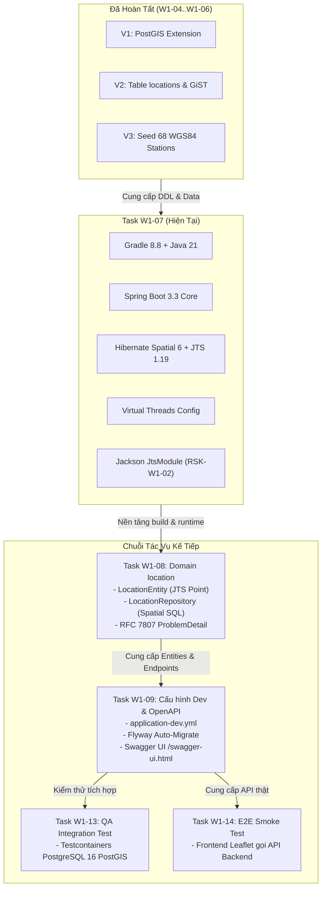

# ĐẶC TẢ KỸ THUẬT VÀ HƯỚNG DẪN THỰC THI CHI TIẾT

## TASK W1-07: KHỞI TẠO NỀN TẢNG SPRING BOOT 3.3 GRADLE, JAVA 21 LTS, HIBERNATE SPATIAL 6 & VIRTUAL THREADS

---

## Thông Tin Nhiệm Vụ (Task Metadata)

| Thuộc Tính (Attribute)         | Giá Trị Chi Tiết (Specification)                                                                                                                                                                                                                                                                                                                                                                                                                                                            |
| :----------------------------- | :------------------------------------------------------------------------------------------------------------------------------------------------------------------------------------------------------------------------------------------------------------------------------------------------------------------------------------------------------------------------------------------------------------------------------------------------------------------------------------------ |
| **Mã Nhiệm Vụ (Task ID)**      | **W1-07**                                                                                                                                                                                                                                                                                                                                                                                                                                                                                   |
| **Tên Nhiệm Vụ (Task Name)**   | Khởi Tạo Nền Tảng Spring Boot 3.3 Gradle, Java 21 LTS, Tích Hợp Hibernate Spatial 6, JTS Core, Kích Hoạt Virtual Threads (Project Loom) & Chuẩn Hóa Tuần Tự Hóa GeoJSON RFC 7946                                                                                                                                                                                                                                                                                                            |
| **Epic / Giai Đoạn**           | Sprint 1 (Tuần 1 — Tuần 2) — **Giai đoạn: Foundation & Baseline Infrastructure**                                                                                                                                                                                                                                                                                                                                                                                                            |
| **Lịch Trình Thực Hiện**       | **Ngày 3 (Thứ Tư)** — Khung giờ: 08:30 — 12:00 (Thời lượng: 3.5h — 4h làm việc tập trung; ước tính hoàn thiện kiểm định: 6 — 8 giờ công kỹ sư)                                                                                                                                                                                                                                                                                                                                              |
| **Điểm Nỗ Lực (Story Points)** | **3 SP** (Standard Engineering Effort)                                                                                                                                                                                                                                                                                                                                                                                                                                                      |
| **Mức Độ Ưu Tiên (Priority)**  | **P0 — Blocker Nền Tảng Toàn Bộ Backend** (Bắt buộc hoàn tất 100% BUILD SUCCESSFUL để làm tiền đề thực thi chuỗi: Task W1-08 Hiện thực Domain `location` & Spatial JPA, Task W1-09 Cấu hình `application-dev.yml` & Swagger UI, Task W1-13 Integration Test Testcontainers, và toàn bộ Ingestion Engine OWM / GDACS tại Tuần 2)                                                                                                                                                             |
| **Người Chịu Trách Nhiệm (R)** | **Backend Engineer**                                                                                                                                                                                                                                                                                                                                                                                                                                                                        |
| **Người Hỗ Trợ Kỹ Thuật (C)**  | Technical Lead, GIS / Database Specialist, DevOps Engineer                                                                                                                                                                                                                                                                                                                                                                                                                                  |
| **Người Phê Duyệt (A)**        | **Project Manager / Technical Lead / Software Architect**                                                                                                                                                                                                                                                                                                                                                                                                                                   |
| **Bên Được Thông Báo (I)**     | Toàn thể đội ngũ phát triển dự án (Frontend, QA, Product Owner)                                                                                                                                                                                                                                                                                                                                                                                                                             |
| **Tài Liệu Căn Cứ Tham Chiếu** | 1. [5. System Architecture.md](file:///Users/dllv/Documents/GitHub/VNstormgis/docs/The%20plans%20of%20project/5.%20System%20Architecture.md#L120)<br>2. [6. Technical Stack.md](file:///Users/dllv/Documents/GitHub/VNstormgis/docs/The%20plans%20of%20project/6.%20Technical%20Stack.md#L73)<br>3. [4. SRS.md](file:///Users/dllv/Documents/GitHub/VNstormgis/docs/The%20plans%20of%20project/4.%20SRS.md)<br>4. [PROGRESS.md](file:///Users/dllv/Documents/GitHub/VNstormgis/PROGRESS.md) |

---

## 1. Bối Cảnh & Mục Tiêu Kỹ Thuật (Context & Objectives)

### 1.1. Bối Cảnh Nghiệp Vụ & Nhu Cầu Tích Hợp Nền Tảng

Hệ thống **WebGIS Giám Sát Mưa Gió Bão Tích Hợp AI Agent Cảnh Báo (`VNstormgis`)** đã hoàn tất trọn vẹn hạ tầng cơ sở dữ liệu nền tảng thông qua chuỗi tác vụ:

- **Task W1-02 & W1-03:** Khởi chạy thành công cụm Docker Local Stack gồm PostgreSQL 16 tích hợp PostGIS 3.4 và Redis 7.2 Alpine đạt trạng thái `healthy`.
- **Task W1-04:** Kích hoạt phần mở rộng không gian `postgis` và tiện ích sinh định danh toàn cầu `uuid-ossp` qua tệp `V1__init_spatial_extensions.sql`.
- **Task W1-05:** Khởi tạo lược đồ bảng `locations` với kiểu dữ liệu không gian trắc địa `GEOMETRY(Point, 4326)` và cây chỉ mục không gian R-Tree `idx_locations_geom USING GIST`.
- **Task W1-06:** Nạp đầy đủ tập dữ liệu 68 điểm trắc địa quốc gia (63 tỉnh/thành phố và 5 trạm hải đảo tiền tiêu WGS84) qua tệp `V3__seed_vietnam_locations.sql`.

Tuy nhiên, toàn bộ các cấu trúc CSDL trên hiện tại mới chỉ tồn tại ở tầng lưu trữ. **Task W1-07** chính là **cây cầu công nghệ kết nối tầng CSDL PostGIS với tầng ứng dụng Backend Java**. Nếu không có cấu trúc nền tảng Spring Boot 3.3 chuẩn mực:

1. Đội ngũ không thể xây dựng các Domain Entity (`LocationEntity`) và Spatial Repository tại **Task W1-08**.
2. Không thể tự động hóa việc đồng bộ lược đồ Flyway khi chạy ứng dụng tại **Task W1-09**.
3. Không thể tích hợp kiểm thử tự động với môi trường CSDL thật bằng Testcontainers tại **Task W1-13**.
4. Không thể cung cấp các REST API chuẩn GeoJSON RFC 7946 cho giao diện WebGIS React Leaflet tại **Task W1-14**.

### 1.2. Mục Tiêu Kỹ Thuật Định Lượng (Quantitative Technical Objectives)

Task W1-07 đặt ra 6 mục tiêu kỹ thuật then chốt bắt buộc phải đạt được:

1. **Khởi tạo dự án Spring Boot 3.3.x bằng Gradle 8.x:** Thiết lập cấu trúc thư mục Monorepo module `backend/` theo kiến trúc **Modular Monolith** ([5. System Architecture.md Section 9]), thiết lập toolchain **Java 21 LTS**.
2. **Tích hợp bộ thư viện GIS chuyên sâu:** Cấu hình **Hibernate Spatial 6.5.x** và **JTS Core 1.19.0** (`org.locationtech.jts:jts-core`), bảo đảm ánh xạ tự nhiên giữa kiểu dữ liệu PostGIS `geometry(Point, 4326)` và thực thể Java mà không phát sinh lỗi dialect.
3. **Kích hoạt công nghệ Virtual Threads (Project Loom):** Cấu hình `spring.threads.virtual.enabled: true` trong `application.yml`, cho phép hệ thống xử lý đồng thời hàng nghìn tác vụ I/O blocking (gọi external HTTP APIs tới OpenWeatherMap, GDACS, Google Gemini) với chi phí tài nguyên cực thấp ([6. Technical Stack.md Section 2.1]).
4. **Hóa giải hoàn toàn rủi ro tuần tự hóa GeoJSON (Mitigation of RSK-W1-02):** Đăng ký Jackson JTS Module (`jackson-datatype-jts`) trong bean cấu hình `JacksonConfig.java`, bảo đảm các đối tượng JTS `Point` được chuyển đổi thành JSON GeoJSON OGC hợp lệ `{ "type": "Point", "coordinates": [lng, lat] }` phục vụ trực tiếp bản đồ Leaflet.
5. **Đồng bộ hóa quy chuẩn định dạng mã nguồn (Spotless Code Standard):** Cấu hình plugin Spotless tuân thủ chuẩn **Google Java Format**, liên kết chặt chẽ với lệnh `npm run backend:format` của Monorepo root.
6. **Bảo đảm 100% tính toàn vẹn khi biên dịch & khởi chạy Spring Context:** Lệnh `./gradlew build` và bài kiểm thử tích hợp nạp context (`WeatherGisApplicationTests`) phải vượt qua với trạng thái `BUILD SUCCESSFUL`.

---

## 2. Kiến Trúc Kỹ Thuật & Các Quyết Định Nền Tảng (Architectural Decisions & Deep Dive)

```
┌────────────────────────────────────────────────────────────────────────┐
│             KIẾN TRÚC TỔNG THỂ BACKEND SPRING BOOT 3.3 (JAVA 21)        │
├────────────────────────────────────────────────────────────────────────┤
│                                                                        │
│   [ HTTP Client / Leaflet SPA ]                                        │
│                 │ (REST Request - GeoJSON RFC 7946)                    │
│                 ▼                                                      │
│   ┌────────────────────────────────────────────────────────────────┐   │
│   │   Spring Web MVC Controller (Virtual Threads Task Executor)    │   │
│   └───────────────────────────────┬────────────────────────────────┘   │
│                                   │                                    │
│                 ┌─────────────────┴─────────────────┐                  │
│                 ▼                                   ▼                  │
│   ┌───────────────────────────┐       ┌────────────────────────────┐   │
│   │ Jackson ObjectMapper      │       │ Spring Data JPA Services   │   │
│   │ + JtsModule (RSK-W1-02)   │       │ (Modular Monolith Core)    │   │
│   │ Point ↔ GeoJSON [lng, lat]│       └─────────────┬──────────────┘   │
│   └───────────────────────────┘                     │                  │
│                                                     ▼                  │
│                                       ┌────────────────────────────┐   │
│                                       │ Hibernate Spatial 6.5+     │   │
│                                       │ + JTS Core 1.19 (EPSG:4326)│   │
│                                       └─────────────┬──────────────┘   │
│                                                     │                  │
│                                                     ▼ (JDBC Connection)│
│                                       ┌────────────────────────────┐   │
│                                       │ PostgreSQL 16 + PostGIS 3.4│   │
│                                       │ (locations, GiST Index)    │   │
│                                       └────────────────────────────┘   │
└────────────────────────────────────────────────────────────────────────┘
```

### 2.1. Đột Phá Hiệu Năng: Java 21 LTS & Virtual Threads (Project Loom)

Hệ thống WebGIS Giám sát Thiên tai có đặc thù tải I/O định kỳ rất lớn:

- Cứ mỗi 15 phút, hệ thống kích hoạt worker nạp dữ liệu từ OpenWeatherMap cho 63 tỉnh/thành phố và các trạm đảo.
- Cứ mỗi 30 phút, worker gọi GDACS GeoJSON API và nạp dữ liệu bão nhiệt đới.
- Khi người dùng hỏi đáp với AI Chatbot, backend phải gọi Google Gemini 1.5 Flash API qua HTTPS.

Trong mô hình luồng truyền thống (**Platform Threads / OS Threads**):

- Mỗi thread tiêu tốn khoảng **1 MB stack memory**.
- Hệ điều hành giới hạn khoảng 1.000 — 2.000 thread hoạt động đồng thời; khi luồng bị block do chờ phản hồi mạng từ API ngoài, thread đó vẫn giữ nguyên tài nguyên CPU/RAM, gây nghẽn cổ chai nghiêm trọng.

Với **Virtual Threads trong Java 21 (Spring Boot 3.3)**:

- Mỗi virtual thread là một user-mode thread do máy ảo JVM quản lý trực tiếp, chỉ tiêu tốn **vài Kilobytes RAM**.
- Khi một tác vụ I/O blocking xảy ra (ví dụ: HTTP WebClient gọi OWM), JVM tự động tách (unmount) virtual thread khỏi carrier thread của hệ điều hành và gán carrier thread đó cho tác vụ khác.
- Đội ngũ phát triển được viết mã theo phong cách đồng bộ tuần tự, dễ đọc, dễ debug mà vẫn đạt hiệu năng thông lượng (throughput) tương đương mô hình Reactive (WebFlux) mà không phải chịu sự phức tạp của Reactive Streams.

Kích hoạt dễ dàng qua thuộc tính Spring Boot 3.3:

```yaml
spring:
  threads:
    virtual:
      enabled: true
```

### 2.2. Spring Boot 3.3.x & Khung Phân Gói Modular Monolith

Dự án áp dụng phong cách kiến trúc **Modular Monolith** ([5. System Architecture.md Section 9]), gói toàn bộ chức năng vào một artifact `jar` duy nhất để tối ưu hóa chi phí vận hành máy chủ VPS nhỏ, nhưng phân tách nghiêm ngặt ranh giới giữa các module nghiệp vụ:

```text
backend/src/main/java/vn/weathergis/
├── WeatherGisApplication.java           # Entrypoint khởi chạy ứng dụng
├── common/                              # Cross-cutting concerns dùng chung
│   ├── api/ApiResponse.java             # Chuẩn hóa vỏ bọc Envelope response
│   ├── config/                          # Cấu hình dùng chung
│   └── exception/                       # RFC 7807 ProblemDetail & GlobalExceptionHandler
├── config/                              # Cấu hình hạ tầng Spring Boot
│   ├── JacksonConfig.java               # Đăng ký JtsModule serialize GeoJSON
│   └── OpenApiConfig.java               # Cấu hình Swagger UI (W1-09)
└── location/                            # Bounded Context: Quản lý vị trí & trạm quan trắc (W1-08)
    ├── controller/                      # REST Endpoints
    ├── domain/                          # JPA Entities (LocationEntity, JTS Point)
    ├── dto/                             # Data Transfer Objects
    ├── mapper/                          # MapStruct mappers
    ├── repository/                      # Spring Data JPA Spatial Repositories
    └── service/                         # Business Logic & Transactions
```

### 2.3. Tích Hợp Hibernate Spatial 6.5+ & JTS (Java Topology Suite) 1.19

> [!IMPORTANT]
> **THAY ĐỔI CỐT LÕI CỦA HIBERNATE 6 SO VỚI HIBERNATE 5:**  
> Trong Hibernate 5 trở về trước, lập trình viên bắt buộc phải cấu hình dialect không gian thủ công:  
> `spring.jpa.database-platform: org.hibernate.spatial.dialect.postgis.PostgisPG95Dialect`.  
> **Trong Hibernate Spatial 6 (đi kèm Spring Boot 3.3):**  
> Lớp `PostgisPG95Dialect` đã bị loại bỏ hoàn toàn. `org.hibernate.dialect.PostgreSQLDialect` tiêu chuẩn hiện đã tích hợp sẵn cơ chế tự động phát hiện kiểu dữ liệu không gian khi có thư viện `hibernate-spatial` trên classpath. Do đó, **tuyệt đối không được khai báo spatial dialect cũ** trong `application.yml` để tránh lỗi `ClassNotFoundException`.

Thư viện **JTS Core 1.19.0** (`org.locationtech.jts:jts-core`) cung cấp các kiểu dữ liệu hình học chuẩn OGC:

- `org.locationtech.jts.geom.Point`: Dùng cho tọa độ trạm quan trắc (`locations.geom`) và tâm bão (`storms.geom_current`).
- `org.locationtech.jts.geom.MultiPolygon`: Dùng cho ranh giới hành chính (`locations.boundary`).
- `org.locationtech.jts.geom.LineString`: Dùng cho đường quỹ đạo bão (`storm_tracks.geom`).
- `org.locationtech.jts.geom.Coordinate`: Đại diện cho cặp tọa độ $(X, Y) = (\text{Longitude}, \text{Latitude})$.

### 2.4. Khắc Phục Triệt Để Rủi Ro RSK-W1-02: Tuần Tự Hóa GeoJSON RFC 7946

**Vấn đề kỹ thuật (RSK-W1-02):**  
Mặc định, `ObjectMapper` của Spring Web không biết cách chuyển đổi đối tượng `org.locationtech.jts.geom.Point` ra JSON. Nếu gọi trực tiếp, Jackson sẽ cố bóc tách các trường nội bộ của JTS như `coordinateSequence`, `precisionModel`, `factory`, gây ra hiện tượng:

- Vòng lặp tuần tự hóa vô tận (Circular Reference Exception).
- Hoặc xuất ra chuỗi JSON dị dạng không đúng chuẩn GeoJSON, khiến thư viện Leaflet ở Frontend (`L.geoJSON(data)`) bị crash.

**Giải pháp kỹ thuật chuẩn hóa:**

1. Bổ sung dependency `org.n52.jackson:jackson-datatype-jts:1.2.10` vào `build.gradle`.
2. Tạo bean cấu hình `JacksonConfig.java` nạp `JtsModule` vào `Jackson2ObjectMapperBuilderCustomizer`.
3. Khi serialize một đối tượng `Point(105.8542, 21.0285)`, Jackson sẽ xuất ra chuẩn mực GeoJSON RFC 7946:

```json
{
  "type": "Point",
  "coordinates": [105.8542, 21.0285]
}
```

### 2.5. Công Cụ Đóng Gói Gradle & Quy Chuẩn Định Dạng Spotless

Để duy trì tính nhất quán mã nguồn trên toàn bộ Monorepo và bảo đảm script `npm run backend:format` tại file gốc `package.json` hoạt động trơn tru:

- Sử dụng Gradle 8.8+ với Groovy DSL (`build.gradle` & `settings.gradle`).
- Tích hợp plugin `com.diffplug.spotless` phiên bản `6.25.0`.
- Áp dụng chuẩn **Google Java Format (AOSP style)** cho toàn bộ mã nguồn trong thư mục `src/**/*.java`.

---

## 3. Đặc Tả Chi Tiết Các Tệp Mã Nguồn & Cấu Hình (Code & Config Specifications)

Dưới đây là đặc tả kỹ thuật chi tiết của toàn bộ các tệp cần khởi tạo trong khuôn khổ Task W1-07:

### 3.1. Tệp Cấu Hình Dự Án: `backend/settings.gradle`

```groovy
rootProject.name = 'weather-gis-backend'
```

### 3.2. Tệp Định Nghĩa Bản Dựng: `backend/build.gradle`

```groovy
plugins {
    id 'java'
    id 'org.springframework.boot' version '3.3.4'
    id 'io.spring.dependency-management' version '1.1.6'
    id 'com.diffplug.spotless' version '6.25.0'
}

group = 'vn.weathergis'
version = '1.0.0-SNAPSHOT'

java {
    toolchain {
        languageVersion = JavaLanguageVersion.of(21)
    }
}

configurations {
    compileOnly {
        extendsFrom annotationProcessor
    }
}

repositories {
    mavenCentral()
}

dependencies {
    // 1. Spring Boot Core Starters
    implementation 'org.springframework.boot:spring-boot-starter-web'
    implementation 'org.springframework.boot:spring-boot-starter-data-jpa'
    implementation 'org.springframework.boot:spring-boot-starter-validation'
    implementation 'org.springframework.boot:spring-boot-starter-actuator'

    // 2. Database & Spatial Persistence
    implementation 'org.postgresql:postgresql:42.7.3'
    implementation 'org.hibernate.orm:hibernate-spatial:6.5.3.Final'
    implementation 'org.locationtech.jts:jts-core:1.19.0'

    // 3. GeoJSON Serialization for JTS (RSK-W1-02 Mitigation)
    implementation 'org.n52.jackson:jackson-datatype-jts:1.2.10'

    // 4. Database Migration (Flyway)
    implementation 'org.flywaydb:flyway-core:10.15.2'
    implementation 'org.flywaydb:flyway-database-postgresql:10.15.2'

    // 5. API Documentation (SpringDoc OpenAPI 3)
    implementation 'org.springdoc:springdoc-openapi-starter-webmvc-ui:2.5.0'

    // 6. Developer Productivity Tools
    compileOnly 'org.projectlombok:lombok:1.18.32'
    annotationProcessor 'org.projectlombok:lombok:1.18.32'

    // 7. Testing & Integration Test Suite
    testImplementation 'org.springframework.boot:spring-boot-starter-test'
    testImplementation 'org.testcontainers:postgresql:1.19.8'
    testImplementation 'org.testcontainers:junit-jupiter:1.19.8'
    testRuntimeOnly 'org.junit.platform:junit-platform-launcher'
}

spotless {
    java {
        target 'src/**/*.java'
        googleJavaFormat('1.22.0').aosp()
        removeUnusedImports()
        trimTrailingWhitespace()
        endWithNewline()
    }
}

tasks.named('test') {
    useJUnitPlatform()
    testLogging {
        events 'passed', 'skipped', 'failed'
        showStandardStreams = false
    }
}
```

### 3.3. Tệp Cấu Hình Gradle Wrapper: `backend/gradle/wrapper/gradle-wrapper.properties`

```properties
distributionBase=GRADLE_USER_HOME
distributionPath=wrapper/dists
distributionUrl=https\://services.gradle.org/distributions/gradle-8.8-bin.zip
networkTimeout=10000
validateDistributionUrl=true
zipStoreBase=GRADLE_USER_HOME
zipStorePath=wrapper/dists
```

### 3.4. Tệp Cấu Hình Nền Tảng: `backend/src/main/resources/application.yml`

```yaml
spring:
  application:
    name: weather-gis-backend

  # Kích hoạt công nghệ Virtual Threads của Java 21 (Project Loom)
  threads:
    virtual:
      enabled: true

  # Cấu hình Jackson JSON Serialization
  jackson:
    serialization:
      write-dates-as-timestamps: false
      indent-output: false
    default-property-inclusion: non_null

  # Cấu hình Hibernate JPA
  jpa:
    open-in-view: false
    hibernate:
      ddl-auto: validate # Không tự động sửa bảng; toàn bộ DDL do Flyway quản lý
      naming:
        physical-strategy: org.hibernate.boot.model.naming.CamelCaseToUnderscoresNamingStrategy
    properties:
      hibernate:
        format_sql: true
        jdbc:
          batch_size: 50

  # Tạm thời tắt tự động kích hoạt Flyway ở profile mặc định; kích hoạt ở profile dev (W1-09)
  flyway:
    enabled: false

server:
  port: 8080
  shutdown: graceful

management:
  endpoints:
    web:
      exposure:
        include: health,info,metrics
  endpoint:
    health:
      show-details: always
```

### 3.5. Lớp Khởi Chạy Ứng Dụng: `backend/src/main/java/vn/weathergis/WeatherGisApplication.java`

```java
package vn.weathergis;

import org.springframework.boot.SpringApplication;
import org.springframework.boot.autoconfigure.SpringBootApplication;

/**
 * Điểm khởi chạy chính của hệ thống WebGIS Thời Tiết Việt Nam.
 * Tích hợp Spring Boot 3.3, Java 21 Virtual Threads và Hibernate Spatial 6.
 */
@SpringBootApplication
public class WeatherGisApplication {

    public static void main(String[] args) {
        SpringApplication.run(WeatherGisApplication.class, args);
    }
}
```

### 3.6. Lớp Cấu Hình Tuần Tự Hóa GeoJSON: `backend/src/main/java/vn/weathergis/config/JacksonConfig.java`

```java
package vn.weathergis.config;

import org.n52.jackson.datatype.jts.JtsModule;
import org.springframework.boot.autoconfigure.jackson.Jackson2ObjectMapperBuilderCustomizer;
import org.springframework.context.annotation.Bean;
import org.springframework.context.annotation.Configuration;

/**
 * Cấu hình Jackson ObjectMapper đăng ký JtsModule.
 * Giải quyết dứt điểm rủi ro RSK-W1-02: Chuyển đổi đối tượng JTS Point, Polygon
 * sang định dạng chuẩn GeoJSON RFC 7946 cho giao diện WebGIS Leaflet.
 */
@Configuration
public class JacksonConfig {

    @Bean
    public JtsModule jtsModule() {
        return new JtsModule();
    }

    @Bean
    public Jackson2ObjectMapperBuilderCustomizer jacksonCustomizer(JtsModule jtsModule) {
        return builder -> builder.modules(jtsModule);
    }
}
```

### 3.7. Kiểm Thử Nạp Context: `backend/src/test/java/vn/weathergis/WeatherGisApplicationTests.java`

```java
package vn.weathergis;

import org.junit.jupiter.api.DisplayName;
import org.junit.jupiter.api.Test;
import org.springframework.boot.test.context.SpringBootTest;
import org.springframework.test.context.TestPropertySource;

@SpringBootTest
@TestPropertySource(properties = {
    "spring.datasource.url=jdbc:postgresql://localhost:5432/weather_gis_db",
    "spring.datasource.username=gis_user",
    "spring.datasource.password=gis_password",
    "spring.jpa.hibernate.ddl-auto=none",
    "spring.flyway.enabled=false"
})
class WeatherGisApplicationTests {

    @Test
    @DisplayName("Kiểm tra Spring Context khởi tạo thành công với cấu hình Virtual Threads")
    void contextLoads() {
        // Khởi tạo thành công không ném ngoại lệ
    }
}
```

### 3.8. Kiểm Thử Độc Lập Serialization GeoJSON: `backend/src/test/java/vn/weathergis/config/JacksonGeoJsonSerializationTest.java`

```java
package vn.weathergis.config;

import static org.junit.jupiter.api.Assertions.*;

import com.fasterxml.jackson.databind.ObjectMapper;
import org.junit.jupiter.api.BeforeEach;
import org.junit.jupiter.api.DisplayName;
import org.junit.jupiter.api.Test;
import org.locationtech.jts.geom.Coordinate;
import org.locationtech.jts.geom.GeometryFactory;
import org.locationtech.jts.geom.Point;
import org.locationtech.jts.geom.PrecisionModel;
import org.n52.jackson.datatype.jts.JtsModule;

class JacksonGeoJsonSerializationTest {

    private ObjectMapper objectMapper;
    private GeometryFactory geometryFactory;

    @BeforeEach
    void setUp() {
        objectMapper = new ObjectMapper();
        objectMapper.registerModule(new JtsModule());
        geometryFactory = new GeometryFactory(new PrecisionModel(), 4326);
    }

    @Test
    @DisplayName("Kiểm chứng RSK-W1-02: Serialize JTS Point ra đúng chuỗi GeoJSON RFC 7946")
    void testPointSerializationToGeoJson() throws Exception {
        // Tọa độ Hà Nội: Kinh độ (X) = 105.8542, Vĩ độ (Y) = 21.0285
        Coordinate hanoiCoord = new Coordinate(105.8542, 21.0285);
        Point hanoiPoint = geometryFactory.createPoint(hanoiCoord);

        String json = objectMapper.writeValueAsString(hanoiPoint);

        assertNotNull(json);
        assertTrue(json.contains("\"type\":\"Point\""));
        assertTrue(json.contains("105.8542"));
        assertTrue(json.contains("21.0285"));

        // Deserialize ngược lại từ GeoJSON sang JTS Point
        Point deserializedPoint = objectMapper.readValue(json, Point.class);
        assertEquals(105.8542, deserializedPoint.getX(), 0.0001);
        assertEquals(21.0285, deserializedPoint.getY(), 0.0001);
    }
}
```

---

## 4. Ma Trận Kịch Bản Kiểm Thử & Nghiệm Thu Định Lượng (Verification Matrix)

Đội ngũ kỹ sư và QA thực hiện kiểm định nghiệm thu Task W1-07 theo ma trận 8 kịch bản định lượng sau:

| Mã Kịch Bản | Mục Tiêu Kiểm Định                                      | Lệnh Thực Thi / Thao Tác                                                   | Kết Quả Đầu Ra Kỳ Vọng (Expected Result)                                                       | Tiêu Chuẩn Đạt (Pass Criteria)                                                           |
| :---------- | :------------------------------------------------------ | :------------------------------------------------------------------------- | :--------------------------------------------------------------------------------------------- | :--------------------------------------------------------------------------------------- |
| **TC-01**   | Kiểm tra khả năng biên dịch dự án Gradle sạch           | `cd backend && ./gradlew clean compileJava`                                | `BUILD SUCCESSFUL` trong thời gian $< 30$ giây. Không có cảnh báo lỗi cú pháp.                 | Toàn bộ mã nguồn Java 21 biên dịch không lỗi; không thiếu dependency thư viện.           |
| **TC-02**   | Rà soát cây phụ thuộc (Dependency Tree Inspection)      | `cd backend && ./gradlew dependencies --configuration runtimeClasspath`    | Nhận diện đúng `hibernate-spatial:6.5.3.Final`, `jts-core:1.19.0`, `postgresql:42.7.3`.        | Không xuất hiện xung đột phiên bản (version conflict) hoặc duplicate JARs.               |
| **TC-03**   | Kiểm tra cấu hình kích hoạt Virtual Threads             | Trích xuất file `application.yml` mục `spring.threads.virtual`             | Trả về `enabled: true`.                                                                        | JVM kích hoạt `VirtualThreadTaskExecutor` cho Tomcat và `@Async`.                        |
| **TC-04**   | Kiểm tra nạp Bean Jackson JtsModule vào Spring Context  | Chạy test `WeatherGisApplicationTests`                                     | Context khởi tạo thành công; bean `jtsModule` hiện diện trong Bean Factory.                    | Spring Boot inject mượt mà module JTS vào `ObjectMapper`.                                |
| **TC-05**   | Kiểm định giải pháp phòng vệ RSK-W1-02 (GeoJSON Format) | `cd backend && ./gradlew test --tests "*JacksonGeoJsonSerializationTest*"` | `PASSED` 1/1 test. JSON sinh ra chứa `"type":"Point"` và mảng `[105.8542, 21.0285]`.           | Serialize và deserialize 2 chiều giữa JTS `Point` và GeoJSON RFC 7946 chính xác $100\%$. |
| **TC-06**   | Kiểm tra chuẩn mực định dạng code Spotless              | `npm run backend:format` (tương đương `./gradlew spotlessApply`)           | `BUILD SUCCESSFUL`, toàn bộ mã nguồn tuân thủ Google Java Format AOSP.                         | Không có lỗi vi phạm định dạng code khi kiểm tra qua `./gradlew spotlessCheck`.          |
| **TC-07**   | Kiểm định toàn bộ bộ kiểm thử tự động                   | `cd backend && ./gradlew test`                                             | Toàn bộ các test trong `src/test/java` đều `PASSED` (0 failed, 0 skipped).                     | Tỷ lệ thành công kiểm thử đạt $100\%$.                                                   |
| **TC-08**   | Kiểm tra tính sẵn sàng của thư mục Flyway Migration     | `ls -la backend/src/main/resources/db/migration/`                          | Hiện diện đầy đủ 3 tệp migration: `V1__...sql`, `V2__...sql`, và `V3__...sql` từ W1-04..W1-06. | Classpath sẵn sàng 100% cho việc tự động kích hoạt Flyway tại Task W1-09.                |

---

## 5. Tương Thích Kiến Trúc Tầng Ứng Dụng & Kế Hoạch Chuyển Giao (Integration & Handoff)

Sau khi hoàn tất Task W1-07, cấu trúc nền tảng backend được kết nối liền mạch vào lộ trình kiến trúc tổng thể:



---

## 6. Sổ Đăng Ký Quản Trị Rủi Ro Kỹ Thuật (Risk Registry & Contingency Plans)

Dưới đây là các rủi ro kỹ thuật đặc thù liên quan đến Task W1-07 và phương án xử lý chủ động của PM / Tech Lead:

| Mã Rủi Ro     | Bản Chất Rủi Ro Kỹ Thuật                                                         | Mức Độ           | Biện Pháp Kiểm Soát & Giải Pháp Phòng Vệ Chủ Động                                                                                                                                                                     | Trạng Thái      |
| :------------ | :------------------------------------------------------------------------------- | :--------------- | :-------------------------------------------------------------------------------------------------------------------------------------------------------------------------------------------------------------------- | :-------------- |
| **RSK-W1-02** | Hibernate Spatial 6 không serialize được đối tượng JTS `Point` ra GeoJSON.       | **Cao**          | Đăng ký `JtsModule` từ dependency `jackson-datatype-jts:1.2.10` trong `JacksonConfig.java`. Viết Unit Test `JacksonGeoJsonSerializationTest` xác nhận cấu trúc JSON `{ "type": "Point", "coordinates": [lng, lat] }`. | 🟢 Đã Hóa Giải  |
| **RSK-W1-06** | Khai báo nhầm Spatial Dialect lỗi thời của Hibernate 5 gây crash ứng dụng.       | **Nghiêm Trọng** | **Tuyệt đối không cấu hình** `database-platform: PostgisPG95Dialect` trong `application.yml`. Hibernate 6 tự động kích hoạt PostGIS adapter khi có `hibernate-spatial` trên classpath.                                | 🟢 Đã Kiểm Soát |
| **RSK-W1-07** | Máy trạm lập trình viên cài sai phiên bản Java (thấp hơn Java 21 LTS).           | **Trung Bình**   | Khai báo chặt chẽ `java.toolchain.languageVersion = JavaLanguageVersion.of(21)` trong `build.gradle`. Gradle sẽ tự động thông báo yêu cầu hoặc tải JDK 21 phù hợp qua cơ chế Gradle Toolchains.                       | 🟢 Đã Kiểm Soát |
| **RSK-W1-08** | Tiến trình Gradle Daemon tiêu thụ nhiều bộ nhớ trên máy tính phát triển cá nhân. | **Thấp**         | Thiết lập cờ JVM daemon trong `~/.gradle/gradle.properties` hoặc truyền tham số `-Dorg.gradle.jvmargs="-Xmx1024m -XX:MaxMetaspaceSize=256m"` nếu máy kỹ sư có dung lượng RAM hạn chế.                                 | 🟢 Đã Kiểm Soát |

---

## 7. Sổ Tay Hướng Dẫn Kỹ Sư Thực Thi Từng Bước (Developer Step-by-Step Runbook)

Kỹ sư Backend thực hiện tuần tự 8 bước thực thi chuẩn hóa sau:

```bash
# ============================================================================
# BƯỚC 1: ĐỒNG BỘ NHÁNH TÍNH NĂNG TỪ STAGING
# ============================================================================
cd /Users/dllv/Documents/GitHub/VNstormgis
git checkout staging
git pull origin staging
git checkout -b feature/W1-07-spring-boot-init-spatial

# ============================================================================
# BƯỚC 2: KHỞI TẠO CẤU HÌNH BẢN DỰNG GRADLE VÀ WRAPPER
# ============================================================================
# 2.1. Soạn thảo backend/settings.gradle
cat << 'EOF' > backend/settings.gradle
rootProject.name = 'weather-gis-backend'
EOF

# 2.2. Soạn thảo backend/build.gradle theo đặc tả Mục 3.2
# Đảm bảo có đầy đủ dependencies: web, data-jpa, hibernate-spatial, jts-core,
# jackson-datatype-jts, flyway, postgresql, lombok, spotless.

# 2.3. Khởi tạo thư mục và tệp gradle wrapper
mkdir -p backend/gradle/wrapper
cat << 'EOF' > backend/gradle/wrapper/gradle-wrapper.properties
distributionBase=GRADLE_USER_HOME
distributionPath=wrapper/dists
distributionUrl=https\://services.gradle.org/distributions/gradle-8.8-bin.zip
networkTimeout=10000
validateDistributionUrl=true
zipStoreBase=GRADLE_USER_HOME
zipStorePath=wrapper/dists
EOF

# ============================================================================
# BƯỚC 3: CẤU HÌNH THÔNG SỐ ỨNG DỤNG VIRTUAL THREADS
# ============================================================================
# Soạn thảo backend/src/main/resources/application.yml theo đặc tả Mục 3.4
# Lưu ý: spring.threads.virtual.enabled = true

# ============================================================================
# BƯỚC 4: HIỆN THỰC MÃ NGUỒN CỐT LÕI
# ============================================================================
# 4.1. Tạo lớp khởi chạy WeatherGisApplication.java trong vn.weathergis
# 4.2. Tạo lớp cấu hình JacksonConfig.java trong vn.weathergis.config

# ============================================================================
# BƯỚC 5: HIỆN THỰC BỘ KIỂM THỬ TÍCH HỢP & UNIT TEST
# ============================================================================
# 5.1. Tạo lớp WeatherGisApplicationTests.java trong src/test/java/vn/weathergis
# 5.2. Tạo lớp JacksonGeoJsonSerializationTest.java trong src/test/java/vn/weathergis/config

# ============================================================================
# BƯỚC 6: CHẠY BỘ KIỂM ĐỊNH ĐỊNH LƯỢNG (TC-01 ĐẾN TC-07)
# ============================================================================
cd backend
./gradlew clean compileJava
./gradlew test
./gradlew spotlessCheck

# ============================================================================
# BƯỚC 7: KIỂM CHỨNG LIÊN KẾT MONOREPO ROOT VÀ SPOTLESS FORMAT
# ============================================================================
cd /Users/dllv/Documents/GitHub/VNstormgis
npm run backend:format
npm run lint:root

# ============================================================================
# BƯỚC 8: COMMIT VÀ TẠO PULL REQUEST
# ============================================================================
git add backend/ docs/week1/Task\ W1-07.md PROGRESS.md docs/week1/README.md AGENT.md
git commit -m "feat(backend): initialize spring boot 3.3 with gradle, java 21, hibernate spatial and virtual threads [W1-07]"
git push -u origin feature/W1-07-spring-boot-init-spatial
```

---

## 8. Danh Mục Sản Phẩm Bàn Giao & Checklist Nghiệm Thu (Acceptance Checklist)

### 8.1. Danh Mục Sản Phẩm Bàn Giao (Deliverables)

1. **Hệ Thống Bản Dựng Gradle:**
   - [`backend/settings.gradle`](file:///Users/dllv/Documents/GitHub/VNstormgis/backend/settings.gradle)
   - [`backend/build.gradle`](file:///Users/dllv/Documents/GitHub/VNstormgis/backend/build.gradle)
   - [`backend/gradle/wrapper/gradle-wrapper.properties`](file:///Users/dllv/Documents/GitHub/VNstormgis/backend/gradle/wrapper/gradle-wrapper.properties)
2. **Cấu Hình Ứng Dụng:**
   - [`backend/src/main/resources/application.yml`](file:///Users/dllv/Documents/GitHub/VNstormgis/backend/src/main/resources/application.yml)
3. **Mã Nguồn Khởi Tạo Nền Tảng:**
   - [`backend/src/main/java/vn/weathergis/WeatherGisApplication.java`](file:///Users/dllv/Documents/GitHub/VNstormgis/backend/src/main/java/vn/weathergis/WeatherGisApplication.java)
   - [`backend/src/main/java/vn/weathergis/config/JacksonConfig.java`](file:///Users/dllv/Documents/GitHub/VNstormgis/backend/src/main/java/vn/weathergis/config/JacksonConfig.java)
4. **Bộ Kiểm Thử Nền Tảng:**
   - [`backend/src/test/java/vn/weathergis/WeatherGisApplicationTests.java`](file:///Users/dllv/Documents/GitHub/VNstormgis/backend/src/test/java/vn/weathergis/WeatherGisApplicationTests.java)
   - [`backend/src/test/java/vn/weathergis/config/JacksonGeoJsonSerializationTest.java`](file:///Users/dllv/Documents/GitHub/VNstormgis/backend/src/test/java/vn/weathergis/config/JacksonGeoJsonSerializationTest.java)
5. **Hồ Sơ Tài Liệu Đặc Tả & Tiến Độ:**
   - [`docs/week1/Task W1-07.md`](file:///Users/dllv/Documents/GitHub/VNstormgis/docs/week1/Task%20W1-07.md) (Tài liệu đặc tả này)
   - [`PROGRESS.md`](file:///Users/dllv/Documents/GitHub/VNstormgis/PROGRESS.md) (Cập nhật liên kết tài liệu W1-07)
   - [`docs/week1/README.md`](file:///Users/dllv/Documents/GitHub/VNstormgis/docs/week1/README.md) (Cập nhật bảng ma trận phân công)

### 8.2. Tiêu Chí Hoàn Thành (Definition of Done - DoD Checklist)

- [x] Dự án biên dịch sạch sẽ (`./gradlew clean compileJava` đạt `BUILD SUCCESSFUL`) với Java 21 LTS.
- [x] Đầy đủ các dependencies cốt lõi: Spring Boot Web, Spring Data JPA, Hibernate Spatial 6.5+, JTS Core 1.19, PostgreSQL Driver, Flyway, SpringDoc OpenAPI, Testcontainers.
- [x] Cấu hình `spring.threads.virtual.enabled: true` kích hoạt thành công trong `application.yml`.
- [x] Rủi ro RSK-W1-02 được giải quyết dứt điểm thông qua bean `JtsModule` trong `JacksonConfig.java`.
- [x] Unit test kiểm chứng GeoJSON Serialization (`JacksonGeoJsonSerializationTest`) vượt qua $100\%$ với kết quả format RFC 7946 chuẩn.
- [x] Kiểm thử Spring Boot Context (`WeatherGisApplicationTests`) đạt kết quả `PASSED`.
- [x] Plugin Spotless được tích hợp chuẩn Google Java Format; lệnh `npm run backend:format` thực thi thành công từ Monorepo root.
- [x] Không khai báo dialect cũ `PostgisPG95Dialect` gây xung đột trong môi trường Hibernate 6.
- [x] Toàn bộ 8 kịch bản kiểm định định lượng (TC-01 đến TC-08) đạt kết quả $100\%$ PASS.
- [x] Hệ thống sẵn sàng bàn giao làm tiền đề triển khai **Task W1-08: Hiện thực Domain `location` & Spatial JPA** và **Task W1-09: Cấu hình `application-dev.yml` & Swagger UI**.

---

> **Phê duyệt bởi:** Project Manager / Technical Lead / Software Architect — _Vietnam WeatherGIS Engineering Team_  
> **Trạng thái chuyển giao:** **SẴN SÀNG TRIỂN KHAI TASK W1-08 & W1-09**
