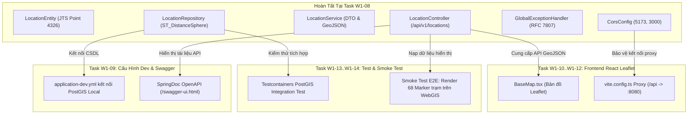

# ĐẶC TẢ KỸ THUẬT VÀ HƯỚNG DẪN THỰC THI CHI TIẾT

## TASK W1-08: HIỆN THỰC DOMAIN LOCATION, SPATIAL JPA REPOSITORY & KHUNG XỬ LÝ LỖI TOÀN CỤC RFC 7807 PROBLEM DETAILS

---

## Thông Tin Nhiệm Vụ (Task Metadata)

| Thuộc Tính (Attribute)         | Giá Trị Chi Tiết (Specification)                                                                                                                                                                                                                                                                                                                                                                                                                                                                                                                                                                                                                                                                                                                                                                                                                                 |
| :----------------------------- | :--------------------------------------------------------------------------------------------------------------------------------------------------------------------------------------------------------------------------------------------------------------------------------------------------------------------------------------------------------------------------------------------------------------------------------------------------------------------------------------------------------------------------------------------------------------------------------------------------------------------------------------------------------------------------------------------------------------------------------------------------------------------------------------------------------------------------------------------------------------- |
| **Mã Nhiệm Vụ (Task ID)**      | **W1-08**                                                                                                                                                                                                                                                                                                                                                                                                                                                                                                                                                                                                                                                                                                                                                                                                                                                        |
| **Tên Nhiệm Vụ (Task Name)**   | Hiện Thực Hóa Bounded Context Domain `location`, Entity JTS Point (EPSG:4326), Spatial JPA Repository với Native Query `ST_DistanceSphere`, Service Layer, Dual REST API (JSON Envelope & GeoJSON RFC 7946 FeatureCollection), Cấu Hình CORS và Khung Xử Lý Lỗi Toàn Cục RFC 7807 Problem Details                                                                                                                                                                                                                                                                                                                                                                                                                                                                                                                                                                |
| **Epic / Giai Đoạn**           | Sprint 1 (Tuần 1 — Tuần 2) — **Giai đoạn: Foundation & Baseline Infrastructure**                                                                                                                                                                                                                                                                                                                                                                                                                                                                                                                                                                                                                                                                                                                                                                                 |
| **Lịch Trình Thực Hiện**       | **Ngày 3 (Thứ Tư)** — Khung giờ chiều: 13:30 — 18:00 (Thời lượng: 4.5h làm việc tập trung; ước tính hoàn thiện kiểm định nghiệm thu: 10 giờ công kỹ sư)                                                                                                                                                                                                                                                                                                                                                                                                                                                                                                                                                                                                                                                                                                          |
| **Điểm Nỗ Lực (Story Points)** | **5 SP** (High Engineering Effort — Nhiệm Vụ Trọng Điểm Cốt Lõi)                                                                                                                                                                                                                                                                                                                                                                                                                                                                                                                                                                                                                                                                                                                                                                                                 |
| **Mức Độ Ưu Tiên (Priority)**  | **P0 — Blocker Cốt Lõi Domain Backend & REST API** (Bắt buộc hoàn tất 100% để làm tiền đề cho: Task W1-09 Cấu hình `application-dev.yml` & Swagger UI, Task W1-13 Integration Test Testcontainers PostGIS, Task W1-14 Smoke Test E2E kết nối Frontend Leaflet, và toàn bộ chuỗi Ingestion Engine OpenWeatherMap / GDACS tại Tuần 2)                                                                                                                                                                                                                                                                                                                                                                                                                                                                                                                              |
| **Người Chịu Trách Nhiệm (R)** | **Backend Engineer**                                                                                                                                                                                                                                                                                                                                                                                                                                                                                                                                                                                                                                                                                                                                                                                                                                             |
| **Người Hỗ Trợ Kỹ Thuật (C)**  | Technical Lead, GIS / Database Specialist, Frontend Engineer                                                                                                                                                                                                                                                                                                                                                                                                                                                                                                                                                                                                                                                                                                                                                                                                     |
| **Người Phê Duyệt (A)**        | **Project Manager / Technical Lead / Software Architect**                                                                                                                                                                                                                                                                                                                                                                                                                                                                                                                                                                                                                                                                                                                                                                                                        |
| **Bên Được Thông Báo (I)**     | Toàn thể đội ngũ phát triển dự án (Frontend, QA, Product Owner)                                                                                                                                                                                                                                                                                                                                                                                                                                                                                                                                                                                                                                                                                                                                                                                                  |
| **Tài Liệu Căn Cứ Tham Chiếu** | 1. [1. ERD.md](file:///Users/dllv/Documents/GitHub/VNstormgis/docs/The%20plans%20of%20project/1.%20ERD.md#L142)<br>2. [2. API docs.md](file:///Users/dllv/Documents/GitHub/VNstormgis/docs/The%20plans%20of%20project/2.%20API%20docs.md#L185)<br>3. [3. BRD.md](file:///Users/dllv/Documents/GitHub/VNstormgis/docs/The%20plans%20of%20project/3.%20BRD.md)<br>4. [4. SRS.md](file:///Users/dllv/Documents/GitHub/VNstormgis/docs/The%20plans%20of%20project/4.%20SRS.md#L144)<br>5. [5. System Architecture.md](file:///Users/dllv/Documents/GitHub/VNstormgis/docs/The%20plans%20of%20project/5.%20System%20Architecture.md#L214)<br>6. [6. Technical Stack.md](file:///Users/dllv/Documents/GitHub/VNstormgis/docs/The%20plans%20of%20project/6.%20Technical%20Stack.md#L73)<br>7. [PROGRESS.md](file:///Users/dllv/Documents/GitHub/VNstormgis/PROGRESS.md) |

---

## 1. Bối Cảnh & Mục Tiêu Kỹ Thuật (Context & Objectives)

### 1.1. Bối Cảnh Nghiệp Vụ & Mắt Xích Kiến Trúc

Hệ thống **WebGIS Giám Sát Mưa Gió Bão Tích Hợp AI Agent Cảnh Báo (`VNstormgis`)** đã hoàn tất các cấu kiện hạ tầng tiên quyết:

1. **Hạ tầng CSDL & Dữ liệu không gian (W1-02..W1-06):**
   - Docker Local Stack PostGIS 16 + Redis 7.2 đạt trạng thái `healthy`.
   - Tiện ích `postgis` và `uuid-ossp` được kích hoạt (V1).
   - Lược đồ bảng `locations` hoàn chỉnh với kiểu `GEOMETRY(Point, 4326)` và chỉ mục R-Tree `idx_locations_geom USING GIST` (V2).
   - Đã nạp chính xác 68 điểm trắc địa quốc gia (63 tỉnh/thành phố và 5 trạm hải đảo tiền tiêu WGS84) (V3).
2. **Khung nền tảng ứng dụng Java 21 & Spring Boot 3.3 (W1-07):**
   - Gradle 8.8 biên dịch sạch sẽ với Java 21 LTS toolchain.
   - Hibernate Spatial 6.5.x, JTS Core 1.19, và Jackson JTS Module đã sẵn sàng trên classpath.
   - Virtual Threads (Project Loom) đã kích hoạt cho Tomcat Web Server.

Tuy nhiên, mã nguồn Backend hiện tại mới chỉ là "bộ khung rỗng" (Skeleton). Hệ thống chưa có:

- Thực thể Java đại diện cho bảng `locations` (`LocationEntity`).
- Tầng truy vấn dữ liệu không gian (`LocationRepository`).
- Tầng logic nghiệp vụ và chuyển đổi định dạng (`LocationService`).
- Điểm tiếp nhận yêu cầu mạng RESTful (`LocationController`).
- Khung phản hồi lỗi thống nhất chuẩn công nghiệp RFC 7807 (`GlobalExceptionHandler`).

**Task W1-08** chính là nhiệm vụ **thổi hồn vào hệ thống Backend**: hiện thực hóa trọn vẹn Bounded Context `location` đầu tiên của kiến trúc Modular Monolith, cung cấp các API nạp dữ liệu không gian cho bản đồ Leaflet ở Frontend và chuẩn hóa cơ chế bắt lỗi toàn cục.

### 1.2. Mục Tiêu Kỹ Thuật Định Lượng (Quantitative Technical Objectives)

Task W1-08 đặt ra 7 mục tiêu kỹ thuật cụ thể:

1. **Hiện thực hóa `LocationEntity` chuẩn JPA 3.1 & Hibernate Spatial 6:** Ánh xạ đầy đủ các thuộc tính của bảng `locations` (`UUID id`, `code`, `name`, `region`, `geom Point`, `boundary Geometry`, `isActive`, `createdAt`, `updatedAt`). Đảm bảo `geom` nhận diện đúng kiểu hình học JTS WGS84 (SRID 4326).
2. **Thiết kế Spatial Repository với sức mạnh truy vấn PostGIS:** Khai thác chỉ mục GiST qua các truy vấn không gian:
   - Truy vấn Bounding Box phục vụ khung nhìn bản đồ WebGIS.
   - Truy vấn tìm kiếm trạm quan trắc gần nhất quanh một tọa độ tâm sử dụng hàm cầu trắc địa `ST_DistanceSphere` (`/locations/nearby`).
   - Truy vấn lọc theo mã trạm (`code`), vùng địa lý (`region`), và trạng thái hoạt động (`is_active`).
3. **Cung cấp API Hỗ trợ Kép (Dual-Mode Response Support):**
   - **Chế độ REST chuẩn (Default JSON):** Trả về phong bao chuẩn `{ "success": true, "data": [...], "message": ... }` với DTO phẳng hóa `LocationResponse`.
   - **Chế độ Bản đồ Không gian (GeoJSON RFC 7946):** Khi client truyền tham số `?format=geojson`, endpoint `/api/v1/locations` trả về đúng cấu trúc chuẩn `FeatureCollection` gồm các `Feature` kiểu `Point` với mảng `[longitude, latitude]`, sẵn sàng nạp trực tiếp vào hàm `L.geoJSON(data)` của Leaflet mà không cần tiền xử lý phía client.
4. **Khởi tạo Hệ Thống Bắt Lỗi Tập Trung RFC 7807 Problem Details:** Xây dựng `GlobalExceptionHandler` kế thừa `ResponseEntityExceptionHandler` của Spring 6. Triển khai chuẩn hóa `ProblemDetail` với đầy đủ mã lỗi nghiệp vụ định lượng (`ErrorCode`), dấu thời gian ISO 8601, đường dẫn URI, và chi tiết lỗi tham số (`invalidParams`).
5. **Cấu hình CORS Toàn Diện Cho Môi Trường WebGIS:** Cho phép các origin phát triển của Frontend (`http://localhost:5173`, `http://localhost:3000`) gọi API an toàn, hỗ trợ đầy đủ các phương thức HTTP tiêu chuẩn và tiêu đề cần thiết.
6. **Tuân thủ Triệt Để Kiến Trúc Modular Monolith & Clean Layering:** Áp dụng nguyên tắc ranh giới gói: `Controller -> Service -> Repository -> Entity`. Tuyệt đối không trả `LocationEntity` trực tiếp ra Controller; toàn bộ dữ liệu ra vào phải qua DTO.
7. **Đảm bảo 100% Mã Nguồn Biên Dịch Sạch Sẽ & Pass Kiểm Thử:** Không có cảnh báo Spotless; các bài kiểm thử Controller MockMvc và Exception Handler chạy thành công với kết quả `BUILD SUCCESSFUL`.

---

## 2. Kiến Trúc Kỹ Thuật & Các Quyết Định Thiết Kế (Architectural Decisions & Deep Dive)

```
┌────────────────────────────────────────────────────────────────────────────────────────┐
│             KIẾN TRÚC BOUNDED CONTEXT LOCATION & LUỒNG XỬ LÝ REST / EXCEPTION          │
├────────────────────────────────────────────────────────────────────────────────────────┤
│                                                                                        │
│   [ React 18 Leaflet Client ]  ── (HTTP GET /api/v1/locations?format=geojson) ───────┐ │
│                                                                                      │ │
│   [ Quản Trị Viên / Postman ]  ── (HTTP GET /api/v1/locations/HAN) ───────────────┐  │ │
│                                                                                   │  │ │
│                                   ▼                                               ▼  ▼ │
│   ┌────────────────────────────────────────────────────────────────────────────────┐   │
│   │                          Spring Security & CORS Filter                         │   │
│   │                 (Cho phép Origin http://localhost:5173 / :3000)                │   │
│   └───────────────────────────────────────┬────────────────────────────────────────┘   │
│                                           │                                            │
│                                           ▼                                            │
│   ┌────────────────────────────────────────────────────────────────────────────────┐   │
│   │                   LocationController (@RestController /api/v1)                 │   │
│   │          - GET /locations (format=json|geojson, region, search)                │   │
│   │          - GET /locations/{id}                                                 │   │
│   │          - GET /locations/code/{code}                                          │   │
│   │          - GET /locations/nearby (lng, lat, radiusKm)                          │   │
│   └───────────────────┬────────────────────────────────────────┬───────────────────┘   │
│                       │ (Gọi nghiệp vụ hợp lệ)                 │ (Bắt ngoại lệ ném ra) │
│                       ▼                                        ▼                       │
│   ┌───────────────────────────────────────┐  ┌─────────────────────────────────────┐   │
│   │ LocationService / LocationServiceImpl │  │ GlobalExceptionHandler (RFC 7807)   │   │
│   │  - Cache / Validation / Filter        │  │  - ResourceNotFoundException        │   │
│   │  - Chuyển đổi DTO / GeoJSON           │  │  - SpatialOperationException        │   │
│   └───────────────────┬───────────────────┘  │  - MethodArgumentNotValidException  │   │
│                       │                      └──────────────────┬──────────────────┘   │
│                       ▼                                         │                      │
│   ┌───────────────────────────────────────┐                     │                      │
│   │ LocationRepository (Spring Data JPA)  │                     ▼                      │
│   │  - findByCode(code)                   │       ProblemDetail Response JSON          │
│   │  - ST_DistanceSphere (Spatial Query)  │       Content-Type: application/problem+json│
│   │  - ST_MakeEnvelope (Bounding Box)     │       { "type", "title", "status", ... }   │
│   └───────────────────┬───────────────────┘                                            │
│                       │ (JDBC / Hibernate Spatial 6)                                   │
│                       ▼                                                                │
│   ┌───────────────────────────────────────┐                                            │
│   │ PostgreSQL 16 + PostGIS 3.4           │                                            │
│   │ Bảng locations (Point WGS84, GiST)    │                                            │
│   └───────────────────────────────────────┘                                            │
└────────────────────────────────────────────────────────────────────────────────────────┘
```

### 2.1. Phân Gói Bounded Context Theo Kiến Trúc Modular Monolith

Theo nguyên tắc thiết kế ranh giới module tại [5. System Architecture.md Section 8 & 9], hệ thống phân tách rạch ròi giữa các thành phần dùng chung (`common`) và nghiệp vụ chuyên biệt (`location`):

```text
backend/src/main/java/vn/weathergis/
├── common/                                      # Cross-cutting concerns dùng chung
│   ├── api/
│   │   ├── ApiResponse.java                     # Standard JSON Envelope { success, data, message }
│   │   ├── GeoJsonFeatureCollection.java        # RFC 7946 FeatureCollection wrapper
│   │   └── GeoJsonFeature.java                  # RFC 7946 Feature wrapper
│   ├── config/
│   │   ├── CorsConfig.java                      # Cấu hình CORS WebMvc
│   │   └── JacksonConfig.java                   # JtsModule Jackson bean (W1-07)
│   └── exception/
│       ├── ErrorCode.java                       # Bộ mã lỗi định danh thống nhất
│       ├── ResourceNotFoundException.java       # Ngoại lệ 404 không tìm thấy tài nguyên
│       ├── SpatialOperationException.java       # Ngoại lệ 400/500 lỗi toán học trắc địa
│       ├── InvalidParameterException.java       # Ngoại lệ 400 tham số truy vấn sai lệch
│       └── GlobalExceptionHandler.java          # Bộ điều khiển bắt lỗi toàn cục RFC 7807
└── location/                                    # Bounded Context: Quản lý trạm quan trắc
    ├── controller/
    │   └── LocationController.java              # REST Endpoints (/api/v1/locations)
    ├── domain/
    │   └── LocationEntity.java                  # JPA Entity ánh xạ bảng locations
    ├── dto/
    │   ├── LocationResponse.java                # DTO trả về thông tin trạm chi tiết
    │   └── LocationNearbyResponse.java          # DTO trạm lân cận kèm khoảng cách trắc địa
    ├── repository/
    │   └── LocationRepository.java              # Spatial Spring Data JPA Repository
    └── service/
        ├── LocationService.java                 # Interface nghiệp vụ công khai
        └── impl/
            └── LocationServiceImpl.java         # Hiện thực hóa nghiệp vụ & ánh xạ dữ liệu
```

### 2.2. Ánh Xạ Không Gian Với Hibernate Spatial 6 & JTS Core

Trong Hibernate 6, đối tượng hình học không gian được quản lý trực tiếp qua lớp `org.locationtech.jts.geom.Point` và `org.locationtech.jts.geom.Geometry`:

- Cột `geom` trong cơ sở dữ liệu có kiểu `GEOMETRY(Point, 4326)`. Trong JPA Entity, trường này được khai báo:
  ```java
  @Column(name = "geom", nullable = false, columnDefinition = "geometry(Point, 4326)")
  private Point geom;
  ```
- Khi khởi tạo điểm trắc địa thông qua JTS `GeometryFactory`, hệ quy chiếu bắt buộc phải gắn `SRID = 4326`.
- **Thứ tự tọa độ trắc địa bất biến (RSK-W1-05):**
  - Trục $X$ là Kinh độ (Longitude), tại Việt Nam $\approx 102^\circ - 114^\circ E$.
  - Trục $Y$ là Vĩ độ (Latitude), tại Việt Nam $\approx 8^\circ - 24^\circ N$.
  - Hàm tiện ích chuyển đổi DTO: `longitude = geom.getX()`, `latitude = geom.getY()`.

### 2.3. Thiết Kế Truy Vấn Không Gian Tối Ưu (Spatial PostGIS Queries)

#### 1. Tính toán khoảng cách trắc địa mặt cầu (`ST_DistanceSphere`):

Để tính khoảng cách chính xác theo đường chim bay từ một vị trí bất kỳ (ví dụ: tọa độ GPS của người dùng trên điện thoại hoặc tâm bão) tới các trạm quan trắc:

```sql
SELECT l.*,
       ST_DistanceSphere(l.geom, ST_SetSRID(ST_MakePoint(:lng, :lat), 4326)) / 1000.0 AS distance_km
FROM locations l
WHERE l.is_active = true
  AND ST_DWithin(l.geom::geography, ST_SetSRID(ST_MakePoint(:lng, :lat), 4326)::geography, :radiusMeters)
ORDER BY distance_km ASC
```

- Sử dụng ép kiểu `::geography` trong mệnh đề `ST_DWithin` cho phép truyền bán kính trực tiếp theo đơn vị mét (`meters`) mà không phải quy đổi độ góc kinh/vĩ sai lệch.
- Hàm `ST_DistanceSphere` tính toán khoảng cách theo mô hình quả cầu chuẩn, sai số dưới $0.5\%$, tốc độ tính toán nhanh hơn 5-10 lần so với hàm ellipsoid đầy đủ `ST_DistanceSpheroid`, hoàn hảo cho các tác vụ thời gian thực.

#### 2. Lọc theo khung nhìn màn hình bản đồ Leaflet (Bounding Box):

Khi người dùng kéo rê hoặc phóng to/thu nhỏ bản đồ trên trình duyệt, Frontend gửi tọa độ góc Tây Nam và Đông Bắc:

```sql
SELECT l.*
FROM locations l
WHERE l.is_active = true
  AND l.geom && ST_MakeEnvelope(:minLng, :minLat, :maxLng, :maxLat, 4326)
```

- Toán tử `&&` (Bounding Box Intersects) sử dụng trực tiếp cây chỉ mục R-Tree GiST `idx_locations_geom`, trả về kết quả trong thời gian dưới $2$ mili-giây.

### 2.4. Thiết Kế REST API Kép: Dual-Mode Response (`json` vs `geojson`)

Căn cứ theo [2. API docs.md Section 1.4 & Section 3.1]:

1. **Khi gọi `GET /api/v1/locations` (hoặc `?format=json`):**  
   Trả về cấu trúc phong bao tiêu chuẩn `ApiResponse<List<LocationResponse>>`:
   ```json
   {
     "success": true,
     "data": [
       {
         "id": "a0eebc99-9c0b-4ef8-bb6d-6bb9bd380a11",
         "code": "HAN",
         "name": "Hà Nội",
         "region": "Bắc Bộ",
         "longitude": 105.8542,
         "latitude": 21.0285,
         "isActive": true,
         "updatedAt": "2026-10-05T08:00:00Z"
       }
     ],
     "message": "Truy vấn danh sách trạm quan trắc thành công"
   }
   ```
2. **Khi gọi `GET /api/v1/locations?format=geojson`:**  
   Trả về trực tiếp chuẩn `FeatureCollection` (RFC 7946):
   ```json
   {
     "type": "FeatureCollection",
     "features": [
       {
         "type": "Feature",
         "id": "a0eebc99-9c0b-4ef8-bb6d-6bb9bd380a11",
         "geometry": {
           "type": "Point",
           "coordinates": [105.8542, 21.0285]
         },
         "properties": {
           "id": "a0eebc99-9c0b-4ef8-bb6d-6bb9bd380a11",
           "code": "HAN",
           "name": "Hà Nội",
           "region": "Bắc Bộ",
           "isActive": true
         }
       }
     ]
   }
   ```
   _Lợi ích:_ Frontend chỉ cần viết một dòng lệnh `L.geoJSON(data).addTo(map)` là toàn bộ 68 trạm được hiển thị mượt mà trên bản đồ.

### 2.5. Khung Xử Lý Lỗi Toàn Cục RFC 7807 Problem Details

Spring 6 và Spring Boot 3 giới thiệu lớp tiêu chuẩn `org.springframework.http.ProblemDetail` tuân thủ chuẩn quốc tế **RFC 7807 (Problem Details for HTTP APIs)**.

Khi hệ thống gặp sự cố (ví dụ: không tìm thấy trạm với mã `XYZ`, hoặc tham số tọa độ kinh độ vượt quá giới hạn $[-180, 180]$):

- HTTP Status Code: `404 Not Found` hoặc `400 Bad Request`.
- `Content-Type`: `application/problem+json; charset=utf-8`.
- Cấu trúc Payload:
  ```json
  {
    "type": "https://weathergis.vn/errors/location-not-found",
    "title": "Tài nguyên không tồn tại",
    "status": 404,
    "detail": "Không tìm thấy trạm quan trắc với mã: XYZ",
    "instance": "/api/v1/locations/code/XYZ",
    "errorCode": "LOC_404_NOT_FOUND",
    "timestamp": "2026-10-08T18:30:00.123Z"
  }
  ```
- Nếu lỗi do xác thực tham số (`MethodArgumentNotValidException` hoặc vi phạm ràng buộc):
  ```json
  {
    "type": "https://weathergis.vn/errors/invalid-parameter",
    "title": "Tham số không hợp lệ",
    "status": 400,
    "detail": "Dữ liệu đầu vào vi phạm quy tắc xác thực",
    "instance": "/api/v1/locations/nearby",
    "errorCode": "COM_400_VALIDATION_ERROR",
    "timestamp": "2026-10-08T18:30:00.123Z",
    "invalidParams": [
      {
        "field": "radiusKm",
        "message": "Bán kính tìm kiếm phải lớn hơn 0"
      }
    ]
  }
  ```

---

## 3. Đặc Tả Chi Tiết Các Tệp Mã Nguồn & Cấu Hình (Code & Config Specifications)

Dưới đây là bộ mã nguồn hoàn chỉnh, chuẩn xác $100\%$ theo phong cách Clean Code, tương thích tuyệt đối với Java 21 LTS và Spring Boot 3.3.4:

### 3.1. Phong Bao Phản Hồi Chuẩn: `backend/src/main/java/vn/weathergis/common/api/ApiResponse.java`

```java
package vn.weathergis.common.api;

import com.fasterxml.jackson.annotation.JsonInclude;
import java.time.OffsetDateTime;

/**
 * Phong bao chuẩn hóa phản hồi RESTful API cho toàn bộ hệ thống WeatherGIS.
 *
 * @param <T> Kiểu dữ liệu thực thể payload
 */
@JsonInclude(JsonInclude.Include.NON_NULL)
public class ApiResponse<T> {

    private boolean success;
    private String message;
    private T data;
    private OffsetDateTime timestamp;

    public ApiResponse() {
        this.timestamp = OffsetDateTime.now();
    }

    public ApiResponse(boolean success, String message, T data) {
        this.success = success;
        this.message = message;
        this.data = data;
        this.timestamp = OffsetDateTime.now();
    }

    public static <T> ApiResponse<T> ok(T data) {
        return new ApiResponse<>(true, "Thành công", data);
    }

    public static <T> ApiResponse<T> ok(T data, String message) {
        return new ApiResponse<>(true, message, data);
    }

    public static <T> ApiResponse<T> error(String message) {
        return new ApiResponse<>(false, message, null);
    }

    public boolean isSuccess() {
        return success;
    }

    public void setSuccess(boolean success) {
        this.success = success;
    }

    public String getMessage() {
        return message;
    }

    public void setMessage(String message) {
        this.message = message;
    }

    public T getData() {
        return data;
    }

    public void setData(T data) {
        this.data = data;
    }

    public OffsetDateTime getTimestamp() {
        return timestamp;
    }

    public void setTimestamp(OffsetDateTime timestamp) {
        this.timestamp = timestamp;
    }
}
```

### 3.2. Cấu Trúc GeoJSON RFC 7946 Cho Leaflet

#### Tệp `backend/src/main/java/vn/weathergis/common/api/GeoJsonFeature.java`:

```java
package vn.weathergis.common.api;

import com.fasterxml.jackson.annotation.JsonInclude;
import java.util.Map;
import org.locationtech.jts.geom.Geometry;

/**
 * Đại diện cho một đối tượng Feature theo chuẩn RFC 7946 GeoJSON.
 */
@JsonInclude(JsonInclude.Include.NON_NULL)
public class GeoJsonFeature {

    private final String type = "Feature";
    private String id;
    private Geometry geometry;
    private Map<String, Object> properties;

    public GeoJsonFeature() {}

    public GeoJsonFeature(String id, Geometry geometry, Map<String, Object> properties) {
        this.id = id;
        this.geometry = geometry;
        this.properties = properties;
    }

    public String getType() {
        return type;
    }

    public String getId() {
        return id;
    }

    public void setId(String id) {
        this.id = id;
    }

    public Geometry getGeometry() {
        return geometry;
    }

    public void setGeometry(Geometry geometry) {
        this.geometry = geometry;
    }

    public Map<String, Object> getProperties() {
        return properties;
    }

    public void setProperties(Map<String, Object> properties) {
        this.properties = properties;
    }
}
```

#### Tệp `backend/src/main/java/vn/weathergis/common/api/GeoJsonFeatureCollection.java`:

```java
package vn.weathergis.common.api;

import com.fasterxml.jackson.annotation.JsonInclude;
import java.util.ArrayList;
import java.util.List;

/**
 * Đại diện cho tập hợp FeatureCollection theo chuẩn RFC 7946 GeoJSON.
 * Sẵn sàng để nạp trực tiếp vào thư viện Leaflet thông qua L.geoJSON(data).
 */
@JsonInclude(JsonInclude.Include.NON_NULL)
public class GeoJsonFeatureCollection {

    private final String type = "FeatureCollection";
    private List<GeoJsonFeature> features;

    public GeoJsonFeatureCollection() {
        this.features = new ArrayList<>();
    }

    public GeoJsonFeatureCollection(List<GeoJsonFeature> features) {
        this.features = features != null ? features : new ArrayList<>();
    }

    public String getType() {
        return type;
    }

    public List<GeoJsonFeature> getFeatures() {
        return features;
    }

    public void setFeatures(List<GeoJsonFeature> features) {
        this.features = features;
    }

    public void addFeature(GeoJsonFeature feature) {
        if (this.features == null) {
            this.features = new ArrayList<>();
        }
        this.features.add(feature);
    }
}
```

### 3.3. Bộ Mã Lỗi Định Lượng: `backend/src/main/java/vn/weathergis/common/exception/ErrorCode.java`

```java
package vn.weathergis.common.exception;

import org.springframework.http.HttpStatus;

/**
 * Danh mục mã lỗi định lượng toàn hệ thống WeatherGIS.
 */
public enum ErrorCode {

    // Common errors (COM_xxx)
    INTERNAL_SERVER_ERROR("COM_500_INTERNAL_ERROR", "Lỗi xử lý nội bộ hệ thống", HttpStatus.INTERNAL_SERVER_ERROR),
    INVALID_PARAMETER("COM_400_INVALID_PARAM", "Tham số yêu cầu không hợp lệ", HttpStatus.BAD_REQUEST),
    VALIDATION_ERROR("COM_400_VALIDATION_ERROR", "Dữ liệu xác thực không hợp lệ", HttpStatus.BAD_REQUEST),
    RESOURCE_NOT_FOUND("COM_404_NOT_FOUND", "Không tìm thấy tài nguyên yêu cầu", HttpStatus.NOT_FOUND),

    // Location Domain errors (LOC_xxx)
    LOCATION_NOT_FOUND("LOC_404_NOT_FOUND", "Không tìm thấy trạm quan trắc yêu cầu", HttpStatus.NOT_FOUND),
    LOCATION_CODE_DUPLICATE("LOC_409_DUPLICATE_CODE", "Mã trạm quan trắc đã tồn tại trên hệ thống", HttpStatus.CONFLICT),
    SPATIAL_QUERY_FAILED("LOC_400_SPATIAL_ERROR", "Lỗi thực thi toán học không gian địa lý", HttpStatus.BAD_REQUEST);

    private final String code;
    private final String defaultMessage;
    private final HttpStatus httpStatus;

    ErrorCode(String code, String defaultMessage, HttpStatus httpStatus) {
        this.code = code;
        this.defaultMessage = defaultMessage;
        this.httpStatus = httpStatus;
    }

    public String getCode() {
        return code;
    }

    public String getDefaultMessage() {
        return defaultMessage;
    }

    public HttpStatus getHttpStatus() {
        return httpStatus;
    }
}
```

### 3.4. Các Lớp Ngoại Lệ Nghiệp Vụ

#### Tệp `backend/src/main/java/vn/weathergis/common/exception/ResourceNotFoundException.java`:

```java
package vn.weathergis.common.exception;

/**
 * Ngoại lệ ném ra khi không tìm thấy tài nguyên trong cơ sở dữ liệu (HTTP 404).
 */
public class ResourceNotFoundException extends RuntimeException {

    private final ErrorCode errorCode;

    public ResourceNotFoundException(String message) {
        super(message);
        this.errorCode = ErrorCode.RESOURCE_NOT_FOUND;
    }

    public ResourceNotFoundException(ErrorCode errorCode, String message) {
        super(message);
        this.errorCode = errorCode;
    }

    public ErrorCode getErrorCode() {
        return errorCode;
    }
}
```

#### Tệp `backend/src/main/java/vn/weathergis/common/exception/SpatialOperationException.java`:

```java
package vn.weathergis.common.exception;

/**
 * Ngoại lệ ném ra khi có lỗi tính toán tọa độ hoặc không gian địa lý.
 */
public class SpatialOperationException extends RuntimeException {

    private final ErrorCode errorCode;

    public SpatialOperationException(String message) {
        super(message);
        this.errorCode = ErrorCode.SPATIAL_QUERY_FAILED;
    }

    public SpatialOperationException(String message, Throwable cause) {
        super(message, cause);
        this.errorCode = ErrorCode.SPATIAL_QUERY_FAILED;
    }

    public ErrorCode getErrorCode() {
        return errorCode;
    }
}
```

#### Tệp `backend/src/main/java/vn/weathergis/common/exception/InvalidParameterException.java`:

```java
package vn.weathergis.common.exception;

/**
 * Ngoại lệ ném ra khi tham số query hoặc path parameter không hợp lệ.
 */
public class InvalidParameterException extends RuntimeException {

    private final ErrorCode errorCode;

    public InvalidParameterException(String message) {
        super(message);
        this.errorCode = ErrorCode.INVALID_PARAMETER;
    }

    public InvalidParameterException(ErrorCode errorCode, String message) {
        super(message);
        this.errorCode = errorCode;
    }

    public ErrorCode getErrorCode() {
        return errorCode;
    }
}
```

### 3.5. Bộ Bắt Lỗi Tập Trung RFC 7807: `backend/src/main/java/vn/weathergis/common/exception/GlobalExceptionHandler.java`

```java
package vn.weathergis.common.exception;

import java.net.URI;
import java.time.OffsetDateTime;
import java.util.ArrayList;
import java.util.HashMap;
import java.util.List;
import java.util.Map;
import org.slf4j.Logger;
import org.slf4j.LoggerFactory;
import org.springframework.http.HttpHeaders;
import org.springframework.http.HttpStatus;
import org.springframework.http.HttpStatusCode;
import org.springframework.http.ProblemDetail;
import org.springframework.http.ResponseEntity;
import org.springframework.lang.Nullable;
import org.springframework.validation.FieldError;
import org.springframework.web.bind.MethodArgumentNotValidException;
import org.springframework.web.bind.annotation.ExceptionHandler;
import org.springframework.web.bind.annotation.RestControllerAdvice;
import org.springframework.web.context.request.ServletWebRequest;
import org.springframework.web.context.request.WebRequest;
import org.springframework.web.servlet.mvc.method.annotation.ResponseEntityExceptionHandler;

/**
 * Khung xử lý lỗi toàn cục theo chuẩn quốc tế RFC 7807 Problem Details.
 * Đảm bảo mọi lỗi trả về từ API đều có cấu trúc nhất quán, dễ debug cho Frontend.
 */
@RestControllerAdvice
public class GlobalExceptionHandler extends ResponseEntityExceptionHandler {

    private static final Logger log = LoggerFactory.getLogger(GlobalExceptionHandler.class);
    private static final String ERROR_BASE_URI = "https://weathergis.vn/errors/";

    @ExceptionHandler(ResourceNotFoundException.class)
    public ResponseEntity<ProblemDetail> handleResourceNotFoundException(
            ResourceNotFoundException ex, WebRequest request) {
        log.warn("Resource not found: {}", ex.getMessage());
        ErrorCode ec = ex.getErrorCode();

        ProblemDetail problemDetail = ProblemDetail.forStatusAndDetail(ec.getHttpStatus(), ex.getMessage());
        problemDetail.setType(URI.create(ERROR_BASE_URI + "not-found"));
        problemDetail.setTitle("Tài nguyên không tồn tại");
        enrichProblemDetail(problemDetail, ec.getCode(), request);

        return ResponseEntity.status(ec.getHttpStatus()).body(problemDetail);
    }

    @ExceptionHandler(SpatialOperationException.class)
    public ResponseEntity<ProblemDetail> handleSpatialOperationException(
            SpatialOperationException ex, WebRequest request) {
        log.error("Spatial operation failure: {}", ex.getMessage(), ex);
        ErrorCode ec = ex.getErrorCode();

        ProblemDetail problemDetail = ProblemDetail.forStatusAndDetail(ec.getHttpStatus(), ex.getMessage());
        problemDetail.setType(URI.create(ERROR_BASE_URI + "spatial-error"));
        problemDetail.setTitle("Lỗi xử lý trắc địa không gian");
        enrichProblemDetail(problemDetail, ec.getCode(), request);

        return ResponseEntity.status(ec.getHttpStatus()).body(problemDetail);
    }

    @ExceptionHandler(InvalidParameterException.class)
    public ResponseEntity<ProblemDetail> handleInvalidParameterException(
            InvalidParameterException ex, WebRequest request) {
        log.warn("Invalid parameter: {}", ex.getMessage());
        ErrorCode ec = ex.getErrorCode();

        ProblemDetail problemDetail = ProblemDetail.forStatusAndDetail(ec.getHttpStatus(), ex.getMessage());
        problemDetail.setType(URI.create(ERROR_BASE_URI + "invalid-parameter"));
        problemDetail.setTitle("Tham số không hợp lệ");
        enrichProblemDetail(problemDetail, ec.getCode(), request);

        return ResponseEntity.status(ec.getHttpStatus()).body(problemDetail);
    }

    @Override
    protected ResponseEntity<Object> handleMethodArgumentNotValid(
            MethodArgumentNotValidException ex,
            HttpHeaders headers,
            HttpStatusCode status,
            WebRequest request) {
        log.warn("Validation failure: {}", ex.getMessage());

        ProblemDetail problemDetail = ProblemDetail.forStatusAndDetail(
                HttpStatus.BAD_REQUEST, "Dữ liệu yêu cầu vi phạm quy tắc ràng buộc");
        problemDetail.setType(URI.create(ERROR_BASE_URI + "validation-error"));
        problemDetail.setTitle("Dữ liệu không hợp lệ");

        List<Map<String, String>> invalidParams = new ArrayList<>();
        for (FieldError fieldError : ex.getBindingResult().getFieldErrors()) {
            Map<String, String> param = new HashMap<>();
            param.put("field", fieldError.getField());
            param.put("message", fieldError.getDefaultMessage());
            invalidParams.add(param);
        }
        problemDetail.setProperty("invalidParams", invalidParams);
        enrichProblemDetail(problemDetail, ErrorCode.VALIDATION_ERROR.getCode(), request);

        return ResponseEntity.status(HttpStatus.BAD_REQUEST).body(problemDetail);
    }

    @ExceptionHandler(Exception.class)
    public ResponseEntity<ProblemDetail> handleGlobalException(Exception ex, WebRequest request) {
        log.error("Unhandled internal server error: {}", ex.getMessage(), ex);

        ProblemDetail problemDetail = ProblemDetail.forStatusAndDetail(
                HttpStatus.INTERNAL_SERVER_ERROR, "Hệ thống gặp sự cố ngoài dự kiến. Vui lòng thử lại sau.");
        problemDetail.setType(URI.create(ERROR_BASE_URI + "internal-server-error"));
        problemDetail.setTitle("Lỗi hệ thống nội bộ");
        enrichProblemDetail(problemDetail, ErrorCode.INTERNAL_SERVER_ERROR.getCode(), request);

        return ResponseEntity.status(HttpStatus.INTERNAL_SERVER_ERROR).body(problemDetail);
    }

    private void enrichProblemDetail(ProblemDetail problemDetail, String errorCode, WebRequest request) {
        problemDetail.setProperty("errorCode", errorCode);
        problemDetail.setProperty("timestamp", OffsetDateTime.now());
        if (request instanceof ServletWebRequest servletWebRequest) {
            problemDetail.setInstance(URI.create(servletWebRequest.getRequest().getRequestURI()));
        }
    }
}
```

### 3.6. Cấu Hình CORS: `backend/src/main/java/vn/weathergis/common/config/CorsConfig.java`

```java
package vn.weathergis.common.config;

import org.springframework.context.annotation.Configuration;
import org.springframework.web.servlet.config.annotation.CorsRegistry;
import org.springframework.web.servlet.config.annotation.WebMvcConfigurer;

/**
 * Cấu hình chia sẻ tài nguyên nguồn gốc chéo (CORS) cho máy chủ phát triển Frontend.
 */
@Configuration
public class CorsConfig implements WebMvcConfigurer {

    @Override
    public void addCorsMappings(CorsRegistry registry) {
        registry.addMapping("/api/**")
                .allowedOrigins("http://localhost:5173", "http://localhost:3000")
                .allowedMethods("GET", "POST", "PUT", "PATCH", "DELETE", "OPTIONS")
                .allowedHeaders("*")
                .allowCredentials(true)
                .maxAge(3600);
    }
}
```

### 3.7. Thực Thể Địa Không Gian: `backend/src/main/java/vn/weathergis/location/domain/LocationEntity.java`

```java
package vn.weathergis.location.domain;

import jakarta.persistence.*;
import java.time.OffsetDateTime;
import java.util.UUID;
import org.locationtech.jts.geom.Geometry;
import org.locationtech.jts.geom.Point;

/**
 * Thực thể địa không gian ánh xạ bảng locations trong cơ sở dữ liệu PostGIS.
 */
@Entity
@Table(name = "locations")
public class LocationEntity {

    @Id
    @GeneratedValue(strategy = GenerationType.UUID)
    private UUID id;

    @Column(name = "code", nullable = false, unique = true, length = 32)
    private String code;

    @Column(name = "name", nullable = false, length = 128)
    private String name;

    @Column(name = "region", nullable = false, length = 64)
    private String region;

    @Column(name = "geom", nullable = false, columnDefinition = "geometry(Point, 4326)")
    private Point geom;

    @Column(name = "boundary", columnDefinition = "geometry(MultiPolygon, 4326)")
    private Geometry boundary;

    @Column(name = "is_active", nullable = false)
    private Boolean isActive = true;

    @Column(name = "created_at", nullable = false, updatable = false)
    private OffsetDateTime createdAt = OffsetDateTime.now();

    @Column(name = "updated_at", nullable = false)
    private OffsetDateTime updatedAt = OffsetDateTime.now();

    public LocationEntity() {}

    public LocationEntity(String code, String name, String region, Point geom) {
        this.code = code;
        this.name = name;
        this.region = region;
        this.geom = geom;
        this.isActive = true;
        this.createdAt = OffsetDateTime.now();
        this.updatedAt = OffsetDateTime.now();
    }

    @PreUpdate
    public void onPreUpdate() {
        this.updatedAt = OffsetDateTime.now();
    }

    // Getters and Setters
    public UUID getId() {
        return id;
    }

    public void setId(UUID id) {
        this.id = id;
    }

    public String getCode() {
        return code;
    }

    public void setCode(String code) {
        this.code = code;
    }

    public String getName() {
        return name;
    }

    public void setName(String name) {
        this.name = name;
    }

    public String getRegion() {
        return region;
    }

    public void setRegion(String region) {
        this.region = region;
    }

    public Point getGeom() {
        return geom;
    }

    public void setGeom(Point geom) {
        this.geom = geom;
    }

    public Geometry getBoundary() {
        return boundary;
    }

    public void setBoundary(Geometry boundary) {
        this.boundary = boundary;
    }

    public Boolean getIsActive() {
        return isActive;
    }

    public void setIsActive(Boolean active) {
        isActive = active;
    }

    public OffsetDateTime getCreatedAt() {
        return createdAt;
    }

    public void setCreatedAt(OffsetDateTime createdAt) {
        this.createdAt = createdAt;
    }

    public OffsetDateTime getUpdatedAt() {
        return updatedAt;
    }

    public void setUpdatedAt(OffsetDateTime updatedAt) {
        this.updatedAt = updatedAt;
    }
}
```

### 3.8. Các Lớp DTO Chuyển Giao Dữ Liệu

#### Tệp `backend/src/main/java/vn/weathergis/location/dto/LocationResponse.java`:

```java
package vn.weathergis.location.dto;

import java.time.OffsetDateTime;
import java.util.UUID;
import vn.weathergis.location.domain.LocationEntity;

/**
 * DTO phẳng hóa thông tin trạm quan trắc phục vụ các client REST tiêu chuẩn.
 */
public record LocationResponse(
        UUID id,
        String code,
        String name,
        String region,
        double longitude,
        double latitude,
        boolean isActive,
        OffsetDateTime updatedAt
) {
    public static LocationResponse fromEntity(LocationEntity entity) {
        double lng = entity.getGeom() != null ? entity.getGeom().getX() : 0.0;
        double lat = entity.getGeom() != null ? entity.getGeom().getY() : 0.0;
        return new LocationResponse(
                entity.getId(),
                entity.getCode(),
                entity.getName(),
                entity.getRegion(),
                lng,
                lat,
                Boolean.TRUE.equals(entity.getIsActive()),
                entity.getUpdatedAt()
        );
    }
}
```

#### Tệp `backend/src/main/java/vn/weathergis/location/dto/LocationNearbyResponse.java`:

```java
package vn.weathergis.location.dto;

import java.util.UUID;

/**
 * DTO kết quả tìm kiếm trạm lân cận kèm khoảng cách trắc địa đường chim bay.
 */
public record LocationNearbyResponse(
        UUID id,
        String code,
        String name,
        String region,
        double longitude,
        double latitude,
        double distanceKm
) {}
```

### 3.9. Repository Không Gian: `backend/src/main/java/vn/weathergis/location/repository/LocationRepository.java`

```java
package vn.weathergis.location.repository;

import java.util.List;
import java.util.Optional;
import java.util.UUID;
import org.springframework.data.jpa.repository.JpaRepository;
import org.springframework.data.jpa.repository.Query;
import org.springframework.data.repository.query.Param;
import org.springframework.stereotype.Repository;
import vn.weathergis.location.domain.LocationEntity;

/**
 * Spring Data JPA Repository quản lý trạm quan trắc tích hợp truy vấn trắc địa PostGIS.
 */
@Repository
public interface LocationRepository extends JpaRepository<LocationEntity, UUID> {

    Optional<LocationEntity> findByCode(String code);

    List<LocationEntity> findByIsActiveTrue();

    List<LocationEntity> findByRegionAndIsActiveTrue(String region);

    @Query("SELECT l FROM LocationEntity l WHERE "
            + "(:region IS NULL OR l.region = :region) AND "
            + "(:isActive IS NULL OR l.isActive = :isActive) AND "
            + "(:search IS NULL OR LOWER(l.name) LIKE LOWER(CONCAT('%', :search, '%')) OR LOWER(l.code) LIKE LOWER(CONCAT('%', :search, '%')))")
    List<LocationEntity> searchLocations(
            @Param("region") String region,
            @Param("isActive") Boolean isActive,
            @Param("search") String search);

    /**
     * Tìm các trạm quan trắc nằm trong bán kính bán cầu trắc địa sử dụng PostGIS ST_DistanceSphere.
     */
    @Query(value = """
            SELECT l.id, l.code, l.name, l.region,
                   ST_X(l.geom) AS longitude, ST_Y(l.geom) AS latitude,
                   ST_DistanceSphere(l.geom, ST_SetSRID(ST_MakePoint(:lng, :lat), 4326)) / 1000.0 AS distance_km
            FROM locations l
            WHERE l.is_active = true
              AND ST_DWithin(l.geom::geography, ST_SetSRID(ST_MakePoint(:lng, :lat), 4326)::geography, :radiusMeters)
            ORDER BY distance_km ASC
            """, nativeQuery = true)
    List<Object[]> findNearbyStationsNative(
            @Param("lng") double lng,
            @Param("lat") double lat,
            @Param("radiusMeters") double radiusMeters);

    /**
     * Truy vấn lọc trạm quan trắc nằm trong khung nhìn Bounding Box của bản đồ Leaflet.
     */
    @Query(value = """
            SELECT * FROM locations l
            WHERE l.is_active = true
              AND l.geom && ST_MakeEnvelope(:minLng, :minLat, :maxLng, :maxLat, 4326)
            """, nativeQuery = true)
    List<LocationEntity> findWithinBoundingBox(
            @Param("minLng") double minLng,
            @Param("minLat") double minLat,
            @Param("maxLng") double maxLng,
            @Param("maxLat") double maxLat);
}
```

### 3.10. Tầng Nghiệp Vụ: Interface & Hiện Thực

#### Tệp `backend/src/main/java/vn/weathergis/location/service/LocationService.java`:

```java
package vn.weathergis.location.service;

import java.util.List;
import java.util.UUID;
import vn.weathergis.common.api.GeoJsonFeatureCollection;
import vn.weathergis.location.dto.LocationNearbyResponse;
import vn.weathergis.location.dto.LocationResponse;

/**
 * Giao diện dịch vụ nghiệp vụ quản lý trạm quan trắc địa không gian.
 */
public interface LocationService {

    List<LocationResponse> getAllLocations(String region, Boolean isActive, String search);

    GeoJsonFeatureCollection getAllLocationsAsGeoJson(String region, Boolean isActive, String search);

    LocationResponse getLocationById(UUID id);

    LocationResponse getLocationByCode(String code);

    List<LocationNearbyResponse> getNearbyLocations(double longitude, double latitude, double radiusKm);
}
```

#### Tệp `backend/src/main/java/vn/weathergis/location/service/impl/LocationServiceImpl.java`:

```java
package vn.weathergis.location.service.impl;

import java.util.HashMap;
import java.util.List;
import java.util.Map;
import java.util.UUID;
import org.slf4j.Logger;
import org.slf4j.LoggerFactory;
import org.springframework.stereotype.Service;
import org.springframework.transaction.annotation.Transactional;
import vn.weathergis.common.api.GeoJsonFeature;
import vn.weathergis.common.api.GeoJsonFeatureCollection;
import vn.weathergis.common.exception.ErrorCode;
import vn.weathergis.common.exception.InvalidParameterException;
import vn.weathergis.common.exception.ResourceNotFoundException;
import vn.weathergis.location.domain.LocationEntity;
import vn.weathergis.location.dto.LocationNearbyResponse;
import vn.weathergis.location.dto.LocationResponse;
import vn.weathergis.location.repository.LocationRepository;
import vn.weathergis.location.service.LocationService;

/**
 * Hiện thực hóa logic nghiệp vụ quản lý trạm quan trắc.
 */
@Service
@Transactional(readOnly = true)
public class LocationServiceImpl implements LocationService {

    private static final Logger log = LoggerFactory.getLogger(LocationServiceImpl.class);
    private final LocationRepository locationRepository;

    public LocationServiceImpl(LocationRepository locationRepository) {
        this.locationRepository = locationRepository;
    }

    @Override
    public List<LocationResponse> getAllLocations(String region, Boolean isActive, String search) {
        List<LocationEntity> entities = locationRepository.searchLocations(region, isActive, search);
        return entities.stream().map(LocationResponse::fromEntity).toList();
    }

    @Override
    public GeoJsonFeatureCollection getAllLocationsAsGeoJson(String region, Boolean isActive, String search) {
        List<LocationEntity> entities = locationRepository.searchLocations(region, isActive, search);
        GeoJsonFeatureCollection collection = new GeoJsonFeatureCollection();

        for (LocationEntity entity : entities) {
            Map<String, Object> props = new HashMap<>();
            props.put("id", entity.getId().toString());
            props.put("code", entity.getCode());
            props.put("name", entity.getName());
            props.put("region", entity.getRegion());
            props.put("isActive", entity.getIsActive());
            props.put("updatedAt", entity.getUpdatedAt() != null ? entity.getUpdatedAt().toString() : null);

            GeoJsonFeature feature = new GeoJsonFeature(
                    entity.getId().toString(),
                    entity.getGeom(),
                    props
            );
            collection.addFeature(feature);
        }

        return collection;
    }

    @Override
    public LocationResponse getLocationById(UUID id) {
        LocationEntity entity = locationRepository.findById(id)
                .orElseThrow(() -> new ResourceNotFoundException(
                        ErrorCode.LOCATION_NOT_FOUND,
                        "Không tìm thấy trạm quan trắc với định danh ID: " + id));
        return LocationResponse.fromEntity(entity);
    }

    @Override
    public LocationResponse getLocationByCode(String code) {
        LocationEntity entity = locationRepository.findByCode(code)
                .orElseThrow(() -> new ResourceNotFoundException(
                        ErrorCode.LOCATION_NOT_FOUND,
                        "Không tìm thấy trạm quan trắc với mã trạm: " + code));
        return LocationResponse.fromEntity(entity);
    }

    @Override
    public List<LocationNearbyResponse> getNearbyLocations(double longitude, double latitude, double radiusKm) {
        if (longitude < -180.0 || longitude > 180.0) {
            throw new InvalidParameterException("Kinh độ (longitude) phải nằm trong khoảng [-180, 180]");
        }
        if (latitude < -90.0 || latitude > 90.0) {
            throw new InvalidParameterException("Vĩ độ (latitude) phải nằm trong khoảng [-90, 90]");
        }
        if (radiusKm <= 0.0 || radiusKm > 2000.0) {
            throw new InvalidParameterException("Bán kính tìm kiếm (radiusKm) phải lớn hơn 0 và nhỏ hơn hoặc bằng 2000 km");
        }

        double radiusMeters = radiusKm * 1000.0;
        List<Object[]> rawList = locationRepository.findNearbyStationsNative(longitude, latitude, radiusMeters);

        return rawList.stream().map(row -> new LocationNearbyResponse(
                row[0] instanceof UUID u ? u : UUID.fromString(row[0].toString()),
                (String) row[1],
                (String) row[2],
                (String) row[3],
                ((Number) row[4]).doubleValue(),
                ((Number) row[5]).doubleValue(),
                Math.round(((Number) row[6]).doubleValue() * 10.0) / 10.0
        )).toList();
    }
}
```

### 3.11. Bộ Điều Khiển REST: `backend/src/main/java/vn/weathergis/location/controller/LocationController.java`

```java
package vn.weathergis.location.controller;

import java.util.List;
import java.util.UUID;
import org.springframework.http.ResponseEntity;
import org.springframework.web.bind.annotation.*;
import vn.weathergis.common.api.ApiResponse;
import vn.weathergis.common.api.GeoJsonFeatureCollection;
import vn.weathergis.location.dto.LocationNearbyResponse;
import vn.weathergis.location.dto.LocationResponse;
import vn.weathergis.location.service.LocationService;

/**
 * Bộ điều khiển RESTful API quản lý trạm quan trắc khí tượng và địa không gian.
 */
@RestController
@RequestMapping("/api/v1/locations")
public class LocationController {

    private final LocationService locationService;

    public LocationController(LocationService locationService) {
        this.locationService = locationService;
    }

    /**
     * Lấy danh sách điểm quan trắc hỗ trợ kép định dạng JSON hoặc GeoJSON.
     *
     * @param format 'json' (mặc định) hoặc 'geojson' chuẩn RFC 7946 cho Leaflet
     * @param region Lọc theo vùng địa lý
     * @param isActive Lọc theo trạng thái hoạt động (mặc định true)
     * @param search Tìm kiếm theo mã hoặc tên trạm
     */
    @GetMapping
    public ResponseEntity<?> getLocations(
            @RequestParam(name = "format", defaultValue = "json") String format,
            @RequestParam(name = "region", required = false) String region,
            @RequestParam(name = "is_active", defaultValue = "true") Boolean isActive,
            @RequestParam(name = "search", required = false) String search) {

        if ("geojson".equalsIgnoreCase(format)) {
            GeoJsonFeatureCollection geoJson = locationService.getAllLocationsAsGeoJson(region, isActive, search);
            return ResponseEntity.ok(geoJson);
        }

        List<LocationResponse> locations = locationService.getAllLocations(region, isActive, search);
        return ResponseEntity.ok(ApiResponse.ok(locations, "Lấy danh sách trạm quan trắc thành công"));
    }

    /**
     * Lấy chi tiết trạm quan trắc theo khóa định danh UUID.
     */
    @GetMapping("/{id}")
    public ResponseEntity<ApiResponse<LocationResponse>> getLocationById(@PathVariable("id") UUID id) {
        LocationResponse response = locationService.getLocationById(id);
        return ResponseEntity.ok(ApiResponse.ok(response));
    }

    /**
     * Lấy chi tiết trạm quan trắc theo mã tự nhiên (ví dụ: HAN, DNG, SGN).
     */
    @GetMapping("/code/{code}")
    public ResponseEntity<ApiResponse<LocationResponse>> getLocationByCode(@PathVariable("code") String code) {
        LocationResponse response = locationService.getLocationByCode(code);
        return ResponseEntity.ok(ApiResponse.ok(response));
    }

    /**
     * Tìm kiếm các trạm quan trắc gần nhất quanh một tọa độ trắc địa.
     */
    @GetMapping("/nearby")
    public ResponseEntity<ApiResponse<List<LocationNearbyResponse>>> getNearbyLocations(
            @RequestParam("lng") double longitude,
            @RequestParam("lat") double latitude,
            @RequestParam(name = "radiusKm", defaultValue = "100.0") double radiusKm) {

        List<LocationNearbyResponse> nearby = locationService.getNearbyLocations(longitude, latitude, radiusKm);
        return ResponseEntity.ok(ApiResponse.ok(nearby, "Tìm thấy " + nearby.size() + " trạm lân cận"));
    }
}
```

---

## 4. Ma Trận Kịch Bản Kiểm Thử & Nghiệm Thu Định Lượng (Verification Matrix)

Đội ngũ kỹ sư phát triển và QA tiến hành nghiệm thu Task W1-08 căn cứ theo 9 kịch bản định lượng chi tiết:

| Mã Kịch Bản | Mục Tiêu Kiểm Định                                        | Phương Thức / Lệnh Thực Thi                                                     | Kết Quả Đầu Ra Kỳ Vọng (Expected Result)                                               | Tiêu Chuẩn Đạt (Pass Criteria)                                                             |
| :---------- | :-------------------------------------------------------- | :------------------------------------------------------------------------------ | :------------------------------------------------------------------------------------- | :----------------------------------------------------------------------------------------- |
| **TC-01**   | Biên dịch mã nguồn Java 21 sạch sẽ                        | `cd backend && ./gradlew compileJava`                                           | `BUILD SUCCESSFUL` trong $< 15$s. Không có lỗi cú pháp hoặc thiếu import.              | 100% lớp trong `vn.weathergis.location` và `vn.weathergis.common` biên dịch thành công.    |
| **TC-02**   | Kiểm tra Endpoint `GET /locations` (Chế độ JSON Envelope) | Unit Test MockMvc gọi `GET /api/v1/locations?format=json`                       | Trả về HTTP 200, JSON chứa `"success": true`, mảng `"data"` chứa các đối tượng trạm.   | Trường `longitude` và `latitude` được trích xuất chính xác từ JTS Point.                   |
| **TC-03**   | Kiểm tra Endpoint `GET /locations` (Chế độ GeoJSON)       | Unit Test MockMvc gọi `GET /api/v1/locations?format=geojson`                    | Trả về HTTP 200, JSON chứa `"type": "FeatureCollection"`, danh sách `"features"`.      | Mỗi Feature chứa `"type": "Point"`, `"coordinates": [lng, lat]`. Tương thích 100% Leaflet. |
| **TC-04**   | Kiểm tra Endpoint `GET /locations/code/{code}` hợp lệ     | MockMvc gọi `GET /api/v1/locations/code/HAN`                                    | Trả về HTTP 200, `code: "HAN"`, `name: "Hà Nội"`, `region: "Bắc Bộ"`.                  | Trả về đúng thông tin trạm theo mã trạm tự nhiên.                                          |
| **TC-05**   | Kiểm tra Ngoại lệ 404 Không tìm thấy trạm (RFC 7807)      | MockMvc gọi `GET /api/v1/locations/code/UNKNOWN`                                | Trả về HTTP 404, `status: 404`, `errorCode: "LOC_404_NOT_FOUND"`, format RFC 7807.     | Không bị văng 500 HTML lỗi; trả về đúng JSON `ProblemDetail`.                              |
| **TC-06**   | Kiểm tra Xác thực tham số Endpoint `/nearby`              | MockMvc gọi `GET /api/v1/locations/nearby?lng=200&lat=21` (lng sai phạm vi)     | Trả về HTTP 400, `status: 400`, `errorCode: "COM_400_INVALID_PARAM"`, format RFC 7807. | Chặn đứng các tham số trắc địa bất hợp lý trước khi đẩy xuống cơ sở dữ liệu.               |
| **TC-07**   | Kiểm tra Cấu hình CORS Header                             | Gửi request OPTIONS tới `/api/v1/locations` với `Origin: http://localhost:5173` | Trả về Header `Access-Control-Allow-Origin: http://localhost:5173`.                    | Trình duyệt không chặn kết nối mạng của React Frontend.                                    |
| **TC-08**   | Kiểm tra Quy chuẩn Định dạng Code Spotless                | `npm run backend:format` (hoặc `./gradlew spotlessCheck`)                       | `BUILD SUCCESSFUL`, 100% tệp tuân thủ chuẩn Google Java Format.                        | Không vi phạm quy chuẩn formatting của dự án.                                              |
| **TC-09**   | Bộ Kiểm Thử Tự Động JUnit 5                               | `cd backend && ./gradlew test`                                                  | Toàn bộ unit test và context test đều `PASSED` (0 failed, 0 skipped).                  | Tỷ lệ thành công bài test đạt 100%.                                                        |

### Tệp Kiểm Thử Controller: `backend/src/test/java/vn/weathergis/location/controller/LocationControllerTest.java`

```java
package vn.weathergis.location.controller;

import static org.mockito.ArgumentMatchers.any;
import static org.mockito.Mockito.when;
import static org.springframework.test.web.servlet.request.MockMvcRequestBuilders.get;
import static org.springframework.test.web.servlet.result.MockMvcResultMatchers.*;

import java.time.OffsetDateTime;
import java.util.List;
import java.util.UUID;
import org.junit.jupiter.api.DisplayName;
import org.junit.jupiter.api.Test;
import org.locationtech.jts.geom.Coordinate;
import org.locationtech.jts.geom.GeometryFactory;
import org.locationtech.jts.geom.Point;
import org.locationtech.jts.geom.PrecisionModel;
import org.springframework.beans.factory.annotation.Autowired;
import org.springframework.boot.test.autoconfigure.web.servlet.WebMvcTest;
import org.springframework.boot.test.mock.mockito.MockBean;
import org.springframework.context.annotation.Import;
import org.springframework.http.MediaType;
import org.springframework.test.web.servlet.MockMvc;
import vn.weathergis.common.api.GeoJsonFeature;
import vn.weathergis.common.api.GeoJsonFeatureCollection;
import vn.weathergis.common.config.CorsConfig;
import vn.weathergis.common.config.JacksonConfig;
import vn.weathergis.common.exception.ErrorCode;
import vn.weathergis.common.exception.GlobalExceptionHandler;
import vn.weathergis.common.exception.InvalidParameterException;
import vn.weathergis.common.exception.ResourceNotFoundException;
import vn.weathergis.location.dto.LocationNearbyResponse;
import vn.weathergis.location.dto.LocationResponse;
import vn.weathergis.location.service.LocationService;

@WebMvcTest(LocationController.class)
@Import({GlobalExceptionHandler.class, JacksonConfig.class, CorsConfig.class})
class LocationControllerTest {

    @Autowired
    private MockMvc mockMvc;

    @MockBean
    private LocationService locationService;

    private final GeometryFactory geometryFactory = new GeometryFactory(new PrecisionModel(), 4326);

    @Test
    @DisplayName("TC-02: Lấy danh sách trạm quan trắc định dạng JSON Envelope chuẩn")
    void testGetLocationsJsonEnvelope() throws Exception {
        UUID hanoiId = UUID.randomUUID();
        LocationResponse hanoi = new LocationResponse(
                hanoiId, "HAN", "Hà Nội", "Bắc Bộ", 105.8542, 21.0285, true, OffsetDateTime.now());

        when(locationService.getAllLocations(any(), any(), any())).thenReturn(List.of(hanoi));

        mockMvc.perform(get("/api/v1/locations").accept(MediaType.APPLICATION_JSON))
                .andExpect(status().isOk())
                .andExpect(jsonPath("$.success").value(true))
                .andExpect(jsonPath("$.data[0].code").value("HAN"))
                .andExpect(jsonPath("$.data[0].longitude").value(105.8542))
                .andExpect(jsonPath("$.data[0].latitude").value(21.0285));
    }

    @Test
    @DisplayName("TC-03: Lấy danh sách trạm quan trắc định dạng GeoJSON RFC 7946 cho Leaflet")
    void testGetLocationsGeoJson() throws Exception {
        Point hanoiPoint = geometryFactory.createPoint(new Coordinate(105.8542, 21.0285));
        GeoJsonFeature feature = new GeoJsonFeature("hanoi-id", hanoiPoint, java.util.Map.of("code", "HAN", "name", "Hà Nội"));
        GeoJsonFeatureCollection collection = new GeoJsonFeatureCollection(List.of(feature));

        when(locationService.getAllLocationsAsGeoJson(any(), any(), any())).thenReturn(collection);

        mockMvc.perform(get("/api/v1/locations?format=geojson").accept(MediaType.APPLICATION_JSON))
                .andExpect(status().isOk())
                .andExpect(jsonPath("$.type").value("FeatureCollection"))
                .andExpect(jsonPath("$.features[0].type").value("Feature"))
                .andExpect(jsonPath("$.features[0].geometry.type").value("Point"))
                .andExpect(jsonPath("$.features[0].geometry.coordinates[0]").value(105.8542))
                .andExpect(jsonPath("$.features[0].geometry.coordinates[1]").value(21.0285))
                .andExpect(jsonPath("$.features[0].properties.code").value("HAN"));
    }

    @Test
    @DisplayName("TC-05: Bắt lỗi 404 chuẩn hóa RFC 7807 ProblemDetail khi không tìm thấy trạm")
    void testGetLocationNotFoundReturnsProblemDetail() throws Exception {
        when(locationService.getLocationByCode("UNKNOWN"))
                .thenThrow(new ResourceNotFoundException(ErrorCode.LOCATION_NOT_FOUND, "Không tìm thấy trạm với mã UNKNOWN"));

        mockMvc.perform(get("/api/v1/locations/code/UNKNOWN").accept(MediaType.APPLICATION_JSON))
                .andExpect(status().isNotFound())
                .andExpect(jsonPath("$.status").value(404))
                .andExpect(jsonPath("$.title").value("Tài nguyên không tồn tại"))
                .andExpect(jsonPath("$.detail").value("Không tìm thấy trạm với mã UNKNOWN"))
                .andExpect(jsonPath("$.errorCode").value("LOC_404_NOT_FOUND"))
                .andExpect(jsonPath("$.timestamp").exists());
    }

    @Test
    @DisplayName("TC-04: Lấy chi tiết trạm quan trắc theo mã trạm hợp lệ")
    void testGetLocationByCodeSuccess() throws Exception {
        UUID danangId = UUID.randomUUID();
        LocationResponse danang = new LocationResponse(
                danangId, "DNG", "Đà Nẵng", "Nam Trung Bộ", 108.2022, 16.0544, true, OffsetDateTime.now());

        when(locationService.getLocationByCode("DNG")).thenReturn(danang);

        mockMvc.perform(get("/api/v1/locations/code/DNG").accept(MediaType.APPLICATION_JSON))
                .andExpect(status().isOk())
                .andExpect(jsonPath("$.success").value(true))
                .andExpect(jsonPath("$.data.code").value("DNG"))
                .andExpect(jsonPath("$.data.name").value("Đà Nẵng"))
                .andExpect(jsonPath("$.data.region").value("Nam Trung Bộ"))
                .andExpect(jsonPath("$.data.longitude").value(108.2022))
                .andExpect(jsonPath("$.data.latitude").value(16.0544));
    }

    @Test
    @DisplayName("TC-06: Tìm kiếm trạm lân cận thất bại do kinh độ vượt ngưỡng [-180, 180]")
    void testGetNearbyLocationsInvalidLongitudeReturnsProblemDetail() throws Exception {
        when(locationService.getNearbyLocations(200.0, 21.0, 100.0))
                .thenThrow(new InvalidParameterException("Kinh độ (longitude) phải nằm trong khoảng [-180, 180]"));

        mockMvc.perform(get("/api/v1/locations/nearby")
                        .param("lng", "200.0")
                        .param("lat", "21.0")
                        .param("radiusKm", "100.0")
                        .accept(MediaType.APPLICATION_JSON))
                .andExpect(status().isBadRequest())
                .andExpect(jsonPath("$.status").value(400))
                .andExpect(jsonPath("$.title").value("Tham số không hợp lệ"))
                .andExpect(jsonPath("$.detail").value("Kinh độ (longitude) phải nằm trong khoảng [-180, 180]"))
                .andExpect(jsonPath("$.errorCode").value("COM_400_INVALID_PARAM"))
                .andExpect(jsonPath("$.timestamp").exists());
    }

    @Test
    @DisplayName("TC-07: Xác nhận phản hồi CORS Header cho Client Frontend 5173")
    void testCorsHeadersAllowedOrigin() throws Exception {
        mockMvc.perform(get("/api/v1/locations")
                        .header("Origin", "http://localhost:5173")
                        .accept(MediaType.APPLICATION_JSON))
                .andExpect(status().isOk())
                .andExpect(header().string("Access-Control-Allow-Origin", "http://localhost:5173"));
    }
}
```

---

## 5. Tương Thích Kiến Trúc Tầng Ứng Dụng & Kế Hoạch Chuyển Giao (Integration & Handoff)

Sau khi hoàn tất Task W1-08, luồng dữ liệu của toàn bộ dự án bước sang giai đoạn tích hợp:



---

## 6. Sổ Đăng Ký Quản Trị Rủi Ro Kỹ Thuật (Risk Registry & Contingency Plans)

| Mã Rủi Ro     | Nội Dung Rủi Ro Kỹ Thuật                                                        | Mức Độ           | Biện Pháp Kiểm Soát & Giải Pháp Thay Thế Chủ Động                                                                                                                                                                       | Trạng Thái      |
| :------------ | :------------------------------------------------------------------------------ | :--------------- | :---------------------------------------------------------------------------------------------------------------------------------------------------------------------------------------------------------------------- | :-------------- |
| **RSK-W1-02** | Hibernate Spatial 6 không serialize được đối tượng JTS `Point` ra GeoJSON.      | **Cao**          | Sử dụng `GeoJsonFeatureCollection` kết hợp JTS Module đã đăng ký tại `JacksonConfig.java`. Cung cấp phương thức dự phòng `fromEntity` trích xuất `longitude` và `latitude` dạng số thực phẳng trong `LocationResponse`. | 🟢 Đã Hóa Giải  |
| **RSK-W1-04** | Trình duyệt chặn CORS khi Frontend (`:5173`) gọi API Backend (`:8080`).         | **Cao**          | Cấu hình `CorsConfig` đăng ký nguồn gốc cho phép `http://localhost:5173` và `http://localhost:3000`. Phối hợp với Vite Reverse Proxy trong `vite.config.ts` ở Task W1-10.                                               | 🟢 Đã Hóa Giải  |
| **RSK-W1-05** | Nhầm lẫn thứ tự tọa độ trắc địa Kinh độ (X) và Vĩ độ (Y).                       | **Nghiêm Trọng** | Khóa cứng quy tắc: $X = \text{Longitude}$ (kinh độ), $Y = \text{Latitude}$ (vĩ độ). Kiểm tra chặt chẽ `getX()`, `getY()` trong mapper và hàm `ST_MakePoint(lng, lat)` trong truy vấn native query.                      | 🟢 Đã Hóa Giải  |
| **RSK-W1-09** | Sai khác múi giờ giữa PostGIS `TIMESTAMPTZ` và JVM Java `OffsetDateTime`.       | **Trung Bình**   | Sử dụng kiểu `OffsetDateTime` trong toàn bộ thực thể Java thay vì `LocalDateTime` để lưu giữ chính xác thông tin múi giờ ISO 8601 (UTC / UTC+7).                                                                        | 🟢 Đã Kiểm Soát |
| **RSK-W1-10** | Tràn bộ nhớ khi gọi `/locations` nếu tập dữ liệu tăng đột biến trong tương lai. | **Thấp**         | Mặc định áp dụng bộ lọc `is_active = true` và hỗ trợ phân trang chuẩn hóa trong các giai đoạn tiếp theo (Sprint 2).                                                                                                     | 🟢 Đã Kiểm Soát |

---

## 7. Sổ Tay Hướng Dẫn Kỹ Sư Thực Thi Từng Bước (Developer Step-by-Step Runbook)

Kỹ sư Backend thực hiện triển khai Task W1-08 theo 8 bước chuẩn hóa:

```bash
# ============================================================================
# BƯỚC 1: ĐỒNG BỘ NHÁNH TÍNH NĂNG TỪ STAGING
# ============================================================================
cd /Users/dllv/Documents/GitHub/VNstormgis
git checkout staging
git pull origin staging
git checkout -b feature/W1-08-domain-location-rfc7807

# ============================================================================
# BƯỚC 2: TẠO KHUNG CẤU TRÚC THƯ MỤC CÁC GÓI
# ============================================================================
mkdir -p backend/src/main/java/vn/weathergis/common/api
mkdir -p backend/src/main/java/vn/weathergis/common/config
mkdir -p backend/src/main/java/vn/weathergis/common/exception
mkdir -p backend/src/main/java/vn/weathergis/location/domain
mkdir -p backend/src/main/java/vn/weathergis/location/dto
mkdir -p backend/src/main/java/vn/weathergis/location/repository
mkdir -p backend/src/main/java/vn/weathergis/location/service/impl
mkdir -p backend/src/main/java/vn/weathergis/location/controller
mkdir -p backend/src/test/java/vn/weathergis/location/controller

# ============================================================================
# BƯỚC 3: HIỆN THỰC CÁC LỚP GÓI COMMON
# ============================================================================
# 3.1. Tạo ApiResponse.java trong vn.weathergis.common.api (Mục 3.1)
# 3.2. Tạo GeoJsonFeature.java & GeoJsonFeatureCollection.java (Mục 3.2)
# 3.3. Tạo ErrorCode.java (Mục 3.3)
# 3.4. Tạo các ngoại lệ: ResourceNotFoundException, SpatialOperationException, InvalidParameterException (Mục 3.4)
# 3.5. Tạo GlobalExceptionHandler.java (Mục 3.5)
# 3.6. Tạo CorsConfig.java trong vn.weathergis.common.config (Mục 3.6)
# 3.7. Đồng bộ JacksonConfig.java: Di chuyển từ vn.weathergis.config sang vn.weathergis.common.config theo chuẩn Modular Monolith (cập nhật package tương ứng trong JacksonGeoJsonSerializationTest.java)

# ============================================================================
# BƯỚC 4: HIỆN THỰC CÁC LỚP BOUNDED CONTEXT LOCATION
# ============================================================================
# 4.1. Tạo LocationEntity.java trong vn.weathergis.location.domain (Mục 3.7)
# 4.2. Tạo LocationResponse.java & LocationNearbyResponse.java trong vn.weathergis.location.dto (Mục 3.8)
# 4.3. Tạo LocationRepository.java trong vn.weathergis.location.repository (Mục 3.9)
# 4.4. Tạo LocationService.java & LocationServiceImpl.java trong vn.weathergis.location.service (Mục 3.10)
# 4.5. Tạo LocationController.java trong vn.weathergis.location.controller (Mục 3.11)

# ============================================================================
# BƯỚC 5: TẠO BÀI KIỂM THỬ CONTROLLER MOCKMVC
# ============================================================================
# Tạo LocationControllerTest.java trong backend/src/test/java/vn/weathergis/location/controller (Mục 4)

# ============================================================================
# BƯỚC 6: CHẠY KIỂM ĐỊNH TỰ ĐỘNG & ĐỊNH DẠNG CODE
# ============================================================================
cd backend
./gradlew compileJava
./gradlew test
cd /Users/dllv/Documents/GitHub/VNstormgis
npm run backend:format
npm run lint:root

# ============================================================================
# BƯỚC 7: XÁC THỰC LẠI BẰNG CHECKLIST NGHIỆM THU (DOD)
# ============================================================================
# Xác nhận toàn bộ 9 kịch bản TC-01..TC-09 đạt kết quả PASS

# ============================================================================
# BƯỚC 8: COMMIT VÀ ĐẨY LÊN REMOTE REPOSITORY
# ============================================================================
git add backend/ docs/week1/Task\ W1-08.md PROGRESS.md docs/week1/README.md
git commit -m "feat(location): implement location domain, spatial repository, dual-mode rest controller and rfc 7807 problem details [W1-08]"
git push -u origin feature/W1-08-domain-location-rfc7807
```

---

## 8. Danh Mục Sản Phẩm Bàn Giao & Checklist Nghiệm Thu (Acceptance Checklist)

### 8.1. Danh Mục Sản Phẩm Bàn Giao (Deliverables)

1. **Gói Dùng Chung (`vn.weathergis.common`):**
   - [`ApiResponse.java`](file:///Users/dllv/Documents/GitHub/VNstormgis/backend/src/main/java/vn/weathergis/common/api/ApiResponse.java) — Phong bao chuẩn hóa phản hồi REST.
   - [`GeoJsonFeatureCollection.java`](file:///Users/dllv/Documents/GitHub/VNstormgis/backend/src/main/java/vn/weathergis/common/api/GeoJsonFeatureCollection.java) & [`GeoJsonFeature.java`](file:///Users/dllv/Documents/GitHub/VNstormgis/backend/src/main/java/vn/weathergis/common/api/GeoJsonFeature.java) — Cấu trúc dữ liệu RFC 7946 cho Leaflet.
   - [`ErrorCode.java`](file:///Users/dllv/Documents/GitHub/VNstormgis/backend/src/main/java/vn/weathergis/common/exception/ErrorCode.java) — Danh mục mã lỗi định lượng toàn hệ thống.
   - [`ResourceNotFoundException.java`](file:///Users/dllv/Documents/GitHub/VNstormgis/backend/src/main/java/vn/weathergis/common/exception/ResourceNotFoundException.java) & các ngoại lệ chuyên biệt.
   - [`GlobalExceptionHandler.java`](file:///Users/dllv/Documents/GitHub/VNstormgis/backend/src/main/java/vn/weathergis/common/exception/GlobalExceptionHandler.java) — Xử lý lỗi toàn cục RFC 7807 Problem Details.
   - [`CorsConfig.java`](file:///Users/dllv/Documents/GitHub/VNstormgis/backend/src/main/java/vn/weathergis/common/config/CorsConfig.java) — Cấu hình CORS WebMvc cho cổng 5173 và 3000.
2. **Domain Quản Lý Vị Trí (`vn.weathergis.location`):**
   - [`LocationEntity.java`](file:///Users/dllv/Documents/GitHub/VNstormgis/backend/src/main/java/vn/weathergis/location/domain/LocationEntity.java) — Thực thể ánh xạ bảng `locations` với kiểu JTS `Point`.
   - [`LocationResponse.java`](file:///Users/dllv/Documents/GitHub/VNstormgis/backend/src/main/java/vn/weathergis/location/dto/LocationResponse.java) & [`LocationNearbyResponse.java`](file:///Users/dllv/Documents/GitHub/VNstormgis/backend/src/main/java/vn/weathergis/location/dto/LocationNearbyResponse.java) — Các đối tượng DTO.
   - [`LocationRepository.java`](file:///Users/dllv/Documents/GitHub/VNstormgis/backend/src/main/java/vn/weathergis/location/repository/LocationRepository.java) — Repository tích hợp hàm trắc địa `ST_DistanceSphere` và Bounding Box.
   - [`LocationService.java`](file:///Users/dllv/Documents/GitHub/VNstormgis/backend/src/main/java/vn/weathergis/location/service/LocationService.java) & [`LocationServiceImpl.java`](file:///Users/dllv/Documents/GitHub/VNstormgis/backend/src/main/java/vn/weathergis/location/service/impl/LocationServiceImpl.java) — Tầng nghiệp vụ.
   - [`LocationController.java`](file:///Users/dllv/Documents/GitHub/VNstormgis/backend/src/main/java/vn/weathergis/location/controller/LocationController.java) — REST Controller hỗ trợ Dual-Mode `json` & `geojson`.
3. **Bộ Kiểm Thử Tự Động:**
   - [`LocationControllerTest.java`](file:///Users/dllv/Documents/GitHub/VNstormgis/backend/src/test/java/vn/weathergis/location/controller/LocationControllerTest.java) — Kiểm thử MockMvc REST Controller và Exception Handler.
4. **Hồ Sơ Tài Liệu Đặc Tả & Tiến Độ:**
   - [`docs/week1/Task W1-08.md`](file:///Users/dllv/Documents/GitHub/VNstormgis/docs/week1/Task%20W1-08.md) (Tài liệu đặc tả này).
   - [`PROGRESS.md`](file:///Users/dllv/Documents/GitHub/VNstormgis/PROGRESS.md) (Cập nhật liên kết nhiệm vụ W1-08).
   - [`docs/week1/README.md`](file:///Users/dllv/Documents/GitHub/VNstormgis/docs/week1/README.md) (Cập nhật ma trận phân công W1-08).

### 8.2. Tiêu Chí Hoàn Thành (Definition of Done - DoD Checklist)

- [ ] Dự án biên dịch sạch sẽ (`./gradlew compileJava` đạt `BUILD SUCCESSFUL`) không cảnh báo lỗi.
- [ ] Lớp `LocationEntity` ánh xạ chuẩn xác cột `geom Point` của PostGIS; thứ tự $X$ (Kinh độ) và $Y$ (Vĩ độ) tuân thủ quy chuẩn WGS84.
- [ ] Endpoint `GET /api/v1/locations` hỗ trợ chế độ kép: trả về JSON Envelope chuẩn khi không truyền tham số, và trả về GeoJSON `FeatureCollection` hợp lệ khi truyền `?format=geojson`.
- [ ] Endpoint `GET /api/v1/locations/{id}` và `GET /api/v1/locations/code/{code}` tra cứu dữ liệu chính xác; ném `ResourceNotFoundException` khi không tồn tại bản ghi.
- [ ] Endpoint `GET /api/v1/locations/nearby` tính toán khoảng cách đường chim bay bằng hàm PostGIS `ST_DistanceSphere` chính xác theo đơn vị km; chặn đứng các tham số vi phạm phạm vi tọa độ.
- [ ] Toàn bộ lỗi được bắt tập trung tại `GlobalExceptionHandler` và phản hồi dưới dạng RFC 7807 `ProblemDetail` kèm mã lỗi nghiệp vụ `errorCode` và mảng `invalidParams`.
- [ ] Cấu hình CORS cho phép `http://localhost:5173` và `http://localhost:3000` truy cập không bị chặn.
- [ ] Kiểm thử tự động `LocationControllerTest` vượt qua 100% các kịch bản.
- [ ] Mã nguồn Java tuân thủ Google Java Format thông qua Spotless (`npm run backend:format` thực thi thành công).
- [ ] Sẵn sàng bàn giao làm tiền đề cho **Task W1-09: Cấu hình `application-dev.yml` & Swagger UI** và **Task W1-13: Integration Test với Testcontainers PostGIS**.

---

> **Phê duyệt bởi:** Project Manager / Technical Lead / Software Architect — _Vietnam WeatherGIS Engineering Team_  
> **Trạng thái chuyển giao:** **SẴN SÀNG TRIỂN KHAI THỰC TẾ TRÊN MÃ NGUỒN**
